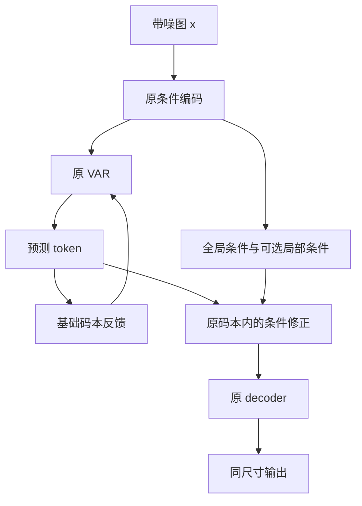

# Real-IISR-PRD：基于现有 S1/S2 结果的代码修改与研究方案修订

> 修订日期：2026-11-21。  
> 审计仓库：[Arialliy/Real-IISR-PRD](https://github.com/Arialliy/Real-IISR-PRD)。  
> 固定提交：`06c9bca1e94f9b989bbeeeeddbf4beebabf7cf67`。  
> 上游 Real-IISR 提交：`70355f7e9d6b849272d429d12e854f5890b89ae2`。  
> 交付范围：实际源码与已提交 JSON 的审计、代码修改规格与核心片段、调整后的研究步骤。本文没有向 GitHub 推送修改，没有重新运行 GPU 推理／训练，也没有读取 214 张测试图像的像素。  
> 约束：始终以同一个 Real-IISR 模型为主线，不拼接另一个去噪网络、检测器、扩散模型或后置修复模型。

## 0. 本次最重要的修改决定

**主实验继续采用“原图保留作参考、复制后额外加噪、所有方法处理同一个加噪输入”的设计。原图直接输入继续保留，用于量化模型对参考图的改动。**

本次修订改变的是后续推进顺序：

1. **保留传统列校正为强对照。**同时比较整图 MAE、背景 RMSE、背景均值偏差、条纹残留和原生目标保真；不能只追求条纹指标下降。
2. **当前 S1 已完成，但目标响应失真严重。**新的有符号统计支持平均对比度被压低；旧表本身只是绝对误差。
3. **当前 S2 已实现、已训练、已计分，而且明显退化。**先定位其全图灰度漂移，不能把它直接当作四组实验的共同初始化。
4. **当前 token 诊断已经覆盖 213 张图。**复用已有结果，补齐关闭 CAC 的三条重建路径，不重复描述为“只有 8 图诊断”。
5. **局部 CAC、输入 token 修正均保留为候选。**现有证据还不能保证它们能恢复目标；先处理共同训练稳定性与表示问题。
6. **保留原 213/214 划分。**在 213 张训练图内部建立 fit/dev；正式 dev 模型从未使用该 dev 做过本项目训练的初始化开始。214 张 test 留到方案锁定之后。
7. **保留仓库已有 P/C 配对损失。**先在同一结构比较基础监督、区域加权 W、基本扰动 P、局部配对 C；结构有依据后再交叉比较。

本文用三种表述区分证据：

- **已核实：**源码中实际存在，或从仓库逐图 JSON 重新汇总得到。
- **推断／线索：**与现有数据一致，但尚未由受控实验确认根因。
- **拟修改：**本文提出的下一版实现，尚未合入或训练验证。

---

## 1. 已有实验究竟说明了什么

### 1.1 用户提供的历史表可以复现

已核对以下三份结果的 213 个 `sample_id`、`data_sha256` 和输入指标，逐条一致：

- `results/local_retrain/train_eval_draw0.json`；
- `results/column_baseline.json` 中的 draw 0；
- `results/warmup_pretrained_eval.json`。

共有 270 个原生连通目标，现有评价中 270 个均满足环区条件。下面是从逐图记录重新计算的图像等权均值。[S1][S2][S3]

| 历史 draw 0 | 有效区 MAE / DN↓ | 背景 RMSE / DN↓ | 原列条纹残留 / DN↓ | 原生目标对比度绝对误差 / DN↓ |
| --- | ---: | ---: | ---: | ---: |
| 不处理 | 5.1105 | 6.4358 | 5.7512 | 1.7894 |
| 传统列校正 | **2.8833** | **3.6928** | 2.6375 | **0.9671** |
| 作者发布的 Real-IISR | 19.2334 | 26.8413 | 14.0595 | 51.0476 |
| 本地重训 S1 | 3.5558 | 5.5273 | **1.9502** | 19.3386 |

**应将“整图误差”明确写为 MAE，将“弱目标对比度误差”暂改为“原生目标对比度误差”。**当前统计覆盖全部原生目标，并没有先筛选最弱目标子组。弱度分组是后续需要增加的分析。

现有旧指标的真实定义是：

- `valid_mae_dn`：原图有效像素的平均绝对误差，单位为 0–255 灰度 DN；
- `background_column_residual_dn`：各列背景误差均值的未加权总体标准差，仅纳入至少 8 个背景像素的列；
- `native_contrast_abs_error_dn`：每个连通目标的“核心均值减环带均值”对比度误差绝对值，先图内平均，再图像等权平均。[C1]

这些数字说明：**S1 在当前列向波动代理上最低，但背景整体误差和目标保真都弱于列校正。**因此，后续不能把“进一步降低 1.95”作为唯一目标。

逐图统计也表明这不是少量异常样本拉高均值：

| 历史 draw 0 的比较 | 改善图像数 |
| --- | ---: |
| S1 的目标绝对误差优于不处理 | 3 / 213 |
| S1 的目标绝对误差优于列校正 | 1 / 213 |
| 列校正的目标绝对误差优于不处理 | 143 / 213 |
| S1 的列条纹指标优于列校正 | 137 / 213 |
| S1 的背景 RMSE 优于列校正 | 57 / 213 |

以上都是**已参与训练的图像上的诊断描述**，不是测试集泛化结论。[S1][S2]

### 1.2 原图输入的结论可以更具体

仓库已有原尺寸、浮点输出、统一新指标的直接对照：

`results/sirst_endpoints/published_vs_s1_clean.json`。[S4]

| 零额外噪声输入 | 整图 MAE / DN | median-ring 对比度绝对误差 / DN | median-ring 有符号偏差 / DN |
| --- | ---: | ---: | ---: |
| 发布权重 | 19.5141 | 47.1858 | −47.1858 |
| 本地 S1 | 3.5222 | 18.3287 | −16.6212 |

S1 有 190/213 张图的图内平均对比度偏差为负。这里的 190 是图像数，不是目标数，也不是“所有目标都衰减”的结论。

这支持：

> S1 在没有额外加入条纹时，也会系统性改写原生目标的响应；不能将目标失真全部归因于额外噪声。

它仍然不能证明原图自带的真实噪声去掉了多少，因为原图本身没有对应的物理无噪真值。

此外，`3.56−3.52` 不是“剩余噪声量”。MAE 不具有这种可相减的误差分解性质；历史 noisy 与新 clean 统计还涉及采样器和目标环定义差异。

### 1.3 S2 已完成，并且发生明显回退

`results/s2_common/training_summary.json` 记录了：

- 213 张训练图；
- 54 次优化更新；
- 从完整本地 S1 初始化；
- 1,144,665,865 个可训练参数；
- 已记录峰值分配显存约 29.19 GiB；
- `test_images=0`。[S5][S6]

下面是同一新版 native／greedy／median-ring 协议的 draw 0 结果，不能与第 1.1 节旧 mean-ring 字段混用。[S7][S8]

| 输出 | 整图 MAE / DN↓ | 加权列残留 / DN↓ | median-ring 绝对误差 / DN↓ | median-ring 有符号偏差 / DN | 背景均值偏差 / DN |
| --- | ---: | ---: | ---: | ---: | ---: |
| 不处理 | 5.1105 | 5.7513 | 2.2478 | −0.5084 | −0.0474 |
| S1 | 3.5565 | **1.9512** | **18.4138** | −16.8748 | −0.4392 |
| S2 | **27.8099** | 3.7423 | 22.5247 | −18.8525 | **+27.6092** |

表中的加粗用于提示关键变化，不表示 S1 在所有方法中最好。

S2 的问题不仅是目标衰减，还包括显著整体亮度抬升。它的去均值条纹指标仍低于输入，说明**仅靠条纹指标会遗漏严重的灰度漂移**。

零额外噪声时，S2 的整图 MAE 也达到 27.6787 DN，背景均值偏差为 +27.4794 DN。[S9]

**修改决定：保留现有 S2 作为失败诊断记录，暂不把它作为正式四组共同起点。**这不证明自由生成训练原则不可行，而是说明当前训练配置还没有达到可用条件。

### 1.4 已有 token 诊断不能再按八图先导解释

完整本地 S1/S2 各自已经在 213 张图上比较了三类 token，且同一端点的三条路径共用原 CAC、同一个 noisy h 和固定解码器。[S10][S11]

S1 的结果为：

| token 来源 | 整图 MAE / DN | 加权列残留 / DN | median-ring 绝对误差 / DN |
| --- | ---: | ---: | ---: |
| AR 自由预测 token | 3.5565 | 1.9512 | 18.4138 |
| 带噪图 VQ token | 5.7313 | 4.6497 | 16.4827 |
| 参考图 VQ token | 3.0399 | 1.3900 | 18.6758 |

这带来两项约束：

1. 参考 token 经当前 CAC／decoder 重建，目标误差仍然很大。不能把目标失真全部归因于 AR 预测错误。
2. 输入 token 路径的目标误差略低，但噪声和整图误差更大，且目标误差远高于不处理。直接改为输入 token 并不等于已经解决保真。

S1/S2 的参考 token 和输入 token 路径均值几乎相同，而 AR 路径 MAE 大幅变化，提示优先排查 S2 的预测／优化路径；尚不能由此确定具体出错层。

进一步汇总已记录的索引不一致数：

| 与参考 token 的差异 | S1 | S2 |
| --- | ---: | ---: |
| 第一个 1×1 尺度不一致的图像数 | 0 / 213 | 213 / 213 |
| 第二尺度 token 不一致比例 | 3.29% | 83.33% |

该统计包含工作网格编码，索引不同不必然意味着像素错误。它与灰度漂移同时出现，足以把**最早几个尺度的更新轨迹**列为下一轮优先诊断，而不是直接认定因果。[S10][S11]

---

## 2. 先统一名称，避免混用两条训练历史

仓库中存在两条不同路线。[C2][C3][C4][C5][C6]

| 建议名称 | checkpoint | 初始化／含义 |
| --- | --- | --- |
| Published | `Real-IISR.pth` | 作者发布的完整模型 |
| Warmup-S1 | `s1_warmup.pt` | 从 Published 做的早期局部参数预热 |
| Pilot-S2 | `s2_common_pilot.pt` | Warmup-S1 后的 16 步先导 |
| Retrain-S1 | `sirst_retrained_baseline.pt` | 从 `VQVAE.pth + VARSR.pth` 开始的本地原结构训练 |
| Free-S2-v1 | `sirst_s2_common.pt` | Retrain-S1 后的 54 步自由生成训练 |
| Common-v2 | 拟新增、尚不存在 | 稳定训练与独立 dev 选模后的共同基线 |

用户本次表格中的 S1 是 **Retrain-S1**。

因此应同步修改仓库研究计划和环境记录中的陈旧状态：

- “原结构正在训练”改为已存在本地 S1 评价；
- “自由 rollout 待实现”改为已经实现并通过部分工程检查；
- “S2 待训练”改为 Free-S2-v1 已完成但退化；
- “只有 8 图来源诊断”改为区分早期 8 图与当前完整端点的 213 图诊断；
- 不把 Retrain-S1 描述成从发布成品权重微调得到。

原有历史文件不删除、不改写结果；新增版本说明负责建立清楚的先后关系。

---

## 3. 更新后的研究问题

### 3.1 核心问题

> 在背景 RMSE、背景均值偏移和条纹残留都受控时，能否通过同一 Real-IISR 内部的训练与条件重建设计，更准确地保留原生小目标的幅值和形状？

“条纹更少”与“目标更保真”同时报告。身份映射也保留为对照，因为它在当前目标指标上已经显著优于 S1。

### 3.2 当前最先要回答的两个问题

**问题 A：为什么 Free-S2-v1 把整幅图抬亮？**

先定位更新何时发生、哪些尺度先变化、哪个损失项主导更新。可微通路存在，并不保证离散前向在优化后保持稳定。

**问题 B：为什么参考 token 重建也损伤目标？**

现有诊断还包含 CAC。需要补基础码本 E-only 与 CAC 对照，区分基础表示／解码限制和条件修正的附加影响。

这两个问题解决前，不预定局部 CAC 或输入锚定 token 是最终答案。

### 3.3 配对监督的新增价值要怎样证明

仓库已经实现基本扰动 P 和局部归一化 C。已知信号加入输入、比较两次输出差用于训练，在 MRI 重建中已有明确先例，不能把整个范式宣称为首次提出。[R1]

因此研究重点应是：

- 红外原生弱目标场景中是否有效；
- 局部支持区、外围环、幅度归一化相对基本 P 是否有增量；
- 相对直接区域加权 W 是否仍有增量；
- 最弱／最小目标上能否改善；
- 是否以更差的背景恢复或新增亮点为代价。

---

## 4. 代码修改总表

**以下为建议实施顺序。所有 legacy 结果保留。新配置与结果使用 v2 目录，不直接改写旧预登记哈希以强行复用历史运行。**

| 优先级 | 实际文件／函数 | 拟修改内容 | 完成标准 |
| --- | --- | --- | --- |
| P0 | `evaluate_warmup.py::prepare_metrics` | 先验形状；版本化指标；固定原生背景区；增加逐目标记录 | 历史值可复现，新口径明确 |
| P0 | `evaluate_warmup.py::paired_changes` | 注册指标方向；signed bias 不按越小越好；PSNR 单独处理完美值 | PSNR 上升不会误判变差 |
| P0 | `evaluate_sirst_endpoints.py::evaluate` | 统一 input/column/published/S1/S2；noisy 与 clean 同协议 | 所有输出同一输入和指标版本 |
| P0 | `check_column_baseline.py::correct_columns` | 保留真实算法，参数化强度；补 clean 与新指标 | 原参数结果可复现 |
| P1 | 拟新增 `diagnose_s2_updates.py` | 从旧 S1 追踪 0/1/4/16 步；分项损失和早期尺度日志 | 定位漂移出现的阶段 |
| P1 | `train_s2_common.py::image_loss` 的 v2 复用实现 | 记录逐尺度 CE、梯度比例、均值偏移；受控训练稳定化 | 自由生成不再明显破坏基线 |
| P1 | `verify_formal_s2.py` | 复用现有检查，只为新路径补必要验证 | 硬前向一致，图像梯度有效 |
| P2 | `evaluate_sirst_token_sources.py` | 三来源 × E-only/CAC；补 clean；保存索引与 h | 补齐缺失三格 |
| P3 | `prd_data.py::DenoisePairDataset` | 保留完整 train 审计；增加 fit/dev 索引视图、显式噪声规格 | 子划分互斥，test 未用于开发 |
| P3 | 拟新增 `train_denoise_v2.py` | 配置驱动，复用现有初始化／rollout／loss | 独立输出、完整 lineage |
| P3 | `prd_data.py::sample` | 支持精确零额外噪声和分级噪声；保留默认旧行为 | no-noise 时两输入等于各自参考 |
| P4 | `prd_losses.py` | 复用 P/C；新增匹配归约的 W；pair-only 梯度检查 | 同样本、同幅度和区域归约 |
| P5 | `prd_rollout.py::_condition/_embedding_pair/free_rollout` | 仅在诊断支持后实现局部 CAC 候选 | 零门控等价；不改变基础反馈 |
| P6 | 研究计划、`environment_record.md` | 更新状态、名称、指标版本与证据引用 | 文档与实际运行一致 |

源码依据见文末 [C1]—[C12]。下面逐项说明如何实施。

---

## 5. P0：统一评价，保留历史表但不混用口径

### 5.1 目前已有正确基础，直接复用

`evaluate_sirst_endpoints.py` 已有：

- 原尺寸有效范围检查；
- 浮点图归档；
- greedy 与发布采样器的区分；
- TF32 关闭；
- 新背景指标与 median-ring 指标；
- 文件、输入与样本身份核验。

`compare_published_s1_clean.py` 已核查原 PNG 与原尺寸输出的一致关系。[C7][C8]

下一版应整合这些功能，不另造一套独立且不兼容的计分系统。

### 5.2 修复指标方向

当前 `paired_changes()` 一律把 `delta < 0` 记为改善。旧四项全是误差时可用，但 `check_column_baseline.py --extended` 传入 PSNR 和 signed bias 后，这种规则就不成立。[C1][C9]

建议显式注册：

```python
METRIC_DIRECTION = {
    "whole_mae_dn": "lower",
    "valid_mae_dn": "lower",
    "background_rmse_dn": "lower",
    "plan_background_rmse_dn": "lower",
    "weighted_background_column_residual_dn": "lower",
    "background_column_residual_dn": "lower",
    "native_contrast_abs_error_dn": "lower",
    "native_median_ring_contrast_abs_error_dn": "lower",
    "native_target_mae_dn": "lower",
    "whole_psnr_db": "higher",
    "whole_ssim": "higher",
    "native_median_ring_contrast_bias_dn": "signed",
    "plan_background_mean_error_dn": "signed",
}
```

对 signed 字段报告均值、分位数、正负比例和绝对量，不把“更负”记成改善。

完美重建时的 PSNR 与缺失值也要区分。新报告建议保存明确状态：

```json
{
  "whole_psnr_db": null,
  "metric_status": {
    "whole_psnr_db": "perfect_reconstruction"
  }
}
```

“没有可评价区域”使用另一个状态，不能复用为完美重建。聚合时延续现有 endpoint 对正无穷的显式处理，不静默丢弃这些样本。

### 5.3 先检查形状，再减参考图

当前实现先相减再验 error.shape，NumPy 广播可能让错误输入形状未被识别。[C1]

建议在入口使用：

```python
import numpy as np

def checked_error_dn(prediction, reference):
    pred = np.asarray(prediction)
    ref = np.asarray(reference)
    if pred.shape != ref.shape:
        raise ValueError(
            f"Prediction/reference shapes differ: {pred.shape} vs {ref.shape}"
        )
    if pred.ndim != 2:
        raise ValueError("Expected one native-grid grayscale image")
    if not np.isfinite(pred).all() or not np.isfinite(ref).all():
        raise ValueError("Nonfinite prediction or reference")
    return (pred.astype(np.float64) - ref.astype(np.float64)) * 255.0
```

不要为了让形状匹配，自动 resize 预测或参考。

### 5.4 固定背景区，不让它随人工注入位置变化

旧 `background_mask` 排除了人工注入点的 support/ring，但旧主表评价的是未注入该点的 `noisy_minus`。由于 signal seed 随 draw 改变，旧背景区会随这个并不存在于被评图中的点而变化。[C1][C10]

历史值继续按旧定义保存。正式新表使用已有 extended 思路：

\[
B=\text{valid}\setminus\operatorname{dilate}(M_{\mathrm{native}}).
\]

同一原图的所有噪声 draw、所有方法、clean 输入共用同一个 B。

### 5.5 增加逐目标记录

主报告保留图像等权均值，同时保存 `per_target.jsonl`：

```json
{
  "sample_id": "dataset/image_id",
  "target_id": 1,
  "target_area_px": 4,
  "ring_pixels": 48,
  "reference_contrast_dn": 6.0,
  "prediction_contrast_dn": 1.0,
  "contrast_bias_dn": -5.0,
  "contrast_abs_error_dn": 5.0,
  "gain": 0.1666666667,
  "gain_eligible": true,
  "metric_version": "native_v2"
}
```

这些数值仅为字段示例，不是某张真实图的结果。

需要同时保存：

- mean-ring 历史指标；
- median-ring 新指标；
- 目标面积和参考图弱度；
- 参考／输出对比度；
- signed bias、绝对误差；
- 对比度足够远离零时的 gain；
- 环区有效性、边界情况。

弱度分组依据参考图，不能依据模型输出。无有效环的目标记为不适用并计数，不设为零；消失目标不能从统计中删掉。

### 5.6 保留真实的列校正算法

当前代码实际是：

1. 在未补边输入上，逐行做宽度 7 的水平中值滤波；
2. 计算输入减滤波结果；
3. 沿每列取残差中位数；
4. 对列偏置去中位数中心；
5. 从原输入扣除并 clip。[C9]

它不是“先求列中位数，再平滑列曲线”。

参数化时建议默认值完全复现旧实现：

```python
import numpy as np
from scipy.ndimage import median_filter

def correct_columns_v2(noisy, left, top, width, height, *,
                       window=7, strength=1.0):
    if window < 1 or window % 2 == 0:
        raise ValueError("window must be a positive odd integer")
    if not np.isfinite(strength) or strength < 0:
        raise ValueError("strength must be finite and nonnegative")
    result = np.asarray(noisy).copy()
    field = result[top:top + height, left:left + width]
    local = median_filter(field, size=(1, window), mode="reflect")
    bias = np.median(field - local, axis=0)
    bias = bias - np.median(bias)
    field[:] = np.clip(field - strength * bias, 0, 1)
    return result
```

该方法只读取输入和有效图像几何范围，不读取参考或目标 mask。

在 dev 上先固定 window=7，扫描预先规定的 strength；确有必要再扩窗口搜索。所有参数在 test 前锁定。列校正保持独立对照，不把其输出接到 Real-IISR 前面作为主方法。

### 5.7 新 evaluator 的接口

保留 legacy 文件与运行结果。拟新增统一入口，复用现有实现：

```text
evaluate_protocol_v2.py
  --partition {fit,dev,test}
  --endpoints input,column,published,s1_retrained,s2_common,candidate
  --corruptions clean,draw0,draw1,...
  --metric-version native_v2
  --config <locked-json>
  --output-dir <new-directory>
```

目前 `evaluate_sirst_endpoints.py` 限制 published 只能跑 clean，也没有 column 路由。新入口扩展这些能力，而不是改写历史报告。[C7]

每个结果至少记录：代码 SHA、checkpoint SHA、父权重、manifest/partition hash、输入像素 hash、参考 hash、噪声规格、采样器、CFG、精度、TF32、输出域、指标版本。

### 5.8 同图 clean/noisy 分解

统一协议后，对每个方法保存：

\[
e_0=F(y)-y,\qquad
d_n=F(y+n)-F(y),\qquad
e_n=e_0+d_n.
\]

其中：

- \(e_0\)：零额外噪声时的改写；
- \(d_n\)：新增噪声引起的输出变化；
- \(e_n\)：最终恢复误差。

比较这些**像素误差场**，而不是直接相减两个平均 MAE。列校正也做同样的 clean 评价。

---

## 6. P1：先追踪 Free-S2-v1 的退化，不直接扩大训练

### 6.1 已有 free rollout 不需要从零重写

`prd_rollout.py::free_rollout()` 已经做到：

- 由带噪输入和自身前缀生成；
- 无持久 KV cache 的前缀重算；
- 硬查表的真实前向；
- 零前向值的 softmax 切线提供 logits 的 ST 梯度；
- 下一尺度反馈使用基础码本；
- 最终 CAC 解码；
- eval 模式固定随机层，同时允许 autograd。[C11]

`verify_formal_s2.py` 已有图像单独 loss 的梯度检查与硬前向一致性检查。[C12]

所以新的任务是**解释更新为何损坏输出**，不是再次宣称“图像损失还没有接通”。

### 6.2 从旧 S1 做小预算更新轨迹

继续使用已训练过的图做工程诊断，暂不作泛化声明。

固定一小组训练图和噪声 schedule，记录：

- step 0；
- step 1；
- step 4；
- step 16；
- 若出现明显退化，在第一次异常更新前后增加记录。

如果已有对应中间 checkpoint，直接复用；没有则从同一个旧 S1 小步重放。

每个点用固定图和固定 noisy/clean 输入计算：

- 整图 MAE、背景 RMSE、背景均值偏移；
- 原生目标 signed contrast 与绝对误差；
- 每个尺度 CE；
- 每尺度 token 不一致率；
- 第一尺度预测 token ID 分布、参考 ID 分布与 logit margin；
- 参数更新量相对参数范数；
- 梯度范数、裁剪、AMP overflow／重试；
- 解码前后取值范围及饱和比例。

**先定位第一处明显漂移，不等跑完长训练再观察。**

### 6.3 三条独立短程诊断

每条都从同一个旧 S1、相同优化器初态、相同样本开始：

| 诊断 | 开启的损失 | 目的 |
| --- | --- | --- |
| T-CE | 仅现有 token CE | 观察预测 token 更新是否引起漂移 |
| T-IMG | 现有像素＋顺序项 | 观察图像监督方向及强度 |
| T-ALL | 原完整基础损失 | 复现当前更新的共同作用 |

先测 1 步，再决定是否延长。记录损失分项梯度在 head、后部 VAR、CAC 等代表参数上的大小及方向关系。不能以总梯度非零替代分项分析。

若要区分像素与顺序项，再做有针对性的额外拆分；不一次扩大成大量无目的消融。

### 6.4 一个应检查的具体实现选择：多尺度 CE 归约

当前 S2 将各尺度 token 拼接后按覆盖率整体平均。高分辨率尺度 token 数多，对总 CE 的贡献通常更大；最早尺度 token 少，却会影响后续生成。[C6]

结合首尺度 0/213 → 213/213 的差异，值得记录各尺度真实损失和梯度。**只有诊断支持时**，再测试尺度归一化 CE，作为共同训练稳定化候选：

```python
import torch
import torch.nn.functional as F

def scale_balanced_ce(scores, labels, coverage_by_scale, scale_weights):
    if not (len(scores) == len(labels)
            == len(coverage_by_scale) == len(scale_weights)):
        raise ValueError("Scale lists must have identical lengths")
    terms = []
    for logits, target, coverage in zip(scores, labels, coverage_by_scale):
        loss_map = F.cross_entropy(
            logits.float().transpose(1, 2), target, reduction="none"
        )
        weight = coverage.float()
        per_image = (loss_map * weight).sum(1) / weight.sum(1).clamp_min(1e-8)
        terms.append(per_image.mean())
    weights = terms[0].new_tensor(scale_weights)
    if (weights < 0).any() or weights.sum() <= 0:
        raise ValueError("Invalid scale weights")
    return (torch.stack(terms) * weights).sum() / weights.sum()
```

等尺度权重只是候选，不是已证实最优值。它与降低 CE 权重、改变学习率、改变图像 loss 是不同变化，应逐项验证，不能同时修改后把全部收益归为某一个因素。

### 6.5 精度与训练模式只做必要复核

当前 S1 使用 teacher forcing 和 `model.train()`；S2 使用自由生成与 eval 模式固定 BN／随机层。这是实际训练协议差异，需在日志中说明。[C4][C6]

已有 parity 检查先复用。若更改了码本、精度、条件语义或训练循环，再做对应检查：

- 硬前向与同规则推理一致；
- 不含参考 token 前缀；
- 图像 loss 对 logits 和预期参数有梯度；
- 冻结 decoder 参数，但保留其输入梯度；
- cast、checkpoint 重算与缓存状态不改变前向。

现有 S2 仍在 FP16 autocast 下进行主要解码；应针对最弱幅度另测 FP32 的差异。若改精度，把它作为公共实现变化，所有正式组一致，不能只给新方法更高精度。

### 6.6 历史预登记必须保留

`train_s2_common.py` 的 `LOCK_SHA`、54 updates、213 images、父 checkpoint 与 manifest hash 是历史运行身份的一部分。

新试验使用：

```text
configs/denoise_v2/
results/denoise_v2/<run_id>/
checkpoints/denoise_v2/<run_id>.pt
```

不要删掉校验或改旧哈希来容纳新数据／预算。新 trainer 读取新配置，旧 loader 继续验证旧模型。

### 6.7 这一阶段的通过条件

- 能复现并解释最早的明显退化阶段；
- 新训练配置在固定诊断集上不再出现类似 +27 DN 的全图漂移；
- noisy/clean 两类输入均有稳定记录；
- 背景与目标误差没有靠指标漏洞“改善”；
- 具备进入独立 dev 训练的候选公共配置。

这一步成功不等于最终目标保真问题已解决。它只建立可靠训练基础。

## 7. P2：补齐表示诊断，决定是否有结构修改依据

### 7.1 复用已有三来源，只补缺失分支

现有 `evaluate_sirst_token_sources.py` 已在完整端点实现三来源和固定 noisy h。下一版增加解码开关：[C13]

| token 来源 | E-only：原基础码本＋固定 decoder | 原全局 CAC＋固定 decoder |
| --- | --- | --- |
| \(Q(y)\)：参考图 token | **待补** | 已有 |
| \(Q(x)\)：带噪图 token | **待补** | 已有 |
| \(\hat Q(x)\)：AR 预测 token | **待补** | 已有 |

同一图固定模型、decoder、基础码本、输出域、原尺寸范围、精度。CAC 三条路径继续使用同一个 \(h(x)\)，不能把参考 token 路径换成 \(h(y)\)。

补存预测索引、参考索引、输入索引和 h，并记录 checkpoint／tokenizer hash。这样后续只比较解码器路径时可复用索引，避免重复昂贵的 AR 前向。

clean 输入也可以按同样方式诊断；此时参考与输入是同一张图，\(Q(x)=Q(y)\) 应成为一致性检查。

### 7.2 如何据此决定下一项修改

| 观察 | 优先处理 | 暂不能声称 |
| --- | --- | --- |
| 参考 token 的 E-only 已丢失目标 | 基础量化表示／原 decoder 的保真限制 | 不能保证局部 CAC 或更准 AR 能恢复丢失信息 |
| E-only 较好、同 token 加 CAC 变差 | 条件码本的附加校准 | 不能仅凭个例证明局部化必然有效 |
| 表示路径较好、AR 预测路径明显差 | 自由预测训练与条件信息 | 不能用 GT token 作为可部署输出 |
| 输入 Q 路径比 AR 保点但条纹更多 | 噪声与保真权衡 | 不能直接称输入 token 锚定成功 |

如果确实需要适配原 decoder，先作为新的公共训练设置验证，在所有后续方法中一致。它是原模型内部适配，仍不需要拼接外部网络，但必须单独记录与冻结 decoder 基线的差别。

### 7.3 为什么暂缓输入 token 锚定方案

当前 \(D(\mathrm{CAC}(Q(x)))\) 的原生目标绝对误差仍约 16.48 DN，且条纹残留约 4.65 DN。因此：

- 用输入 token 作为底座，不等于像素恒等；
- latent 零修正不等于输出等于输入；
- 把 decoder 的普通图像输出直接当噪声残差加减，没有得到现有任务语义支持；
- 改为残差 token 预测会改变训练标签与表示，应作为独立候选。

现阶段先补 E-only 诊断，不把“输入锚定”与局部 CAC、零噪声混合、配对 loss 一起加入。

---

## 8. P3：建立可靠的新共同基线与开发划分

### 8.1 保留原 213/214，不动测试划分

已读取的 manifest 元数据确认 SIRST train 为 213 张、test 为 214 张。本文没有加载测试像素。[S12][S13]

建议新增：

```text
manifests/dev_partition_v2.json
```

记录：

- 原 train manifest hash；
- fit IDs；
- dev IDs；
- 分组依据与随机种子；
- partition hash；
- 创建时间及用途。

如果每个 group 对应一张独立原图，170/43 可以是一个启动方案；若可识别相邻场景或近重复，应以这些组为单位再决定数量。它不是必须采用的比例。

### 8.2 在原数据类上加索引视图，保留已有审计

`DenoisePairDataset` 构造时严格核对完整原训练清单，实际像素在 `sample()` 时加载。这些保护值得保留。[C10]

拟新增索引视图：

```python
class PartitionView:
    def __init__(self, parent, selected_ids, role):
        if role not in {"fit", "dev"}:
            raise ValueError("Only development partitions are allowed")
        by_id = {r["sample_id"]: i for i, r in enumerate(parent.records)}
        if len(by_id) != len(parent.records):
            raise ValueError("Duplicate parent IDs")
        ids = list(selected_ids)
        if len(ids) != len(set(ids)) or not set(ids) <= set(by_id):
            raise ValueError("Invalid partition IDs")
        self.parent = parent
        self.indices = [by_id[k] for k in ids]
        self.role = role

    def __len__(self):
        return len(self.indices)

    def sample(self, index, epoch=0, draw_id=0, **kwargs):
        sample = self.parent.sample(
            self.indices[index], epoch=epoch, draw_id=draw_id, **kwargs
        )
        sample["meta"]["partition_role"] = self.role
        return sample
```

在建立两个视图前还必须断言：

\[
\mathrm{fit}\cap\mathrm{dev}=\varnothing,\qquad
\mathrm{fit}\cup\mathrm{dev}=\mathrm{original\ train}.
\]

不要删除原数据类的校验来放行任意文件，也不要改变旧 `manifests/train.jsonl` 的含义。

### 8.3 旧 S1 可以做工程诊断，但不能当成未见 dev 的初始化

旧 S1 已训练过全部 213 张。事后从其中取 dev，再继续使用旧 S1，只能算训练内开发检查。

真正用于独立 dev 选模的 Common-v2：

1. 保留本地正式路线的 `VQVAE.pth + VARSR.pth` 初始化；
2. 只用 fit 训练；
3. dev 只用于验证与选择；
4. 214 test 不参与。

这里的“未见”指未用这些 dev 图做过本项目的本地训练，不意味着开发者此前从未查看过这批数据。

先用旧 S1 完成短程 S2 排查，再重训独立 dev 基线，可以避免在未知故障下反复长训练。

### 8.4 显式加入零额外噪声样本

当前数据从连续范围采样条纹和像素噪声，不包含预先规定比例的精确零噪声样本。[C10]

建议给 `sample()` 增加可选 `noise_override`，在生成噪声、寻找合法注入点之前应用：

```python
def resolve_noise_sigmas(rng, noise_override=None):
    stripe_dn = float(rng.uniform(0, 12))
    pixel_dn = float(rng.uniform(0, 4))
    if noise_override is not None:
        stripe_dn = float(noise_override["stripe_sigma_dn"])
        pixel_dn = float(noise_override["pixel_sigma_dn"])
        if not (0 <= stripe_dn < float("inf")
                and 0 <= pixel_dn < float("inf")):
            raise ValueError("Noise sigmas must be finite and nonnegative")
    return stripe_dn, pixel_dn
```

默认 `None` 时保持旧抽样次序与数值行为，方便复现历史 hash。clean 使用两个 sigma 都为零，最终检查：

\[
x^-=y^-,\quad x^+=y^+,\quad x^+-x^-=s.
\]

这组输入表达的是“零额外噪声”，不能称物理无噪声真值。

先做一个受控小消融：精确零噪声比例 \(q=0\) 与一个小比例，例如 \(q=0.1\)。总更新数和输入图数量保持相同，避免把多训练造成的收益记为该策略的作用。若 dev 支持，再将其固定为所有正式组的共同协议。

采用样本混合时，clean 样本直接接受同一个基础重建损失；不要未经说明又重复叠加一份相同 identity loss。

### 8.5 新训练入口复用现有代码

拟新增 `train_denoise_v2.py`，复用：

- `prd_original_training.build_original / initialize / optimizer_for`；
- `prd_rollout.free_rollout`；
- `train_warmup.valid_order_loss / atomic_save`；
- `prd_losses.paired_loss`。

新入口读取配置而不依赖旧固定 213、54、20 等常量：

```text
initialization
source_manifest_hash
partition_hash
fit_ids
dev_ids
noise_schedule
zero_extra_noise_fraction
trainable_parameter_names
steps
loss_weights
precision
sampler
selection_rule
run_directory
```

新 checkpoint 使用新的 `format`，旧 loader 保持原来严格规则。新 loader 根据新格式与配置校验，不用 `strict=False` 静默忽略未知参数。

### 8.6 共同基线何时算可用

在 dev 上同时确认：

- 相比输入，背景恢复有稳定改善；
- 无类似 Free-S2-v1 的系统性亮度抬升；
- clean 输入改动处于事先设定的可接受范围；
- 目标误差可重复，并有足够的指标动态范围；
- 训练输出确由自由前缀生成；
- 基础配置、精度与参数更新范围已锁定。

共同基线不必提前完全解决弱目标，但不能以全图 MAE 大幅回退的 S2 端点开始贡献实验。

---

## 9. P4：先验证监督，再决定是否投入结构四组

### 9.1 对齐仓库已有的 P/C 定义

`prd_losses.py::paired_loss` 已实现两种损失。[C14]

令：

\[
e=\big(F_\theta(x^+)-F_\theta(x^-)\big)-s.
\]

**P：全有效区域的基本扰动损失**

\[
L_P=\operatorname{mean}_{\mathrm{valid}}|e|.
\]

**C：支持区、环区分开求均值，再幅度归一化**

\[
L_C=
\frac{
\operatorname{mean}_{M}|e|
+\eta\,\operatorname{mean}_{R}|e|
}{
\max(a,a_{\min})
}.
\]

按有效配对等权平均。\(a\) 是注入信号实际绝对峰值。当前默认 \(\eta=0.25\)、\(a_{\min}=1/255\)。

**这不是“将 support 与 ring 合并后按总面积平均”的公式。**本次文档以真实代码为准，不能写另一公式却仍声称复现实验。

继续保留：

- 同背景、同噪声；
- 图像只经同一个模型；
- 两支常规重建监督；
- `pair_valid` 与支持区有效性；
- 注入区域避免 clipping；
- 输出差监督来自可微自由生成。

P 的基本思路已有先例；C 的区域选择与归一化是否有价值，需要相对 P 和直接监督验证。[R1]

### 9.2 固定原结构先做四种监督

| 组 | 结构 | 训练目标 | 回答的问题 |
| --- | --- | --- | --- |
| A | 原全局 CAC | 共同基础监督 | 稳定的新基线表现 |
| W | 原全局 CAC | 基础＋区域加权重建 | 简单强化局部监督能改善多少 |
| P | 原全局 CAC | 基础＋基本扰动 P | 配对差范式的作用 |
| C | 原全局 CAC | 基础＋局部配对 C | 区域与幅度设计的增量 |

这是**固定一种结构的监督比较**，不是两种结构×两种监督的四组。名称必须区分。

所有组：

- 从同一个未见 dev 的共同初始化开始；
- 都看到同样的有点／无点两支；
- 都计算两支基础监督；
- 使用相同样本、噪声、更新数、有效图数；
- 使用相同 clean 混合比例；
- 给 W/P/C 相同规模的 dev 权重搜索预算。

### 9.3 W 应匹配 C 的归约

定义：

\[
r=\frac12\left(|\hat y^--y^-|+|\hat y^+-y^+|\right),
\]

\[
L_W=
\frac{
\operatorname{mean}_{M}r+\eta\operatorname{mean}_{R}r
}{
\max(a,a_{\min})
}.
\]

这样 W 与 C 在区域、幅度、有效配对的处理上接近，核心差异是直接重建误差与输出差误差。

可在现有 `prd_losses.py` 中增加：

```python
import torch

def weighted_reconstruction_loss(
    pred_minus, pred_plus, batch, *,
    ring_weight=0.25, amplitude_floor=1.0 / 255.0,
):
    if ring_weight < 0 or amplitude_floor <= 0:
        raise ValueError("Invalid loss normalization")
    required = (
        "reference_minus", "reference_plus", "signal",
        "valid_mask", "support_mask", "ring_mask",
    )
    for name in required:
        if batch[name].shape != pred_minus.shape:
            raise ValueError(f"Shape mismatch: {name}")
    if pred_plus.shape != pred_minus.shape:
        raise ValueError("Pair prediction shapes differ")

    error = 0.5 * (
        (pred_minus.float() - batch["reference_minus"].float()).abs()
        + (pred_plus.float() - batch["reference_plus"].float()).abs()
    )
    valid = batch["valid_mask"].bool()
    support = valid & batch["support_mask"].bool()
    ring = valid & batch["ring_mask"].bool()

    def masked_mean(values, mask):
        n = mask.flatten(1).sum(1).clamp_min(1)
        return values.masked_fill(~mask, 0).flatten(1).sum(1) / n

    amplitude = (
        batch["signal"].float().abs().masked_fill(~valid, 0)
        .flatten(1).amax(1).clamp_min(amplitude_floor)
    )
    eligible = batch["pair_valid"].reshape(-1).bool()
    eligible = eligible & support.flatten(1).any(1)
    per_pair = (
        masked_mean(error, support) + ring_weight * masked_mean(error, ring)
    ) / amplitude
    return per_pair.masked_fill(~eligible, 0).sum() / eligible.sum().clamp_min(1)
```

该片段与当前 P/C 的空环处理保持一致；正式运行前仍须使用项目已有形状／配对检查验证全部输入。

如果需要更强直接监督，可再对原生训练目标加区域或对比度项，但要单列，不能在主 W 定义中悄悄增加不同数据来源。

### 9.4 不把共用背景当成输出自动相消

非线性模型可能因一个点斑改变远处输出。除了支持区与环区，还记录监督窗口外的输出差，例如：

\[
E_{\mathrm{far}}
=
\operatorname{mean}_{\mathrm{valid}\setminus(M\cup R)}
|F(x^+)-F(x^-)-s|.
\]

首轮可以先作为诊断，不必再加一个新 loss。基础监督负责控制共同背景和噪声。

### 9.5 配对训练的显存处理

Free-S2-v1 已记录约 29.19 GiB 峰值。不能假定同时保留两条完整图像计算图仍能装进原显卡。[S5]

先测一对样本的真实 forward/backward。若放不下，可选：

- 沿用已有无状态 checkpoint；
- 每次一个背景对，梯度累积；
- 对两支使用确定性重算的向量—雅可比积。

最后一种方法仍是同一个模型：

1. 在固定参数下无梯度计算两张输出；
2. 把两张输出作为独立叶子张量，计算配对 loss 对各输出的梯度；
3. 重新前向第一支，用基础 loss 和该输出梯度的内积反传；
4. 重新前向第二支，同样反传；
5. 两支完成后才执行一次 optimizer step。

如果前向确定、两次重算输出一致、loss 对参数没有额外直接依赖，这给出该配对项的一阶梯度，同时避免保留两条大图。应先在一个能容纳普通双图的小配置上核对梯度一致性，再用于正式预算。

它会增加计算时间，必须报告。不能在重算两支之间更新参数或改变 BN、随机状态与精度。

---

## 10. P5：结构候选仍在同一个 Real-IISR 内部

### 10.1 候选定位

如果 P2 的同 token 对照支持改进条件码本，再实现：

> **输入条件特征引导的局部 CAC。**

继续使用原预测 token、基础码本、原 VAR 与原 decoder。输入 VQ token 暂用于诊断，不直接替代 AR 输出。

推理仍为单图：



### 10.2 精确公式

原 CAC：

\[
z^g_{k,p}
=
E[a_{k,p}]
+
\tanh(g)\big(U[a_{k,p}]\odot h^g(x)\big)V^\top.
\]

复用原 `con_embedding` 的空间特征 \(C(x)\)，对齐到第 k 个网格，复用原 `cb_cond`：

\[
h^\ell_{k,p}
=
G(\operatorname{pool}_k C(x)_p)
-
\operatorname{weighted\ mean}_q G(\operatorname{pool}_k C(x)_q).
\]

有效区域权重只由图像几何范围决定，不使用目标 mask。

候选：

\[
z^{g+\ell}_{k,p}
=
z^g_{k,p}
+
\tanh(\beta)\big(U[a_{k,p}]\odot h^\ell_{k,p}\big)V^\top,
\qquad \beta_0=0.
\]

只新增一个门控参数即可复用现有投影和低秩因子。位置级计算仍有额外时间／显存，需测量。

### 10.3 按实际 PRD 文件修改

**`prd_rollout.py::_condition`**

保留原空间特征，返回给自由生成内部使用；全局 h 的现有计算保持一致。外部 `free_rollout` 的原三项返回值默认不变，避免破坏检查脚本。

**`prd_rollout.py::_embedding_pair`**

保留现有“真实硬查表＋零前向切线”结构，同时增加：

- 硬局部项：传递 U/V、局部条件和门控的真实梯度；
- 零前向局部切线：只向 logits 提供代理梯度。

关键增量示意：

```python
# final、ids 和 tangent 来自现有 _embedding_pair。
# 这是需要嵌入原函数的片段，不是完整独立函数。
local_offset = (
    quant.U[ids] * h_local
) @ quant.V.T
final = final + local_gate.tanh() * local_offset

if torch.is_grad_enabled() and logits.requires_grad:
    with torch.autocast(device_type=logits.device.type, enabled=False):
        local_tangent = (
            (tangent @ quant.U.detach().float())
            * h_local.detach().float()
        ) @ quant.V.detach().float().T
        final = final + (
            local_gate.detach().float().tanh() * local_tangent
        ).to(final.dtype)
```

实际合并时应保持与原全局项一致的数值域和受控精度。下一尺度 `feedback` 仍只使用基础 E，不把局部 CAC 顺手送入反馈。

**候选的硬推理入口必须同步修改**

现有 `hard_prediction`、`cached_greedy` 和 `official_inference` 的最终重建仍调用原全局 `idxBl_to_img_lora`。如果候选训练使用局部项、评价却调用旧入口，新增修正会在推理时消失。

首版候选直接在 `torch.no_grad()` 下调用同一个修改后的 `free_rollout`，保留硬 token 前向并跳过 ST 切线。v2 evaluator 根据 checkpoint 的 `model_variant` 分派；训练和推理共用局部重建公式。`valid_mask` 只承载补边几何范围，不读取目标标注。

后续若为速度优化缓存推理，再同步传递局部 h，并验证 token 与输出一致；不能仅凭旧全局模型的 parity 记录宣布新路径已经通过。模型速度比较要注明使用的前向实现。

**模型构造与优化器**

将 `local_gate` 注册到同一模型的 state dict；明确加入训练白名单与 CAC 学习率组。checkpoint 记录 `model_variant=global/global_local`。零初始化加载原 checkpoint 时，只允许这个已声明新增键缺失，其他 missing/unexpected keys 继续报错。

### 10.4 先单项结构试验

先比较：

- 原 CAC＋已锁定的一种监督；
- 局部 CAC＋同一种监督。

两组共享初始化、数据、样本数量、更新预算和验证规则。门控为零时先做同输出检查，再训练。

若局部结构没有稳定收益，保留原结构完成监督研究。无需为了论文形式强行保留一个无效模块。

### 10.5 再做与当前仓库研究问题一致的 2×2

仓库原计划已定义“两种 CAC × P/C”。本次建议保留这一主矩阵：[D1][C14]

| 组 | CAC | 额外监督 |
| --- | --- | --- |
| G-P | 原全局 | 基本扰动 P |
| G-C | 原全局 | 局部配对 C |
| L-P | 全局＋局部 | 基本扰动 P |
| L-C | 全局＋局部 | 局部配对 C |

所有组共用基础监督。P 的权重在两种结构中相同，C 的权重在两种结构中相同；P/C 数值尺度不同，允许在同等 dev 搜索预算下选各自权重。

第 9 节已经完成的 G-P/G-C 可以复用，但前提是初始化、数据、预算、代码和选模协议完全相同。若发生变化，要补齐对应组，不能拼接不一致的实验。

A 和 W 仍然保留：

- A 判断配对监督相对基础恢复是否有效；
- W 判断配对设计是否优于简单局部监督；
- 若最终选 L-C，至少补同样局部结构的 W 对照。

不要把这一矩阵与“有／无配对开关”的另一套四组混写。两种设计回答的问题不同。

### 10.6 如何判断交互

令 E 为越小越好的目标误差，先在固定公共超参数和预算下计算：

\[
\Delta_G=E_{G,P}-E_{G,C},\qquad
\Delta_L=E_{L,P}-E_{L,C},
\]

\[
I=\Delta_L-\Delta_G.
\]

\(I>0\) 才支持该误差下 C 相对 P 的增量在局部结构中更大，还需统计区间。最终一组最好不自动等于存在协同。

分别选取背景匹配工作点后计算的差值，只能称为该选点协议下的性能差异；不要与固定因素消融的解释混淆。

## 11. 七个研究步骤的具体修订版

### 步骤 1：复现记录与现有结果审计

**当前状态：已完成主要工作，优先复用。**

现在做：

1. 固定 PRD 与上游提交；
2. 给 Published、Warmup-S1、Pilot-S2、Retrain-S1、Free-S2-v1 分别建立记录；
3. 保留原始报告 hash；
4. 将本次复算表写入研究记录；
5. 更新陈旧的“待训练／仅八图”状态。

产物：`experiment_registry.json`、历史结果索引、更新后的环境记录。

通过条件：每个模型名称都能对应唯一 checkpoint、初始化和训练预算。

### 步骤 2：把可计分对照升级为统一协议

**当前状态：历史 draw0 已完成；部分新版 native 指标与 clean 对照已完成。**

现在做：

1. 实现 P0 指标修正和版本区分；
2. 在同一 native_v2 协议补齐 input、column、Published、S1、S2 的 noisy/clean 结果；
3. 在开发图上增加预先规定的新 draw；
4. 分别做固定噪声水平与随机噪声分布评价；
5. 输出逐图与逐目标结果；
6. 增加列校正强度曲线。

“固定 draw”表示采样结果固定；当前代码对不同图的噪声 sigma 从范围中抽样，并非全体图像共享同一个 sigma。正式分级表应显式规定噪声水平。

产物：`protocol_v2.json`、逐图／逐目标 CSV、同背景指标下的曲线。

通过条件：各方法读取同一输入，指标含义明确，clean 与 noisy 可以直接配对。

### 步骤 3：修复共同训练的稳定性

**当前状态：S1 已有；S2 已完成但回退，尚不能作为合格共同起点。**

现在做：

1. 从旧 S1 做 P1 的 0/1/4/16 步追踪；
2. 先定位早尺度预测和整体灰度漂移；
3. 逐项验证损失归约、权重、学习率或精度调整；
4. 保留旧 S2，避免覆盖失败证据；
5. 得到稳定公共配置后，建立 fit/dev；
6. 从 VQVAE＋VARSR 初始化训练未见 dev 的 Common-v2；
7. 必要时单独验证零额外噪声混合，再锁定共同训练协议。

产物：分项梯度日志、更新轨迹、Common-v2、fit/dev 清单。

通过条件：自由生成背景恢复稳定，clean 改动受控，dev 可用于公平选模。

### 步骤 4：补表示诊断，再验证一项结构候选

**当前状态：完整 S1/S2 的 213 图三来源 CAC 诊断已经完成。**

现在做：

1. 补 E-only 三格；
2. 检查参考 token 路径的响应限制；
3. 检查条件特征对小扰动是否仍有可用响应；
4. 决定是否优先做局部 CAC；
5. 从同一个 Common-v2 用同一监督比较原结构与候选；
6. 同时看噪声、目标与 clean 改动。

P1 和 P2 的离线诊断可并行；**需要训练的结构比较必须等 Common-v2 稳定之后。**

产物：六格诊断、一个明确候选、一组结构先导。

通过条件：有依据的单项修改在 dev 上稳定改善，而不是只改变去噪力度。

### 步骤 5：监督比较与结构交叉验证

**当前状态：正式贡献实验尚未完成。**

现在做：

1. 在原结构上先比较 A/W/P/C；
2. 检查 C 是否优于 P 与 W；
3. 若结构候选成立，补全 G-P/G-C/L-P/L-C；
4. 最终结构上的 W 对照保持；
5. 所有正式组采用相同公共配置和独立日志；
6. 做多个训练种子，推荐资源允许时至少三个。

产物：监督主表、结构×监督主表、强对照、统计区间。

通过条件：能分别说明训练协议、结构和配对设计的收益来源。

### 步骤 6：锁定方案后正式测试

**当前状态：保留 214 张 SIRST test。**

现在阶段只准备协议，不用 test 调参。

最终执行：

1. 锁定模型、loss、噪声与指标版本；
2. 可以在方案确定后用全 213 张重训正式各组，但所有组采用同样的全量训练与预算；
3. 运行 214 张 SIRST test；
4. 按原划分做 IRSTD-1K 跨库与 NUDT-SIRST 压力测试；
5. 分目标面积、参考弱度、噪声水平统计；
6. 报告 clean 改动、失败样例与推理成本。

如果跨库数据曾参与调参，要准确记录其用途；若只用 SIRST fit/dev 开发，跨库结果才具有相应的未见数据含义。

额外加噪实验不能单独支持真实传感器噪声结论。需要该主张时，另列真实噪声配对或真实条纹数据验证；不将缺少干净参考的变化图当成全参考保真分数。

产物：锁定测试表、分组表、失败分析、各模型统计区间。

### 步骤 7：论文与复现材料

现在就可以整理协议、方法和失败诊断；性能结论等正式测试。

论文建议围绕：

1. 原生小目标响应与去条纹之间的权衡；
2. 自回归训练／重建路径的失真诊断；
3. 同模型内的局部配对监督；
4. 如有证据，再加入局部条件码本；
5. 相对列校正、基础监督、直接区域监督和基本扰动监督的收益。

最终每个主张都对应一项实验：

| 主张 | 必要证据 |
| --- | --- |
| 公共训练更稳定 | S2-v1 与受控 v2 更新轨迹及 dev 结果 |
| C 相对 P 有增量 | 同结构、同预算的 P/C 比较 |
| C 优于简单局部监督 | 同结构 W/C 比较 |
| 局部 CAC 有增量 | 同监督的全局／局部比较 |
| 更好保留原生弱目标 | 留出原生目标分组与跨库结果 |
| 优于简单去条纹 | 背景条件共同覆盖区内对列校正比较 |

如果最终仅改善了原神经基线，却仍普遍弱于列校正，论文应据实限定贡献，不能概括为已经获得更好的通用去噪器。

---

## 12. 背景匹配、模型选择与统计规则

### 12.1 同时匹配背景 RMSE 和条纹残留

在 dev 上画：

- 目标误差—加权条纹残留；
- 目标误差—背景 RMSE；
- clean 目标改动—noisy 恢复收益。

同时监测背景平均误差，避免中心化条纹指标掩盖亮度漂移。

选择规则在 test 前固定。若方法之间没有共同覆盖的背景范围，就如实展示曲线和取舍，不强行声称同等背景恢复。

不能对每张测试图根据参考图选择模型、强度、checkpoint 或输入／输出混合系数。

### 12.2 历史数字不是新实验的绝对门槛

`1.95`、`0.97` 等值来自历史训练 draw0，且部分指标是旧定义。它们是诊断参照，不应直接写成新 dev／test 必须达到的阈值。

新门槛来自：

- 同一指标版本；
- 同一 dev 输入；
- 列校正和输入基准；
- 预先规定的实际关注差异；
- 不确定性范围。

### 12.3 多 draw 与独立图像不是一回事

旧 draw0 的 epoch=0 数据是 S1 训练日程实际包含的退化。新增 draw 可以研究噪声变化，但不能让同一张训练原图变成未见测试图。[C4][C10]

统计以原图／场景为独立单位，多个噪声版本和多个目标是组内重复。建议：

- 保留逐图与逐目标结果；
- 主表先图内聚合再图像等权；
- 补目标等权结果时明确区分；
- 按原图／场景做配对 bootstrap；
- 同时报告多个训练种子的变化；
- 不只展示最佳种子。

---

## 13. 实施批次、命令规格与验收

### 13.1 建议按六个代码批次提交

| 批次 | 内容 | 不包含什么研究变量 |
| --- | --- | --- |
| A | 指标版本、方向、形状与逐目标输出 | 不改变模型 |
| B | 统一 endpoint、列校正、clean/noisy 配对 | 不改变权重 |
| C | S2 更新轨迹与分项梯度诊断 | 不引入局部 CAC／配对训练 |
| D | fit/dev、v2 trainer、共同稳定配置 | 不把它算成局部结构收益 |
| E | 匹配归约的 W/P/C 训练 | 不同时改变结构 |
| F | 单项局部 CAC 与交叉比较 | 不改变已锁定数据和公共训练 |

这种组织方式让每次变化都有明确目的，便于回滚和审查。本文没有替用户创建远端提交。

### 13.2 已有脚本与拟新增脚本

已有、应复用：

```text
evaluate_warmup.py
evaluate_retrained.py
evaluate_sirst_endpoints.py
evaluate_sirst_token_sources.py
compare_published_s1_clean.py
check_column_baseline.py
verify_formal_s2.py
prd_data.py
prd_rollout.py
prd_losses.py
```

拟新增：

```text
build_dev_partition.py
evaluate_protocol_v2.py
diagnose_s2_updates.py
train_denoise_v2.py
configs/denoise_v2/*.json
```

下面是**实现这些新接口后**的命令约定，不是声称仓库当前已经支持这些参数：

```bash
python build_dev_partition.py --config configs/denoise_v2/data.json
python evaluate_protocol_v2.py --config configs/denoise_v2/eval_development.json
python diagnose_s2_updates.py --config configs/denoise_v2/s2_step_trace.json
python train_denoise_v2.py --config configs/denoise_v2/common_fit.json
python train_denoise_v2.py --config configs/denoise_v2/global_A.json
python train_denoise_v2.py --config configs/denoise_v2/global_W.json
python train_denoise_v2.py --config configs/denoise_v2/global_P.json
python train_denoise_v2.py --config configs/denoise_v2/global_C.json
```

局部结构组和正式 test 配置在前述通过条件满足后再创建。GPU 命令使用用户已有环境；不能因为文档给出了接口名称就假定完整训练脚本已经实现。

### 13.3 一个 v2 配置示例

```json
{
  "format": "prd_denoise_v2",
  "run_id": "global_C_fit_seed0",
  "source_revision": "06c9bca1e94f9b989bbeeeeddbf4beebabf7cf67",
  "source_manifest": "manifests/train.jsonl",
  "partition": "manifests/dev_partition_v2.json",
  "training_partition": "fit",
  "validation_partition": "dev",
  "initialization": {
    "kind": "common_v2",
    "path": "checkpoints/denoise_v2/common_fit.pt",
    "sha256": "FILL_FROM_VERIFIED_FILE"
  },
  "model": {
    "cac_mode": "global",
    "extra_networks": 0,
    "feedback": "base_codebook",
    "token_rule": "greedy_argmax",
    "cfg": 1.0
  },
  "training": {
    "prefix": "free",
    "freeze_batch_statistics": true,
    "persistent_kv_cache": false,
    "zero_extra_noise_fraction": "LOCK_AFTER_DEV_ABLATION",
    "update_budget": "LOCK_AFTER_STABILITY_CHECK"
  },
  "loss": {
    "base_definition": "LOCKED_COMMON_V2",
    "variant": "C",
    "weight": "SELECT_WITH_EQUAL_DEV_BUDGET",
    "ring_weight": 0.25,
    "amplitude_floor": 0.00392156862745098
  },
  "evaluation": {
    "metric_version": "native_v2",
    "save_float_output": true,
    "adain": false,
    "tf32": false,
    "test_used_for_selection": false
  }
}
```

带大写占位值的配置是规格，不可直接用于训练；运行前必须填入已验证值，并让程序拒绝占位内容。

### 13.4 必要验收，不扩展无目的测试

**评价：**

- reference 输出的误差为零；
- identity 输出得到相同输入基准；
- 形状错误直接报错；
- PSNR 上升被记为改善；
- signed bias 不按越负越好；
- 新原生背景 mask 不随注入点变化；
- 同一方法重复运行的浮点结果稳定；
- 原 window=7、strength=1 的列校正复现 legacy 算法。

**训练：**

- 0 步输出等于初始化；
- 新配置不读 dev 做更新；
- 主生成路径不使用参考 token 前缀；
- 分项梯度与参数变化可追溯；
- 双支或重算式配对梯度正确；
- decoder 冻结时仍保留输入梯度；
- local_gate=0 与原结构等价；
- 所有正式组看到相同训练对。

**结果：**

- 旧文件保持原 hash；
- 新结果有新 metric_version 与 run_id；
- 所有表可从逐图数据重建；
- 当前实验不触及 214 test 像素或性能选择。

---

## 14. 可直接复算当前历史表的代码

以下只读取已提交 JSON，不加载模型、不使用 GPU、不读取测试图像。应在 PRD 项目根目录运行。

```python
import json
import statistics
from pathlib import Path

root = Path(".")
s1 = json.loads(
    (root / "results/local_retrain/train_eval_draw0.json").read_text()
)
column = json.loads(
    (root / "results/column_baseline.json").read_text()
)["draws"]["0"]
published = json.loads(
    (root / "results/warmup_pretrained_eval.json").read_text()
)

rows = [s1["samples"], column["samples"], published["samples"]]
assert len(rows[0]) == len(rows[1]) == len(rows[2]) == 213

for a, b, c in zip(*rows):
    assert a["sample_id"] == b["sample_id"] == c["sample_id"]
    assert a["data_sha256"] == b["data_sha256"] == c["data_sha256"]
    assert a["metrics"]["input"] == b["metrics"]["input"] == c["metrics"]["input"]

fields = (
    "valid_mae_dn",
    "background_rmse_dn",
    "background_column_residual_dn",
    "native_contrast_abs_error_dn",
)
routes = (
    ("input", s1, "input"),
    ("column", column, "column_correction"),
    ("published", published, "pretrained"),
    ("s1", s1, "retrained"),
)
for name, report, route in routes:
    result = {
        field: statistics.mean(
            item["metrics"][route][field] for item in report["samples"]
        )
        for field in fields
    }
    print(name, result)
```

这段程序可以核实历史表的输入一致性和均值。它不能替代重新跑网络、验证 checkpoint 文件本身或确认全部原始输出数组。

---

## 15. 最近一轮只需要完成的工作

为了控制工作量，下一轮先完成以下四项：

1. **合并评价口径。**给 Published、S1、S2、列校正补齐统一 noisy/clean 表，加入背景均值、背景 RMSE 和逐目标 signed contrast。
2. **追踪 S2 最初几次更新。**重点观察最早尺度 token 与整图灰度漂移，先做短程损失分项诊断。
3. **补 E-only 三格。**复用现有 213 图三来源结果，判断基础表示／decoder 与 CAC 各自的限制。
4. **形成稳定公共配置与 fit/dev 方案。**之后才启动未见 dev 的 Common-v2 和监督研究。

下一份值得讨论的结果应包括：

- S2 的 step 0／1／4／16 更新轨迹；
- 三来源×两种解码的完整诊断表；
- 统一新指标下列校正、S1、S2 的 noisy/clean 对照；
- 明确的 Common-v2 训练协议。

这些结果会决定局部 CAC 是否值得训练、输入 token 锚定是否有足够依据，以及配对监督该接在哪一个稳定基线上。

---

## 16. 证据与代码链接

所有 PRD 链接固定在本次审计提交，避免后续 main 更新使本文指向不同内容。

### 16.1 已保存结果

- [S1] [本地 S1 历史 draw0](https://github.com/Arialliy/Real-IISR-PRD/blob/06c9bca1e94f9b989bbeeeeddbf4beebabf7cf67/results/local_retrain/train_eval_draw0.json)
- [S2] [传统列校正结果](https://github.com/Arialliy/Real-IISR-PRD/blob/06c9bca1e94f9b989bbeeeeddbf4beebabf7cf67/results/column_baseline.json)
- [S3] [发布权重历史结果](https://github.com/Arialliy/Real-IISR-PRD/blob/06c9bca1e94f9b989bbeeeeddbf4beebabf7cf67/results/warmup_pretrained_eval.json)
- [S4] [发布权重与 S1 的原图直接输入比较](https://github.com/Arialliy/Real-IISR-PRD/blob/06c9bca1e94f9b989bbeeeeddbf4beebabf7cf67/results/sirst_endpoints/published_vs_s1_clean.json)
- [S5] [S2 完成记录](https://github.com/Arialliy/Real-IISR-PRD/blob/06c9bca1e94f9b989bbeeeeddbf4beebabf7cf67/results/s2_common/training_summary.json)
- [S6] [S2 原预登记配置](https://github.com/Arialliy/Real-IISR-PRD/blob/06c9bca1e94f9b989bbeeeeddbf4beebabf7cf67/results/s2_common/preregistration.json)
- [S7] [S1 新协议 draw0](https://github.com/Arialliy/Real-IISR-PRD/blob/06c9bca1e94f9b989bbeeeeddbf4beebabf7cf67/results/sirst_endpoints/s1_draw0.json)
- [S8] [S2 新协议 draw0](https://github.com/Arialliy/Real-IISR-PRD/blob/06c9bca1e94f9b989bbeeeeddbf4beebabf7cf67/results/sirst_endpoints/s2_draw0.json)
- [S9] [S2 零额外噪声结果](https://github.com/Arialliy/Real-IISR-PRD/blob/06c9bca1e94f9b989bbeeeeddbf4beebabf7cf67/results/sirst_endpoints/s2_drawclean.json)
- [S10] [S1 三种 token 来源，213 图](https://github.com/Arialliy/Real-IISR-PRD/blob/06c9bca1e94f9b989bbeeeeddbf4beebabf7cf67/results/sirst_endpoints/s1_draw0_token_sources.json)
- [S11] [S2 三种 token 来源，213 图](https://github.com/Arialliy/Real-IISR-PRD/blob/06c9bca1e94f9b989bbeeeeddbf4beebabf7cf67/results/sirst_endpoints/s2_draw0_token_sources.json)
- [S12] [原 train 清单](https://github.com/Arialliy/Real-IISR-PRD/blob/06c9bca1e94f9b989bbeeeeddbf4beebabf7cf67/manifests/train.jsonl)
- [S13] [原 test 清单元数据](https://github.com/Arialliy/Real-IISR-PRD/blob/06c9bca1e94f9b989bbeeeeddbf4beebabf7cf67/manifests/test.jsonl)

### 16.2 实际源码

- [C1] [evaluate_warmup.py](https://github.com/Arialliy/Real-IISR-PRD/blob/06c9bca1e94f9b989bbeeeeddbf4beebabf7cf67/evaluate_warmup.py)
- [C2] [prd_original_training.py](https://github.com/Arialliy/Real-IISR-PRD/blob/06c9bca1e94f9b989bbeeeeddbf4beebabf7cf67/prd_original_training.py)
- [C3] [prd_backbone.py](https://github.com/Arialliy/Real-IISR-PRD/blob/06c9bca1e94f9b989bbeeeeddbf4beebabf7cf67/prd_backbone.py)
- [C4] [train_local_baseline.py](https://github.com/Arialliy/Real-IISR-PRD/blob/06c9bca1e94f9b989bbeeeeddbf4beebabf7cf67/train_local_baseline.py)
- [C5] [train_warmup.py 与历史命名](https://github.com/Arialliy/Real-IISR-PRD/blob/06c9bca1e94f9b989bbeeeeddbf4beebabf7cf67/train_warmup.py)
- [C6] [train_s2_common.py](https://github.com/Arialliy/Real-IISR-PRD/blob/06c9bca1e94f9b989bbeeeeddbf4beebabf7cf67/train_s2_common.py)
- [C7] [evaluate_sirst_endpoints.py](https://github.com/Arialliy/Real-IISR-PRD/blob/06c9bca1e94f9b989bbeeeeddbf4beebabf7cf67/evaluate_sirst_endpoints.py)
- [C8] [compare_published_s1_clean.py](https://github.com/Arialliy/Real-IISR-PRD/blob/06c9bca1e94f9b989bbeeeeddbf4beebabf7cf67/compare_published_s1_clean.py)
- [C9] [check_column_baseline.py](https://github.com/Arialliy/Real-IISR-PRD/blob/06c9bca1e94f9b989bbeeeeddbf4beebabf7cf67/check_column_baseline.py)
- [C10] [prd_data.py](https://github.com/Arialliy/Real-IISR-PRD/blob/06c9bca1e94f9b989bbeeeeddbf4beebabf7cf67/prd_data.py)
- [C11] [prd_rollout.py](https://github.com/Arialliy/Real-IISR-PRD/blob/06c9bca1e94f9b989bbeeeeddbf4beebabf7cf67/prd_rollout.py)
- [C12] [verify_formal_s2.py](https://github.com/Arialliy/Real-IISR-PRD/blob/06c9bca1e94f9b989bbeeeeddbf4beebabf7cf67/verify_formal_s2.py)
- [C13] [evaluate_sirst_token_sources.py](https://github.com/Arialliy/Real-IISR-PRD/blob/06c9bca1e94f9b989bbeeeeddbf4beebabf7cf67/evaluate_sirst_token_sources.py)
- [C14] [prd_losses.py](https://github.com/Arialliy/Real-IISR-PRD/blob/06c9bca1e94f9b989bbeeeeddbf4beebabf7cf67/prd_losses.py)

### 16.3 设计背景

- [D1] [仓库原研究计划](https://github.com/Arialliy/Real-IISR-PRD/blob/06c9bca1e94f9b989bbeeeeddbf4beebabf7cf67/Real-IISR_Weak_Target_Denoising_Research_Plan.md)
- [D2] [环境与早期实验记录](https://github.com/Arialliy/Real-IISR-PRD/blob/06c9bca1e94f9b989bbeeeeddbf4beebabf7cf67/environment_record.md)
- [R1] R. Marc Lebel. *Perturbation loss with carrier image reconstruction: A loss function for optimized point spread functions*. ISMRM 2023, abstract 3708. [会议原文](https://cds.ismrm.org/protected/23MProceedings/PDFfiles/3708_IphDNTQgC.html) · [DOI](https://doi.org/10.58530/2023/3708)
- [R2] [Real-IISR 原论文](https://arxiv.org/html/2603.04745v1)


[S1]: https://github.com/Arialliy/Real-IISR-PRD/blob/06c9bca1e94f9b989bbeeeeddbf4beebabf7cf67/results/local_retrain/train_eval_draw0.json
[S2]: https://github.com/Arialliy/Real-IISR-PRD/blob/06c9bca1e94f9b989bbeeeeddbf4beebabf7cf67/results/column_baseline.json
[S3]: https://github.com/Arialliy/Real-IISR-PRD/blob/06c9bca1e94f9b989bbeeeeddbf4beebabf7cf67/results/warmup_pretrained_eval.json
[S4]: https://github.com/Arialliy/Real-IISR-PRD/blob/06c9bca1e94f9b989bbeeeeddbf4beebabf7cf67/results/sirst_endpoints/published_vs_s1_clean.json
[S5]: https://github.com/Arialliy/Real-IISR-PRD/blob/06c9bca1e94f9b989bbeeeeddbf4beebabf7cf67/results/s2_common/training_summary.json
[S6]: https://github.com/Arialliy/Real-IISR-PRD/blob/06c9bca1e94f9b989bbeeeeddbf4beebabf7cf67/results/s2_common/preregistration.json
[S7]: https://github.com/Arialliy/Real-IISR-PRD/blob/06c9bca1e94f9b989bbeeeeddbf4beebabf7cf67/results/sirst_endpoints/s1_draw0.json
[S8]: https://github.com/Arialliy/Real-IISR-PRD/blob/06c9bca1e94f9b989bbeeeeddbf4beebabf7cf67/results/sirst_endpoints/s2_draw0.json
[S9]: https://github.com/Arialliy/Real-IISR-PRD/blob/06c9bca1e94f9b989bbeeeeddbf4beebabf7cf67/results/sirst_endpoints/s2_drawclean.json
[S10]: https://github.com/Arialliy/Real-IISR-PRD/blob/06c9bca1e94f9b989bbeeeeddbf4beebabf7cf67/results/sirst_endpoints/s1_draw0_token_sources.json
[S11]: https://github.com/Arialliy/Real-IISR-PRD/blob/06c9bca1e94f9b989bbeeeeddbf4beebabf7cf67/results/sirst_endpoints/s2_draw0_token_sources.json
[S12]: https://github.com/Arialliy/Real-IISR-PRD/blob/06c9bca1e94f9b989bbeeeeddbf4beebabf7cf67/manifests/train.jsonl
[S13]: https://github.com/Arialliy/Real-IISR-PRD/blob/06c9bca1e94f9b989bbeeeeddbf4beebabf7cf67/manifests/test.jsonl
[C1]: https://github.com/Arialliy/Real-IISR-PRD/blob/06c9bca1e94f9b989bbeeeeddbf4beebabf7cf67/evaluate_warmup.py
[C2]: https://github.com/Arialliy/Real-IISR-PRD/blob/06c9bca1e94f9b989bbeeeeddbf4beebabf7cf67/prd_original_training.py
[C3]: https://github.com/Arialliy/Real-IISR-PRD/blob/06c9bca1e94f9b989bbeeeeddbf4beebabf7cf67/prd_backbone.py
[C4]: https://github.com/Arialliy/Real-IISR-PRD/blob/06c9bca1e94f9b989bbeeeeddbf4beebabf7cf67/train_local_baseline.py
[C5]: https://github.com/Arialliy/Real-IISR-PRD/blob/06c9bca1e94f9b989bbeeeeddbf4beebabf7cf67/train_warmup.py
[C6]: https://github.com/Arialliy/Real-IISR-PRD/blob/06c9bca1e94f9b989bbeeeeddbf4beebabf7cf67/train_s2_common.py
[C7]: https://github.com/Arialliy/Real-IISR-PRD/blob/06c9bca1e94f9b989bbeeeeddbf4beebabf7cf67/evaluate_sirst_endpoints.py
[C8]: https://github.com/Arialliy/Real-IISR-PRD/blob/06c9bca1e94f9b989bbeeeeddbf4beebabf7cf67/compare_published_s1_clean.py
[C9]: https://github.com/Arialliy/Real-IISR-PRD/blob/06c9bca1e94f9b989bbeeeeddbf4beebabf7cf67/check_column_baseline.py
[C10]: https://github.com/Arialliy/Real-IISR-PRD/blob/06c9bca1e94f9b989bbeeeeddbf4beebabf7cf67/prd_data.py
[C11]: https://github.com/Arialliy/Real-IISR-PRD/blob/06c9bca1e94f9b989bbeeeeddbf4beebabf7cf67/prd_rollout.py
[C12]: https://github.com/Arialliy/Real-IISR-PRD/blob/06c9bca1e94f9b989bbeeeeddbf4beebabf7cf67/verify_formal_s2.py
[C13]: https://github.com/Arialliy/Real-IISR-PRD/blob/06c9bca1e94f9b989bbeeeeddbf4beebabf7cf67/evaluate_sirst_token_sources.py
[C14]: https://github.com/Arialliy/Real-IISR-PRD/blob/06c9bca1e94f9b989bbeeeeddbf4beebabf7cf67/prd_losses.py
[D1]: https://github.com/Arialliy/Real-IISR-PRD/blob/06c9bca1e94f9b989bbeeeeddbf4beebabf7cf67/Real-IISR_Weak_Target_Denoising_Research_Plan.md
[D2]: https://github.com/Arialliy/Real-IISR-PRD/blob/06c9bca1e94f9b989bbeeeeddbf4beebabf7cf67/environment_record.md
[R1]: https://cds.ismrm.org/protected/23MProceedings/PDFfiles/3708_IphDNTQgC.html
[R2]: https://arxiv.org/html/2603.04745v1
