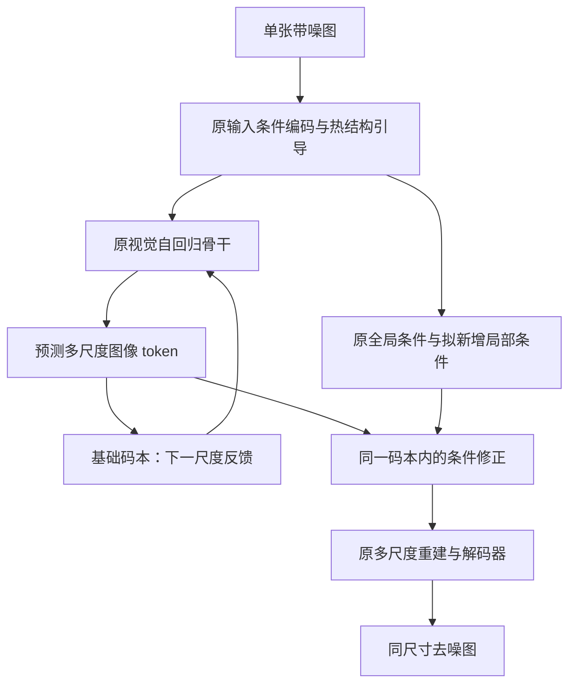

# Real-IISR 研究主方案：在本地固定划分上重训原模型

> 版本：2026-11-20，本地实验主方案。  
> 本地去噪目标：输入一张带噪红外图，输出同尺寸的去噪图；在背景条纹去除程度相近时，更准确地保留弱小目标的亮度响应和空间形状。  
> 技术约束：以官方 Real-IISR 为唯一模型基础，保留原视觉自回归骨干和原解码器，不拼接检测网络、扩散网络或第二个图像恢复网络。  
> 已运行项目以本页链接的本地记录为准；拟新增的脚本、配置和接口在相应小节标明。

## 当前实验：使用自己的数据集重训原模型

训练数据来自本地 `datasets/NUAA-SIRST` 的既有训练清单，共 213 张。测试清单的 214 张保留用于正式评价。重训从作者提供的 `VQVAE.pth` 和 `VARSR.pth` 初始化，模型沿用 Real-IISR 原结构。同尺寸去噪基线已完成 20 轮，每轮 54 次更新，共 1,080 步。[本地训练清单](datasets/NUAA-SIRST/img_idx/train_NUAA-SIRST.txt) · [训练核验](results/local_retrain/training_summary.json) · [终点权重](checkpoints/sirst_retrained_baseline.pt)

在这 213 张训练图上，用两组固定的加噪输入做终点单图推理。第一组的有效区域平均绝对误差从 5.11 降至 3.56，第二组从 5.10 降至 3.50（8 位灰度级）。背景列残差从 5.75／5.83 降至 1.95／1.97，原生目标与邻域背景的对比度绝对误差从 1.79／1.83 升至 19.34／19.15。这是训练集诊断；214 张保留测试图尚未评分。[第一组逐图结果](results/local_retrain/train_eval_draw0.json) · [第二组逐图结果](results/local_retrain/train_eval_draw1.json)

论文在 FLIR-IISR 上报告的 4 倍超分训练预算为 10,000 次更新。作者发布的 1,457 对图像已完成配对检查，仓库自带的七对示例已跑通。公开材料仅给出 1,192／265 的数量，未给出成员。FLIR 自划分方案已撤回，正式训练为 0 次更新。[论文训练设置](https://arxiv.org/html/2603.04745v1#S4.SS1) · [公开数据与样例核验](paper_reproduction/README.md)

## 本地同尺寸去噪的七步顺序与当前进度

第 1 步核查工程环境，第 2 步核查比较方法。**第 3 步是本地去噪的第一项正式训练**，从作者训练用的 VQVAE 和 VARSR 起点在本地重训原结构。第 4 步从共同基线验证局部条件自适应码本（CAC），第 5 步分别检验结构和配对监督。当前同尺寸去噪任务的训练和开发诊断只使用本地 SIRST 的 213 张训练原图。三个数据集的六份训练／测试清单见第 2.1 节。

| 步骤 | 要回答的问题 | 产物和当前进度 |
| --- | --- | --- |
| 1. 工程检查：原图跑官方原版 | 官方发布模型实际读入和输出什么？ | 原版入口已保存 213/213 张 512×512 RGB PNG。另一次重跑补存了 213 张浮点输出及 270 个连通区域的剖面；重跑结果与首次 PNG 平均相差 1.53 个灰度级。[浮点审计](results/official_sirst_train/float_audit/README.md) [运行记录](results/official_sirst_train/run_summary.json) · [输出示例](results/official_sirst_train/testset/VARPrediction/0001_Misc_119.png) |
| 2. 建立可计分对照 | 背景恢复和局部对比度变化能否分别量化？ | 已完成 213 张训练图、两套固定加噪的输入、传统去条纹和冻结模型比较。形状、幅度分层等扩展指标待补。[固定权重逐图结果](results/warmup_pretrained_eval.json) · [第二套噪声](results/warmup_pretrained_eval_draw1.json) · [列条纹对照](results/column_baseline.json) |
| 3. 正式重训原结构 | 原骨干在本地训练后能否实现同尺寸去噪？ | 正式 S1 已完成 20 轮、共 1,080 次更新，并保存终点权重。两组固定加噪输入用于检查单图推理。正式 S2 已从 S1 终点启动，自由生成时逐尺度使用自己的预测。213 张训练图各用一次，固定 54 次更新。[S2 预登记](results/s2_common/preregistration.json)[初始化来源](results/local_retrain/initialization.json) · [更新记录](results/local_retrain/updates.jsonl) |
| 4. 诊断并验证一项结构修改 | 保持 token 预测方式和解码器相同，局部 CAC 能否改善恢复？ | 历史八图探针覆盖同一旧 checkpoint 下三种 token 的全局 CAC 解码列。正式共同权重的六格诊断与 G0/G1 结构训练待做。[八图探针](results/s2_token_source_probe.json) |
| 5. 结构与损失对照 | 局部 CAC 与局部配对监督各有多少收益？ | 四组 M00/M01/M10/M11 和区域加权对照 W0/W1 尚未启动。 |
| 6. 正式测试 | 对原生目标及跨库数据是否稳定有效？ | SIRST、IRSTD-1K、NUDT-SIRST 三套原测试清单尚未用于正式评价。 |
| 7. 论文与复现 | 每项结论能否复现？ | 待正式结果齐备后整理代码、配置、清单、权重和论文。 |

此前从 Real-IISR 发布成品权重出发的 213 步预热和 16 步自由预测属于部分参数微调先导。它们用于数据、梯度、推理路径及 token 来源诊断，正式第 3 步另用 VQVAE/VARSR 起点和独立优化器。[历史预热](results/s1_warmup.json) · [历史自由预测](results/s2_common_pilot.json) · [本地重训命令](results/local_retrain/run.sh)


---

## 0. 先把最终模型完整定义下来

### 0.1 模型输入与输出

定义单模型：

\[
\hat y=F_\theta(x),\qquad x,\hat y\in\mathbb R^{H\times W}.
\]

推理时只输入一张图，不输入参考图、目标掩码、有点／无点配对图或噪声真值。模型不主动放大目标、不进行超分输出，也不保证恢复物理温度。对普通公开数据，本文评价的是**同一灰度标尺下、相对额外加噪前参考图的信号保真**。

为复用官方三通道权重，灰度输入可重复为三通道；输出用固定通道均值恢复灰度。归一化、灰度转换和拼块策略在所有实验组中一致。

### 0.2 单一网络中的组成

保留官方已有的条件编码、热结构引导、视觉自回归 Transformer、基础码本、条件自适应码本和 VQ 解码器。[R1][C2][C5][C6]



图中的“局部条件”来自原有输入条件特征，不增加独立的特征提取网络。训练时把同一个模型调用两次，以构造输出差约束；部署时仍然只调用一个模型。

### 0.3 先分清三种 token

| 名称 | 如何得到 | 本方案中的用途 |
| --- | --- | --- |
| 输入条件 token | 原 `con_embedding(x)` 的连续空间特征 | 为自回归预测和局部码本修正提供条件 |
| 输入 VQ token | 固定 VQ 编码器对带噪图量化 | 主要用于第 4 步诊断 |
| 自回归预测 token | 原 VAR 根据带噪输入逐尺度预测 | 决定输出的基础码字 |

本方案把你说的“基于输入 token 修正”具体化为一个候选：**输入条件 token 引导的局部条件码本修正**。我们没有看到你实际的候选代码，因此不能声称这里的公式就是你现有实现。

如果现有候选是“直接以带噪图的 VQ token 为输出底座”，那属于另一种结构定义，需要单独比较；不能与下面的方案混用实验名称。

### 0.4 原结构：全局条件自适应码本

官方实现先从输入条件序列计算每张图一个全局条件：

\[
h^g(x)=G\!\left(\operatorname{mean}_p C_{\mathrm{all},p}(x)\right),
\]

其中 `G` 是原 `cb_cond`。原条件码本对预测 token \(a_{k,p}\) 的解码为：

\[
z^{(0)}_{k,p}
=
E[a_{k,p}]
+
\tanh(g)
\big(U[a_{k,p}]\odot h^g(x)\big)V_c^\top.
\]

这里 \(E\) 是基础码本，\(U,V_c,g\) 是原 CAC 已有参数；\(k\) 表示尺度，\(p\) 表示该尺度的位置。原 \(h^g\) 的形状是 `[B,r]`，它在各位置广播。同一图中不同 token 的 `U` 行仍可不同，所以不能把原 CAC 描述成“对所有位置加完全相同的偏置”。它缺少的是**显式随位置变化的条件系数**。[C2][C5]

### 0.5 一项结构候选：加入局部条件系数

复用原 `con_embedding(x)` 输出的空间特征 \(C(x)\)。对每个原有 token 尺度 \(n_k\times n_k\)，做面积池化并调用同一个 `cb_cond`：

\[
c_{k,p}=\operatorname{AreaPool}_{n_k\times n_k}(C(x))_p,
\qquad
\tilde h^\ell_{k,p}=G(c_{k,p}).
\]

去掉该尺度的空间平均值：

\[
h^\ell_{k,p}
=
\tilde h^\ell_{k,p}
-
\operatorname{mean}_{q}\tilde h^\ell_{k,q}.
\]

最终仅把原 CAC 改成：

\[
\boxed{
z^{(1)}_{k,p}
=
z^{(0)}_{k,p}
+
\tanh(\beta)
\big(U[a_{k,p}]\odot h^\ell_{k,p}\big)V_c^\top
}
\]

其中 \(\beta\) 是新增的一个标量，初始化为 0。原 `cb_cond`、`U`、`V` 全部复用，所以这是在原模型内部改变条件码本的使用方式，不拼接另一个模型。

**该设计的五个明确约束：**

1. AR 仍负责预测输出 token，不被绕过。
2. 下一尺度的自回归反馈继续使用原基础码本 `E`；局部 CAC 只用于最终重建。官方代码本来就区分这两条路径。[C2]
3. 新增局部门控独立于原 `lora_gate`，避免原门控接近零时把新增分支也一并压住。
4. \(\beta=0\) 时，新旧结构初始输出应一致；之后的差异由训练产生。
5. 1×1 尺度的中心化局部项自然为零，保持粗尺度的全局作用。

有 padding 时，对局部特征使用有效区域加权池化和加权均值，无效位置局部项置零。有效区域来自图像几何尺寸，不是目标掩码。原全局条件如需改变 padding 处理，必须在两种结构共同路径中同时改变。

该候选会增加位置级 `cb_cond` 的计算，不能因为只新增一个标量就声称没有额外推理开销。门控有界也不意味着输出误差必然有界；效果需要第 4、5 步验证。

### 0.6 这项修改试图解决什么

待检验假设是：

> 全局条件系数可能不足以同时校准背景条纹与局部弱信号。原输入特征中的空间信息，可能帮助同一个条件码本在不同位置做更合适的微调。

这是研究假设，不是已证实机制。尤其需要检查：几像素目标经过原条件编码后是否还有可用响应。如果输入条件特征已经丢掉信号，局部 CAC 也无法保证把它恢复。

### 0.7 两种监督方式

共同基础监督：

\[
L_{\mathrm{base}}
=
\lambda_{\mathrm{ce}}L_{\mathrm{token}}
+
\lambda_{\mathrm{pix}}L_{\mathrm{image}}
+
\lambda_{\mathrm{ord}}L_{\mathrm{TOC}}.
\]

图像项先沿用固定的 MSE，目标是参考图；原 TOC 是否保留及其归一化在第 3 步确定，之后所有正式组一致。官方系数只能作为原实现的参照，不能在改变损失归约方式后直接称为等效系数。[C4][C11]

新增配对监督：

\[
L_{\mathrm{pair}}
=
\frac{
\sum (M_s+\eta R_s)
\left|\big(F_\theta(b+s+n)-F_\theta(b+n)\big)-s\right|
}{
\big(\sum(M_s+\eta R_s)\big)\max(a,a_{\min})
}.
\]

其中 \(s\) 是已知注入点斑，\(a\) 是其绝对峰值幅度，\(M_s\) 是支持区域，\(R_s\) 是外围环。每一对先归一化，再对 batch 求平均。

总监督为：

\[
L=L_{\mathrm{base}}+\lambda_{\mathrm{pair}}L_{\mathrm{pair}}.
\]

第 4 步先关闭配对项，仅验证结构；第 5 步再独立打开结构开关与配对开关。

---

## 1. 第一步：用本地原图跑完整官方推理（工程检查）

### 1.1 本步要回答的问题

确认作者的完整推理流程在你自己的图像上做了什么。重点是权重、输入输出尺寸、灰度变换、目标变化，以及官方后处理的作用。

本步没有独立干净参考，不能仅凭原图到输出的变化证明去噪效果。

### 1.2 准备材料

- 官方 Real-IISR 仓库和 README 指定的推理权重。
- 本地 SIRST 训练清单中的 213 张原图。[原始清单](datasets/NUAA-SIRST/img_idx/train_NUAA-SIRST.txt)
- 每张图的原始尺寸、位深、通道、数值范围。
- 你已经诊断的 8 张图的文件名、split 和用途记录。

沿用固定代码提交：

```bash
git clone https://github.com/JZD151/Real-IISR.git
cd Real-IISR
git checkout -b weak-target-denoise 70355f7e9d6b849272d429d12e854f5890b89ae2
git rev-parse HEAD
```

本地已使用该提交的官方入口和发布权重完成 213 张训练原图的工程检查。作者入口读取同名 HR/LR 路径；两处指向同一份原图，故无独立干净观测。推理未使用测试图。[输入清单](results/official_sirst_train/input_manifest.json) · [实际命令](results/official_sirst_train/run.sh) · [环境](environment_record.md)

### 1.3 按顺序操作

**操作 A：先跑官方样例。**

先确认 checkpoint 能加载，保存 missing/unexpected keys。核对实际模型深度、`patch_nums`、码本维度和位置编码形状。不要把参数简写 `pn=512` 直接当成固定版本默认尺度序列；源码对简写有另外的展开方式。[C3]

**操作 B：只替换输入图，按官方流程跑本地开发图。**

原入口是 `python test.py`，但输入路径、权重路径等需按源码和本地目录配置。原样流程先完整保留，用于复现审计。

**操作 C：在保存图之前保留中间结果。**

至少存：

1. 原始输入；
2. 真正进入模型的张量对应图像；
3. 经过模型域转换、但尚未量化和颜色校正的浮点输出；
4. 官方脚本最终写盘图。

官方测试数据读取有 resize，`test.py` 还包含 uint8 转换和颜色校正。必须把模型输出与这些处理分开检查。[C9][C13]

**操作 D：做固定标尺的局部观察。**

对每个目标保存：

- 原尺寸整图；
- 同一窗口的目标放大图；
- 通过目标位置的水平、垂直灰度剖面；
- 输出减输入的差值图；
- 处理前后局部对比度，仅作变化描述。

各图使用同一显示范围；不要各自自动增强对比度，否则容易把响应衰减隐藏掉。

**操作 E：建立后续去噪实验的统一包装。**

不更新权重，只调整输入输出包装：

- 输入保留原生像素尺度；
- 小图补边、大图固定窗口处理；
- 输出裁回原尺寸；
- 用固定灰度标尺保存浮点结果；
- 主评价关闭会重新改变灰度分布的颜色修正。

将这个版本命名为“冻结官方权重＋同尺寸去噪适配推理”。它与“官方原样推理”分别记录。

### 1.4 检查哪些现象

| 检查项 | 具体记录 |
| --- | --- |
| 尺寸 | 原图、实际模型输入、模型输出、最终输出的高宽 |
| 灰度 | 最小值、最大值、均值、是否有饱和与全图漂移 |
| 弱目标 | 衰减、增强、消失、展宽或位移 |
| 背景 | 条纹变化、真实边缘损失、异常纹理和新增亮点 |
| 后处理 | 原始浮点输出与最终保存图的差别 |
| 重复性 | 同一输入在同一配置下是否重复得到相同结果 |

### 1.5 本步产物与通过条件

建议产物：

```text
runs/01_official_probe/
  environment.txt
  checkpoint_metadata.json
  input_output_audit.csv
  float_predictions/
  official_saved_outputs/
  target_crops/
  gray_profiles/
```

通过条件是：流程能复现，尺寸与灰度变换可以解释。**不要求官方超分权重已经适合去噪。**原版出现弱点失真，可以进入第 2 步量化。

---

## 2. 第二步：建立可计分的同尺寸去噪对照

### 2.1 先固定原图清单

逐行读取 `datasets/<数据集>/img_idx/` 的六份随包清单，保留 ID、归属与顺序。

| 本地数据 | 训练清单与项目索引 | 测试清单与项目索引 | 用途 |
| --- | --- | --- | --- |
| NUAA-SIRST（SIRST） | [213 张原始清单](datasets/NUAA-SIRST/img_idx/train_NUAA-SIRST.txt) · [索引](manifests/train.jsonl) | [214 张原始清单](datasets/NUAA-SIRST/img_idx/test_NUAA-SIRST.txt) · [索引](manifests/test.jsonl) | 本地训练、训练图诊断与主测试 |
| IRSTD-1K | [800 张原始清单](datasets/IRSTD-1K/img_idx/train_IRSTD-1K.txt) · [索引](manifests/train_irstd1k.jsonl) | [201 张原始清单](datasets/IRSTD-1K/img_idx/test_IRSTD-1K.txt) · [索引](manifests/test_irstd1k.jsonl) | 保留其训练成员，正式测试跨库迁移 |
| NUDT-SIRST | [663 张原始清单](datasets/NUDT-SIRST/img_idx/train_NUDT-SIRST.txt) · [索引](manifests/train_nudt_sirst.jsonl) | [664 张原始清单](datasets/NUDT-SIRST/img_idx/test_NUDT-SIRST.txt) · [索引](manifests/test_nudt_sirst.jsonl) | 保留其训练成员，正式做合成压力测试 |

本地只有 train 和 test，无独立验证集，也不从 213 张训练原图另划开发集。调试、噪声复测、工作点校准只用 SIRST 训练清单，统计量标为训练图诊断。各阶段固定预定轮数／步数的终点权重；正式比较的预算、工作点、分组和背景匹配容差在正式实验前登记，测试图只在第 6 步按锁定配置使用。

索引记录图像与掩码的相对路径、尺寸、图像哈希及掩码指标资格。同一原图的全部裁块、加噪与注入变体继承其 `group_id` 和集合归属。[训练原图实例](datasets/NUAA-SIRST/images/Misc_119.png) · [对应掩码](datasets/NUAA-SIRST/masks/Misc_119.png)

SIRST 测试成员 `Misc_111` 的原图为 325×220，掩码为 592×400。它保留测试归属；全图指标依其自身资格计分，依赖空间对齐掩码的目标和背景指标使用其余 213 张。报告每项实际分母。[原图](datasets/NUAA-SIRST/images/Misc_111.png) · [掩码](datasets/NUAA-SIRST/masks/Misc_111.png)

### 2.2 明确参考图的含义

对公开原图 \(y\) 加入已知噪声：

\[
x=y+n.
\]

这里的 \(y\) 是“额外加噪前的参考图”，其中可能已经有传感器噪声与处理痕迹。实验首先回答：**去掉额外噪声时，能否保留原图已有的目标响应。**

不能把这个实验直接等同于“恢复真实无噪温度场”。

### 2.3 先实现一个可解释的噪声模型

首轮采用：

\[
n_{ij}=c_j+\epsilon_{ij},
\quad
c_j\sim\mathcal N(0,\sigma_{\mathrm{col}}^2),
\quad
\epsilon_{ij}\sim\mathcal N(0,\sigma_{\mathrm{rnd}}^2).
\]

\(c_j\) 是整列共享偏置，\(\epsilon_{ij}\) 是像素随机噪声。先把列条纹做清楚，再增加缓变条纹、行条纹或混合退化。

启动时可用弱／中／强三个条纹水平。例如对 8-bit 图，`2、5、10 DN` 可作为试运行候选；这些数值不是数据事实或最终协议。应在 SIRST 训练图上检查是否覆盖有意义的失真，再锁定正式水平。

还要有 `noise=0` 对照，检验模型在没有额外噪声时是否主动改坏目标。

**生成规则：**

- 分别固定训练诊断与正式测试的 `sample_id × noise_type × noise_level × repeat` 对应种子。
- 稳定种子使用固定哈希，不用随进程变化的 Python `hash()`。
- 多方法共用同一个加噪张量或落盘文件。
- 对整幅原图生成噪声后再切块，避免同一列在不同块中得到不连续偏置。
- 保留浮点噪声和实际输入；量化结果作为另外的输出协议。
- 记录 clipping 比例；第 5 步的配对目标区域要避免饱和。
- 不给每张图单独做 min-max 拉伸。

### 2.4 实现三个初始对照

| 方法 | 实现 | 作用 |
| --- | --- | --- |
| 保留输入 | \(\hat y=x\) | 给出去噪前误差 |
| 简单列统计去条纹 | 仅根据输入估计高频列偏置 | 判断一个透明简单方法能做到什么 |
| 冻结官方模型 | 第 1 步统一包装后的原权重 | 判断官方权重直接迁移的效果 |

一个可复现的简单方法是：

\[
m_j=\operatorname{median}_i x_{ij},
\quad
\hat c_j=m_j-\operatorname{Smooth}(m)_j,
\quad
\hat y_{ij}=x_{ij}-\lambda\hat c_j.
\]

对 \(\hat c\) 去掉全局均值，减少整体亮度漂移。平滑窗口和 \(\lambda\) 在训练图上确定、正式比较前登记。现有固定参数对照采用每行 7 像素水平中值滤波，并以各列残差中位数估计列偏置。[已运行实现](check_column_baseline.py) · [两套训练图结果](results/column_baseline.json)

这是定位问题的简单对照，可能误伤真实列向结构。它不代表传统去条纹方法的最高水平；推理时也不能读取参考图或目标掩码。

### 2.5 固定评价区域

对一个原生目标：

- \(M\)：该目标的原始连通域掩码；
- \(R\)：其外围背景环，排除其他目标、边界无效区；
- \(B\)：有效图像范围内，排除所有目标及外扩邻域后的背景。

环宽和外扩距离在开发阶段确定并固定。靠近边界或其他目标导致环面积不足时，使用预先规定的处理规则并计数，不能为每张测试图人工挑选有利背景。

目标掩码用于构造训练样本和离线评价，不进入 `Fθ(x)`。

### 2.6 至少实现以下指标

令 \(e=\hat y-y\)。

**背景 RMSE：**

\[
E_{\mathrm{bg}}
=
\sqrt{\frac{\sum B e^2}{\sum B}}.
\]

**列向条纹残留代理：**

\[
b_j=\frac{\sum_i B_{ij}e_{ij}}{\sum_i B_{ij}},
\qquad
S_{\mathrm{col}}
=
\sqrt{
\frac{\sum_j w_j(b_j-\bar b)^2}{\sum_j w_j}
},
\]

其中 \(w_j=\sum_iB_{ij}\)，忽略没有有效背景的列，\(\bar b\) 为加权均值。行条纹使用对应行向指标。

该指标从**输出减参考的误差图**计算；不能直接把输出图的列均值波动都视为条纹。保留 \(E_{\mathrm{bg}}\) 和平均误差，防止去均值指标遗漏全局亮度偏移。

**目标对比度与误差：**

\[
c(q)=\operatorname{mean}_M(q)-\operatorname{median}_R(q),
\quad
E_c=|c(\hat y)-c(y)|.
\]

同时记录有符号变化 \(c(\hat y)-c(y)\)，区分擦弱和增强过度。主报绝对灰度误差；相对误差的分母要加固定下限，避免接近零的参考对比度造成爆炸。

**其他必要指标：**

- 目标区域 MAE；
- 背景扣除后的目标积分响应误差；
- 周围环区域误差与扩散；
- 整图 PSNR、SSIM；
- 零额外噪声下的目标改变。

对于几像素目标，质心与二阶矩可作辅助形状指标，但要预设“输出响应接近零”的处理方式。消失目标不能因为形状指标算不出来就从统计中删除。

### 2.7 先检验评价代码，再信任模型分数

用三个受控输出检查指标：

1. `output = reference`：误差应为零，PSNR 按实现约定为无穷或专门标记。
2. `output = noisy_input`：应显示已知噪声残留。
3. 只在固定目标窗口人工降低或增加亮度：目标指标应能辨别失真，即使整图 PSNR 变化很小。

这是必要的评价逻辑检查，不是加入第四个学习模型。

### 2.8 本步产物与通过条件

产物：固定原图清单、`noise_schedule.jsonl`、三种初始对照、逐图指标、逐目标指标、固定显示范围的可视化。

通过条件：相同输入能得到稳定分数；指标能区分“背景改善”与“目标被削弱”。**此时无需任何模型获胜。**

---

## 3. 第三步：训练原结构的同尺寸去噪基线

### 3.1 本步的边界

正式的原结构重训从作者训练用的 [VQVAE](checkpoints/VQVAE.pth) 和 [VARSR](checkpoints/VARSR.pth) 初始化。沿用原视觉自回归结构和全局 CAC，输入为 SIRST 训练图的带噪版本，参考为加噪前的同尺寸原图。已有成品权重微调记录只作为工程先导。[作者训练入口](vendor/Real-IISR/train.py) · [本地加载审计](results/local_retrain/load_audit.json)

正式训练包含两个阶段：

- **S1：**采用参考 token 前缀（teacher forcing）训练原模型。本地已完成的配置采用公开 README 的 20 轮，固定每轮 54 步，合计 1,080 次更新。论文 §4.1 给出 FLIR-IISR 上 10,000 次迭代的超分训练预算。实验记录须分别标明任务、数据和更新次数。[公共 README](vendor/Real-IISR/README.md) · [论文 §4.1](https://arxiv.org/html/2603.04745v1#S4.SS1)
- **S2：**从正式 S1 终点继续，用与实际推理一致的可微自由生成路径训练共同基线。正式 S2 的首个完整遍历固定为 213 张训练图、54 次优化更新，采用该步权重作本轮共同终点。参数仍为原结构可训练的 388 个张量。训练前已封存逐图顺序、学习率、基础损失和采样规则。[预登记](results/s2_common/preregistration.json) · [逐图顺序](results/s2_common/schedule.json)

不加入局部 CAC，不加入配对响应损失。优先确保原结构基线可信。

### 3.2 先修改数据入口

本地同尺寸去噪样本由 [prd_data.py](prd_data.py) 组装，原超分数据类保留方便审计。

训练样本至少返回：

```text
noisy:       [3,H,W]
reference:   [3,H,W]
valid_mask:  [1,H,W]
target_mask: [1,H,W]，仅用于采样/评价/后续监督
sample_id
noise_spec
original_shape
```

关键是删掉超分任务的实际退化，而不是只改一个 scale 参数。固定版本 `traindataset.py` 把 LR 先硬编码缩到 `crop_size//4`，再放大回原裁块大小；只改 `lr_scale` 不会自动删除该操作。[C1]

在新的去噪数据类中：

1. 原图 \(y\) 保持原生像素网格；
2. 生成同尺寸 \(x=y+n\)；
3. 对两者同步裁块、翻转；
4. 图像与掩码使用相同坐标；
5. 不对小目标先缩小再放大；
6. 映射到官方模型域，例如 `[0,1] → [-1,1]`。

固定权重若使用 512 输入／末级 32×32 token，首版沿用该网格；小图补边，大图裁块。不能为省显存直接把几像素目标缩没。实际尺度仍由 checkpoint 校验。[C2][C3]

### 3.3 确定共同参数更新范围

| 部件 | 首版策略 | 原因 |
| --- | --- | --- |
| 原带噪图条件编码、热结构引导 | 训练 | 适配去噪输入 |
| 原 VAR 与 token 输出头 | 训练 | 学习参考图 token |
| 原 `cb_cond`、CAC `U/V/lora_gate` | 训练 | 适配原有条件码本 |
| VQ 编码器、基础 embedding、量化残差模块 | 冻结 | 固定 token 定义与表示 |
| 原解码器、相关投影 | 冻结 | 先控制重建链路变化 |
| 新局部门控 | 本步不存在 | 留到第 4 步 |

冻结 VQ 编码器不等于冻结带噪图条件编码器；它们是不同模块。优化器显式收集 `requires_grad=True` 参数，并保存参数名列表。[C2][C6][C14]

**冻结解码器参数不等于给解码过程套 `no_grad`。**图像损失还需要穿过解码器输入，回到码本条件和 VAR。

### 3.4 S1：先完成训练链路预热

操作顺序：

正式 S1 以全部 213 张 SIRST 训练图为来源，在原尺度生成加噪输入与参考。每轮重新安排样本及噪声，优化器采用独立状态。本次按既定 20 轮终点保存，以固定训练图的单图硬推理检查实际恢复；teacher-forcing 训练损失单独记录。[进程命令](results/local_retrain/run.sh) · [训练日志](results/local_retrain/training.log)

如果小训练集都无法拟合，先核查归一化、输出域、数据对应、冻结范围与实际学习率，再判断表示瓶颈。不要直接归因于“数据太少”。

**teacher forcing 的限制：**干净参考 token 前缀可能提供目标信息。低训练损失只说明条件于这些前缀的预测较好，不能直接证明只给带噪图时也能保住目标。[C4]

### 3.5 S2：实现可微的自由生成路径

核心要求：

> 主图像输出的整个生成过程只使用带噪输入与模型已经预测的前缀。参考 token 只用于损失标签，不进入主生成路径。

固定版本原训练在解码前对 logits 取硬 `argmax`，会切断图像损失经过离散 token 选择到 logits 的路径；但 CAC 的连续条件仍可能接收到梯度。因此，“某个参数有梯度”不足以证明主干收到了图像保真监督。[C4][C5]

首版使用硬前向、软反向的 ST 估计：

\[
p=\operatorname{softmax}(\ell/\tau),\quad
q=\operatorname{onehot}(\arg\max\ell)+(p-\operatorname{stopgrad}(p)).
\]

前向仍按硬 token 工作；反向采用 softmax 近似梯度。ST 是有偏近似，不是离散 argmax 的真实导数。

基于同一个 \(q\)：

\[
z_{\mathrm{feedback}}=qE,
\]

\[
z_{\mathrm{decode}}
=qE+\tanh(g)\big((qU)\odot h^g\big)V_c^\top.
\]

前者用于原多尺度反馈，后者用于最终解码，保持官方语义。[C2][C5]

### 3.6 具体实现顺序

1. 在 `models/var.py` 增加共同的 `denoise_rollout` 模式。
2. 首版关闭 KV cache，每个尺度重算必要前缀，优先保证训练图正确。
3. 复用原多尺度注意力掩码；不要误改成逐 token 的严格下三角掩码。
4. 在 `quant.py` 支持 ST 权重查码本，累积重建用非原地操作。
5. 在 `vqvae.py` 沿用原 embedding 到图像的解码路径。
6. 统一训练和推理的全局条件语义；原源码两条路径计算 h 时对 `pos_start` 的处理不同，共同去噪路径按已选推理语义统一。[C2]
7. `trainer.py` 通过模型正式 `forward` 调用新模式，避免 DDP 时绕过包装器。
8. 评价使用确定性硬 token 推理，固定 CFG 等参数。

原 `autoregressive_infer_cfg` 带 `@torch.no_grad()`，不能直接把它当作训练函数。原注意力缓存与 activation checkpoint 还存在状态管理问题；首版不把可变 cache 与反向重计算混用。[C2][C8]

### 3.7 做一次有意义的梯度检查

分别只开启：

- 图像重建项；
- 将来要用的配对项，用一对临时训练样本做通路检查。

记录：

- token logits 的梯度；
- token head、VAR 后部参数的梯度；
- `cb_cond`、CAC 参数和条件编码的梯度；
- 冻结参数是否保持无梯度；
- 梯度是否有限、是否更新后发生参数变化。

配对项在这里仅用于验证通路，不参与共同基线正式训练。token logits 通常是非叶张量；若检查其 `.grad`，先调用 `logits.retain_grad()`，或使用 `torch.autograd.grad`。未保留非叶梯度造成的 `None`，不能直接解释为计算图断开。

还要用同一模型检查：

- 训练硬前向与推理输出是否一致；
- 禁用 DropPath 等随机扰动后，两支差分是否可重复；
- BatchNorm 的 running statistics 是否固定；
- FP32 与混合精度是否会明显改变最弱目标响应。

关键 ST 码本乘法和弱差分计算用显式禁用 autocast 的 FP32 区域；仅给张量调用 `.float()` 不一定阻止 matmul 被 autocast 降精度。

### 3.8 固定共同 checkpoint 的训练终点

正式 S1 采用预定 1,080 步终点，正式 S2 采用预登记第 54 次优化更新。用训练图自由推理评估该终点能否作为各组共同初始化，保留失败结果。保存：

- 背景 RMSE 与条纹残留；
- 原生目标对比度误差和目标区域误差；
- 零额外噪声下的目标改变；
- 最终生效学习率、有效 batch、优化步数；
- 输入尺度、CFG、硬 token 规则和输出标尺。

`utils/arg_util.py` 会重算部分 batch／学习率，必须核对最终生效值，不能只相信配置文本。[C3]

### 3.9 通过条件

以下条件满足即可进入第 4 步：

1. 数据与输出域正确；
2. 自由推理、可微训练和指标链路可信；
3. 相比保留带噪输入，在固定的不同加噪实现下，训练图上的背景恢复能稳定改善；
4. 目标损伤能够重复测量；
5. 共同 checkpoint、配置和参数更新范围完整保存。

**不要求基线已经完全保住弱目标。**如果背景变好但弱点稳定衰减，这是有效的研究入口。

如果背景也没有改善，先定位训练、数据或表示问题；不要直接堆配对损失开始正式四组实验。

### 3.10 本步产物

```text
runs/03_original_denoising/
  s1_warmup/
  s2_free_rollout/
  gradient_audit.json
  trainable_parameters.txt
  training_diagnostic_curves.csv
  common_init.pth
  resolved_config.yaml
```

以上是拟生成的产物布局。`common_init.pth` 应来自本地正式 S2 的预定终点，记录其 S1 父权重及最终更新步数，供第 4、5 步各组共同初始化。

## 4. 第四步：固定解码器，定位问题，再训练一个结构候选

### 4.1 先整理你已经做过的 8 张图

每张图补齐：

- `sample_id`、数据集、split；
- 使用的 checkpoint；
- 输入是否加噪，噪声强度与种子；
- token 来源；
- 使用基础码本还是 CAC；
- h 来自哪里；
- 解码器与后处理是否保持一致；
- 背景与目标指标；
- 这张图影响过哪些结构或参数选择。

已核对的八张图是 SIRST 训练清单前八张。旧微调先导在同一解码器下比较参考、带噪、预测三种 token 的全局 CAC 解码结果，同时报告直接保留带噪输入。直接保留输入是像素对照，不能填入基础码本解码列。正式六格诊断在第 3 步的共同权重上补齐两列。[八图逐项记录](results/s2_token_source_probe.json)

8 张图适合发现代码问题和提出机制假设，不足以证明整体收益。

### 4.2 固定一个 checkpoint，取得三种 token

对同一对加噪图 \(x\) 和参考图 \(y\)：

\[
t_y=Q(y),\qquad t_x=Q(x),\qquad \hat t_x=\operatorname{AR}(x).
\]

- \(Q\)：同一个固定 VQ 编码器和基础量化器；
- \(t_y\)：参考图 token；
- \(t_x\)：带噪输入 token；
- \(\hat t_x\)：模型真正自由生成的预测 token。

预测 token 必须来自单图自由生成，不能使用参考前缀。诊断脚本可为原推理路径增加返回多尺度索引的选项；这是拟新增接口，不是当前官方现成参数。

### 4.3 做六格诊断

| token 来源 | 基础码本解码 | 原 CAC 解码 |
| --- | --- | --- |
| 参考图 \(t_y\) | \(D(E(t_y))\) | \(D(E_h(t_y;h(x)))\) |
| 带噪图 \(t_x\) | \(D(E(t_x))\) | \(D(E_h(t_x;h(x)))\) |
| 自回归预测 \(\hat t_x\) | \(D(E(\hat t_x))\) | \(D(E_h(\hat t_x;h(x)))\) |

必须固定：

1. 同一个 decoder 与 checkpoint；
2. 同一组基础码本、U、V、原门控；
3. 同一图的三条 CAC 路径统一使用 **来自带噪输入的同一个 \(h(x)\)**；
4. 相同尺度序列、裁边、数值范围和后处理；
5. 相同目标窗口与指标。

不要一边把 token 换成 \(Q(y)\)，一边把条件也换成 \(h(y)\)；这会混淆两个因素。

参考图 token 只用于离线诊断，不可部署，也不是严格数学性能上界。

固定版本的可靠参考 token 入口示例为：[C6]

```python
with torch.no_grad():
    _, ms_indices = vae.img_to_idxBl(reference_in_model_domain)
    reconstruction = vae.idxBl_to_img(
        ms_indices, same_shape=True, last_one=True
    )
```

以上是已存在函数的用法示意；实际脚本仍要实现数值域、保存和批处理。若使用 CAC，则传入同一个已计算的 \(h(x)\)。

### 4.4 如何阅读诊断结果

| 观察到的现象 | 支持优先调查什么 | 不能直接推出什么 |
| --- | --- | --- |
| 参考 token 重建就明显丢点 | 固定 VQ 表示／解码路径的保真能力 | 不能把问题全归于 AR |
| 参考 token 保点、预测 token 丢点 | 条件信息与 token 预测 | 不能直接证明 CAC 是唯一瓶颈 |
| 相同预测 token 加 CAC 后更差 | 条件码本校准造成额外失真 | 不能保证局部 CAC 必然有效 |
| 多种 token 都变成宽斑 | 表示与解码链路的形状限制 | 不能认为换一个 loss 就必然解决 |
| CAC 改善背景却削弱局部响应 | 全局校准与局部信号之间可能有冲突 | 仍需公平训练对照确认 |

不要只比较 token 索引相等率。不同索引对应码字的图像影响不同，最终应检查实际解码输出。

### 4.5 检查局部条件是否还有目标信息

对同背景、有点／无点输入计算：

\[
\Delta C=C(x+s)-C(x).
\]

保存局部特征差的幅度图，并与完全相同输入重复推理的数值差比较。若可用响应接近数值噪声，局部 CAC 的输入信息可能不足。

这不是新的模型组件，也不要求训练检测器。它只是判断候选是否有合理输入依据。

### 4.6 实现一项局部 CAC 修改

按第 0.5 节公式，修改：

- `models/var.py`：保留原 `con_embedding` 的空间特征；构造每尺度局部 h；最终解码时传入。
- `models/quant.py`：原全局修正项旁增加局部低秩项；新增零初始化 `local_gate`。
- `models/vqvae.py`：解码接口支持每尺度局部 h；原 decoder 结构不动。
- `trainer.py`：将结构开关与损失开关分开。
- 配置：`codebook_mode=global/global_local`、`local_gate_init=0`。

此轮保持：

- 原 token 预测语义；
- 原下一尺度反馈；
- 原尺度序列；
- 第 3 步共同损失；
- 第 3 步冻结策略；
- 相同输入输出包装。

本轮不同时加入图像残差旁路、更换解码器或改采样规则。

### 4.7 训练前先做两个检查

**检查 A：零初始化等价性。**

从共同 checkpoint 加载两份模型，候选 `local_gate=0`。同一输入下两份输出应在数值精度范围内一致。加载后不要重新初始化整个模型。

**检查 B：新分支是否真正进入优化器。**

原模型有冻结再解冻逻辑。若 `local_gate` 放在 quantizer 中，要显式加入训练白名单；创建为 `nn.Parameter` 不代表最终一定可训练。[C2]

第一步局部门控为 0 时，局部项向局部特征传播的梯度为 0 是正常的；应先看门控是否有有限且通常非零的梯度。门控更新后，再检查局部路径是否获得梯度。均匀输入等特殊样本可能使局部项本身为零，应使用有空间变化的调试图。

### 4.8 做一次公平的小规模结构训练

同时启动：

| 运行 | 结构 | 损失 |
| --- | --- | --- |
| G0 | 原全局 CAC | 共同基础损失 |
| G1 | 全局＋局部 CAC | 同一个共同基础损失 |

执行要求：

1. 从相同 `common_init.pth` 开始；
2. 两组都继续训练相同的优化步数；
3. 使用相同原图、噪声 schedule、样本顺序、有效 batch；
4. 使用相同训练图诊断频率和预定训练终点；
5. 初步筛查可用一个种子，正式结论再做多种子；
6. 同时报告背景变化和目标变化。

不能拿“没继续训练的旧基线”与“额外训练后的候选”直接比较。

### 4.9 根据结果决定是否保留候选

- 在相近背景恢复程度下，目标误差稳定减小：候选进入第 5 步。
- 目标更清楚但条纹也更多：先判断是否只是减弱了去噪；暂不算保真收益。
- 仅 8 张图有效，整份训练清单或另一固定加噪实现上不稳定：证据不足。
- 参考 token 重建已严重失真：重新评估原表示链路的适用性；如需解冻原解码器，另建共同基线，所有组统一执行。
- 候选没有稳定收益：保留原结构，继续研究配对监督也完全成立，不强行写成双创新。

产物：`token_diagnosis.csv`、六格图、候选公式与代码差异、G0/G1 训练图诊断曲线、继续／调整的依据。

---

## 5. 第五步：分别验证结构和监督的贡献

### 5.1 主实验采用四组

| 组别 | 条件码本 | 监督 |
| --- | --- | --- |
| M00 | 原全局 CAC | \(L_{\mathrm{base}}\) |
| M01 | 原全局 CAC | \(L_{\mathrm{base}}+\lambda_pL_{\mathrm{pair}}\) |
| M10 | 全局＋局部 CAC | \(L_{\mathrm{base}}\) |
| M11 | 全局＋局部 CAC | \(L_{\mathrm{base}}+\lambda_pL_{\mathrm{pair}}\) |

这四组回答两项改动各有什么作用。M11 是拟议最终模型，是否保留两项改动由实际结果决定。

第 4 步用于筛选候选的额外训练不应只计入某一正式组。正式四组从第 3 步同一个共同 checkpoint 重新开始，各自训练相同步数；不要让 M10/M11 继承候选的额外训练优势。

### 5.2 构造有点／无点训练对

只使用 train 图。

对一个参考背景 \(b\)：

1. 在已有目标掩码的外扩区域之外选择注入窗口。
2. 保留原背景，不用修补网络擦掉原目标。
3. 在相同坐标注入已知点斑 \(s\)。
4. 生成一份噪声 \(n\)，同时加到两支。
5. 两支使用相同几何变换与数值标尺。

得到：

\[
y^-=b,\quad y^+=b+s,
\qquad
x^-=b+n,\quad x^+=b+s+n.
\]

“无点”是指没有这个人工注入点，不一定意味着整张图没有其他原生目标。共同背景与噪声在输入差中抵消；对于非线性且具有全局耦合的模型，输出差仍可能在目标邻域乃至远处出现额外变化，不能假定背景自动抵消。两支都需要常规重建监督，并应记录监督窗口之外的非预期响应。

### 5.3 点斑怎么生成

第一版用有限支持的椭圆高斯，随机化幅度、尺度、长短轴比例、角度与亚像素位置：

\[
s(p)=a_0\exp\!\left[-\frac12(p-\mu)^\top\Sigma^{-1}(p-\mu)\right].
\]

超过预定支持范围的位置置零；损失中的实际幅度用生成后 `max(abs(s))`，避免亚像素采样导致实际峰值与参数 \(a_0\) 不同。

实施建议：

- 幅度和尺寸范围来自 SIRST 训练图的原生目标的统计，不看 test 决定。
- 既覆盖较弱目标，也保留部分较容易目标帮助稳定训练。
- 形状与背景位置要变化，避免只学固定高斯模板。
- 可把冷目标或非高斯点斑作为预先规定的扩展实验，不必第一轮同时加入。
- 核心测试始终使用留出的原生目标；人工点斑用于训练与机理分析。

### 5.4 检查两输入之差

生成后断言：

\[
x^+-x^-\approx s,\qquad y^+-y^-\approx s.
\]

如果发生独立 clipping、独立归一化、不同噪声或不同增强，这个关系会被破坏。首轮在有效目标窗口内避免饱和，保存浮点训练数据。

对于信号相关噪声或乘性条纹，两支观察差未必仍是 \(s\)。这些情况要另行定义观察模型，不能直接沿用上述等式。首轮先使用严格共享的加性噪声。

### 5.5 两次前向，两个常规监督，一个配对监督

\[
\hat y^- =F_\theta(x^-),\qquad
\hat y^+=F_\theta(x^+).
\]

基础损失对两支取平均：

\[
L_{\mathrm{base,pair}}
=
\frac12\big(
L_{\mathrm{base}}(\hat y^-,y^-)
+
L_{\mathrm{base}}(\hat y^+,y^+)
\big).
\]

输出差：

\[
\Delta\hat y=\hat y^+-\hat y^-.
\]

配对损失让 \(\Delta\hat y\) 接近注入点斑 \(s\)。它同时约束幅值减弱、过度增强和空间外扩。环区的监督目标为零，避免点斑响应被抹到周围。

**配对项不能单独使用。**恒等映射 \(F(x)=x\) 也满足 \(\Delta\hat y=s\)，但保留全部噪声。基础监督负责恢复背景。

还要准确理解它的价值：已知 \(y^+\)、\(y^-\) 时，配对监督并未凭空增加真值信息；它改变了优化时对局部响应差的关注方式。能否超过直接局部监督必须通过对照检验。

小扰动时：

\[
F(x+s)-F(x)\approx J_F(x)s.
\]

因此，这项损失试图让网络对训练所覆盖的弱信号方向保持合适响应，并不要求网络对所有方向都成为恒等映射。

### 5.6 四组必须看到相同训练数据

M00/M10 虽然不计算配对项，也必须：

- 看到相同的两支图像；
- 分别接受两支的重建／token 监督；
- 使用相同的原生训练对与人工注入对混合比例；
- 采用相同样本顺序和噪声 schedule。

例如可以先试固定的原生对／注入对混合比例，在 SIRST 训练图上诊断后预先锁定。比例是训练协议，不能仅给 M01/M11 增加更丰富的数据。

两支共享噪声，不表示两支可以使用不同随机采样。训练与推理中的 DropPath、BN、硬 token 决策需按第 3 步共同规定。

### 5.7 还必须补目标区域加权强对照

原始问题是“配对约束是否优于简单增加目标附近的权重”。只做四组仍回答不了这一点。

固定结构下增加：

\[
L_{\mathrm{weighted}}
=
L_{\mathrm{base}}
+
\lambda_w
\frac12\sum_{\sigma\in\{-,+\}}
\frac{\sum W_s|\hat y^\sigma-y^\sigma|}
{\sum W_s\max(a,a_{\min})},
\]

其中 \(W_s=M_s+\eta R_s\)，区域与幅度归一化尽量与配对项一致，两支都计算。还可加入相同目标窗口内的直接对比度／形状监督，形成更强对照。

推荐预算允许时补两组：

| 组别 | 结构 | 监督 |
| --- | --- | --- |
| W0 | 原 CAC | 基础＋目标区域加权重建 |
| W1 | 局部 CAC | 基础＋目标区域加权重建 |

这样比较 M01 与 W0、M11 与 W1，结构固定。

预算紧张时，至少在最终选定结构上补对应的 W 组，并限定结论适用范围。不能用“新结构＋配对”战胜“旧结构＋加权”来证明配对监督本身更好。

另一种可选设计是把合理的直接局部监督纳入所有四组共同基础，再只开关额外配对项；若采用该设计，应重新命名和定义各组，不能把两套实验表混为一谈。本文默认采用上面的四组＋W0/W1。

### 5.8 控制公平预算

所有正式组锁定：

- 相同共同初始化和 tokenizer；
- 相同原图、噪声、点斑清单；
- 相同两支图像数量和有效 batch；
- 相同优化步数及学习率日程；
- 相同冻结范围，候选仅多出明确的局部门控；
- 相同训练图诊断频率、相同预先登记的训练终点；
- 相同规模的训练图超参数诊断预算。

核心四组消融共享基础损失权重、优化超参数和更新预算；M01 与 M11 使用同一个配对权重，除结构与配对开关外保持一致。工作点性能比较可另做等预算的权重扫描，不能把分别调参后的全部差异直接归于两个开关。

可先单种子调通，正式建议多个种子，资源允许时至少三个。记录实际训练耗时、峰值显存、参数量和推理时间；同优化步数不等于计算量完全相同。

区域加权对照 W0/W1 与配对组采用同等的权重校准预算。

### 5.9 在相近背景恢复程度下选择工作点

在 SIRST 训练清单上，用各组预定训练终点绘制：

- 目标对比度误差—背景 RMSE；
- 目标对比度误差—条纹残留。

仅用训练图先导的误差范围确定候选工作区间。在正式比较开始前登记各组工作点、背景 RMSE 和列残差匹配容差、更新步数与种子。各组统一使用预先登记步数的终点，不按曲线挑选中间 checkpoint；每项预登记的配置单列结果。

正式 test 同时列出背景和目标指标。若各组在 test 上背景能力仍明显不同，就报告实际差异和曲线，不能强行称为“同等去噪水平”。

禁止按测试参考图选择与原输入混合的系数，这会把参考答案用于推理。

### 5.10 拆解四组收益

先在固定超参数、固定预算的核心四组上分析，并列报告背景指标。令 \(E_{ab}\) 是同一比较规则下、越小越好的目标误差：

\[
\text{结构收益}=E_{00}-E_{10},
\]

\[
\text{原结构上的配对收益}=E_{00}-E_{01},
\]

\[
\text{新结构上的配对收益}=E_{10}-E_{11}.
\]

定义交互：

\[
I=(E_{10}-E_{11})-(E_{00}-E_{01}).
\]

\(I>0\) 才支持这个误差定义下的正向交互；还需要不确定性分析。M11 排名第一不自动意味着两项改动具有协同机制。

背景匹配曲线回答的是另一层问题：在相近去噪程度下，各方法能达到什么目标保真水平。若上式的 E 来自各组分别校准的损失权重，I 只能解释为该选择协议下的性能交互，不能称为纯粹的结构与损失交互。

### 5.11 本步产物与通过条件

产物：

- M00、M01、M10、M11 和 W 组的配置、权重、日志；
- 每组实际预算；
- 训练图背景—保真诊断曲线；
- 注入响应的增益、泄漏与形状诊断；
- 正式测试前锁定的工作点。

通过条件是对照公平、选择规则固定、收益归因清楚。若配对不优于加权监督，应如实记录并收缩贡献；它不是必须得到的预定结论。

---

## 6. 第六步：按本地原划分正式测试

### 6.1 先写一个“测试冻结记录”

在读取正式结果前固定：

- 模型文件及 SHA256；
- 代码提交；
- 数据清单 hash；
- 噪声协议与种子；
- 模型输入尺度、padding、拼块；
- CFG、token 选择、输出通道和数值域；
- 评价区域定义和分组阈值；
- 所有基线参数；
- 各组预先登记的更新终点、终点 checkpoint 哈希、工作点及背景匹配容差；
- 哪些图曾用于开发。

正式测试不再根据结果修改结构、loss 或阈值。

### 6.2 三个数据集分别怎么跑

| 测试 | 具体输入与参考 | 核心结论 |
| --- | --- | --- |
| SIRST 主测试 | 对原 test 图加固定噪声；原图作参考；原生目标 mask 仅用于计分 | 主数据分布内原生目标保真 |
| IRSTD-1K 跨库测试 | 同一模型、同一推理与计分规则，使用其既有 test 划分 | 跨数据集迁移 |
| NUDT-SIRST 压力测试 | 原 test 划分＋预先固定的较难退化 | 合成目标场景下的失效与鲁棒性 |

SIRST 和 IRSTD-1K 是本方案的原生目标证据来源；NUDT-SIRST 含合成目标场景，应单独解读。[R2][R3][R13]

正式训练与诊断只使用 SIRST 的 213 张训练图。IRSTD-1K 和 NUDT-SIRST 的训练成员按本地清单原样保留。本地重训和调参阶段未使用跨库样本时，可以报告跨库迁移；另行说明预训练来源及可审计的数据重叠范围。

三份测试清单逐行保留。SIRST 测试成员共 214 张，其中 `Misc_111` 的掩码与原图尺寸不符，涉及该掩码的背景与目标指标按其余 213 张计分（见 §2.1）。

### 6.3 每张图的执行顺序

1. 按本地测试索引读取原图 \(y\) 和相应掩码，先核对尺寸与掩码指标资格；
2. 按固定 schedule 生成／读取 \(x\)；
3. 各模型读取同一个 \(x\)；
4. 仅图像传入模型；
5. 保存原尺寸浮点输出；
6. 全图指标按有效图像计，目标与背景只按空间对齐的合格掩码计，逐项记录分母；
7. 最后才聚合成表；
8. 按预先规则选可视化，保留失败样例。

大图切块使用固定坐标和融合权重，各组一致；不要改变原图像素尺度。边界目标单独统计检查。

### 6.4 正式表格至少四类

**表 A：整体恢复与保真。**

| 数据／噪声 | 方法 | 背景 RMSE↓ | 条纹残留↓ | 对比度误差↓ | 目标 MAE↓ | PSNR↑ | 时间 |
| --- | --- | --- | --- | --- | --- | --- | --- |
| 待填 | 待填 | — | — | — | — | — | — |

**表 B：结构与损失主四组。**

并列 M00/M01/M10/M11，报告全部训练种子的均值、离散程度与配对差值。

**表 C：与区域加权监督比较。**

固定相同结构，比较配对项与 W 组；给出背景匹配证据。

**表 D：弱小目标分组与失效。**

按目标面积、参考图局部对比度／背景波动、噪声等级分组。分组界限在 SIRST 训练图上预先确定，测试时固定，不能依据输出“看起来是否清楚”重新分组。

### 6.5 如何分析形状与“消失”

在固定目标窗口内，计算背景扣除后的响应；以同一规则统计：

- 目标响应衰减；
- 过度增强；
- 质心偏移；
- 积分响应误差；
- 二阶矩／展宽；
- 外围泄漏。

输出响应接近零时记为响应衰减事件，并保留在样本数中。不能只对“还能看到的点”算形状。

若使用阈值定义消失率，阈值需在开发阶段固定，并明确这是一个操作性指标，不等于检测系统的真实漏检率。掩码不是无背景目标 PSF 的精确真值，所以本方案的形状评价首先是相对参考图的形状保持。

### 6.6 统计方法

- 以原图或可识别场景为独立统计单位。
- 同一原图的多个噪声版本、多个目标属于组内重复。
- 按原图／场景做配对 bootstrap 或等价的分组统计。
- 多训练种子分别报告，再给总体差值与不确定性。
- 事先给出主要指标和最小关注变化，避免事后挑有利指标。
- 同时报告全体目标和最弱／最小组。

### 6.7 已经诊断的 8 张图如何处理

历史八图探针取自本地 SIRST 训练清单前八张，归属与输入哈希均记录在案。它们继续作为训练图诊断使用，不计为独立泛化证据。正式评价逐行使用原测试清单并记录指标资格。[八图记录](results/s2_token_source_probe.json) · [SIRST 训练清单](datasets/NUAA-SIRST/img_idx/train_NUAA-SIRST.txt)

### 6.8 真实传感器噪声结论怎么处理

三套公开图像额外加噪的结果，支持的是对应退化模型下的恢复与保真。它们不足以单独证明真实传感器噪声恢复。

若论文保留“真实噪声适用”的主张，增加独立验证：

- **SCaN-TIR**：真实带噪／参考配对，检查背景恢复；注意配准和成像差异，不能直接把两台相机图像的每个小目标差异都当成去噪失真。[R4]
- **IRSTDID-SKY**：真实条纹图与目标标注，观察前后目标变化；没有对应干净参考时不报告伪造的全参考 PSNR，也不能仅凭变化确认绝对保真。[R5]

这些作为单独表格。若本轮只用现有三库，就相应收窄论文结论，不必为凑结论增加一个模型。

### 6.9 本步完成条件

所有方法在同一输入上得到可追溯结果；工作点已提前固定；背景指标与目标指标一起报告；对误差、边界、噪声强度、统计不确定性和失败样例有完整说明。

正式结果不支持假设时，应保留并分析。继续根据 test 调模型后，要把后续结果标记为新的开发循环，不能继续冒充第一次锁定测试。

---

## 7. 第七步：整理论文和复现材料

### 7.1 先把主张与证据一一对应

| 论文中想写的主张 | 至少需要的证据 |
| --- | --- |
| Real-IISR 可以迁移到同尺寸去噪 | 第 2 步初始对照与第 3 步训练基线 |
| 局部条件码本有帮助 | 同损失下原结构与候选结构比较 |
| 配对监督有独立价值 | 同结构下对比基础监督及区域加权强对照 |
| 两项改动相互配合 | 四组结果和交互差值；仅 M11 最好不足以证明 |
| 保住了原生弱目标 | 留出 SIRST 与跨库原生目标的定量结果 |
| 能处理真实传感器噪声 | 单独真实噪声证据，不能只依靠合成退化 |

### 7.2 论文建议章节

1. 问题：去条纹与保弱响应之间的冲突；
2. 相关工作：红外去噪、小目标保真、视觉自回归、扰动响应监督；
3. 方法：单模型、局部条件码本、配对损失；
4. 实现：同尺寸数据、自由生成训练与共享冻结方案；
5. 实验：主结果、四组对照、区域加权对照、原生目标与跨库结果；
6. 讨论：码本表示瓶颈、极弱目标、未知噪声、数据局限；
7. 复现说明。

方法段可以提前写，性能结论要等正式结果。不要预写“显著提高”“全面优于”等没有实测支持的结论。

### 7.3 最小复现包

```text
release/
  README.md
  environment_lock.txt
  code_commit.txt
  configs/
  manifests/
  noise_schedules/
  checkpoint_metadata.json
  training_logs/
  image_metrics.csv
  target_metrics.csv
  aggregate_results.csv
  analysis_scripts/
  failure_cases/
```

每个 checkpoint 至少对应：

- 初始化权重和当前权重 hash；
- 代码版本；
- 数据清单 hash；
- 完整解析后配置；
- 实际学习率、有效 batch、优化步数；
- 训练种子和噪声种子；
- 参数冻结列表；
- 模型选择规则；
- 训练与推理资源记录。

### 7.4 推理入口应是什么样

最终需要一个简单入口，其语义是：

```text
输入：一张红外图 + checkpoint + 已锁定配置
输出：一张原高宽的去噪图
```

不要求目标 mask、参考图、点斑位置或无点配对图。用于研究的诊断脚本与部署入口分别组织，避免把 GT token 路径误作为正式推理。

### 7.5 贡献应随结果收敛

- 结构有效、配对也有效：保留两项贡献。
- 仅配对有效：保留原结构，强调监督机制和保真证据。
- 仅结构有效：聚焦条件码本与局部信号修正。
- 两者均不稳定，或不优于区域加权：如实报告，研究问题仍有价值，但不能硬写成已经解决。

**完成标准：别人可以从固定清单、噪声 schedule、代码、配置和权重重建主要表格。**

## 附录 A. 在官方代码的什么位置修改

下表中的“原文件”已在固定版本核查；“拟新增文件”是实施建议，本文没有生成可直接训练的完整代码仓库。

| 原文件／拟新增文件 | 要做的具体修改 | 对应步骤 |
| --- | --- | --- |
| `test.py`、`dataloader/testdataset.py` | 审计 resize、量化和颜色修正；保留官方原样流程 | 1 |
| 拟新增 `tools/probe_official.py` | 保存输入张量、浮点输出、最终保存图和审计表 | 1 |
| 拟新增 `tools/build_denoise_manifest.py` | 从现有 split 导出清单、hash 和接触记录 | 2 |
| 拟新增 `data/noise.py` | 固定列偏置等退化，稳定种子，保存实际噪声 | 2 |
| 拟新增 `metrics/fidelity.py` | 背景、条纹残留、局部对比度与形状指标 | 2、6 |
| `dataloader/traindataset.py`；拟新增 `dataloader/denoise_dataset.py` | 新任务使用同尺寸输入参考，移除超分 down/up 退化 | 3 |
| `utils/data.py` | 根据 task 选择新的数据类 | 3 |
| `models/var.py` | 可微自由 rollout；统一全局 h；保留空间条件特征 | 3、4 |
| `models/quant.py` | ST 查码本、非原地重建累积、局部低秩项 | 3、4 |
| `models/vqvae.py` | 接收连续 embedding 与每尺度局部条件；复用原 decoder | 3、4 |
| `models/basic_var.py` | 检查无 cache 的可微前向与 checkpoint；保持原掩码语义 | 3 |
| `trainer.py` | 同一自由生成路径计算监督，梯度审计，结构／损失独立开关 | 3、5 |
| `train.py`、`utils/arg_util.py` | 步骤 3 按作者训练入口加载 VQVAE／VARSR；步骤 4、5 加载本地正式 S2 终点。记录实际参数与权重摘要 | 3、5 |
| 拟新增 `tools/diagnose_tokens.py` | 固定 h 的六格诊断 | 4 |
| 拟新增 `data/weak_pair.py` | 同背景同噪声注入；返回 s、support、ring、valid | 5 |
| 拟新增 `losses/weak_response.py` | 配对响应损失及公平的区域加权损失 | 5 |
| 拟新增 `infer_denoise.py` | 单图、原尺寸、无目标 mask 的正式推理入口 | 6、7 |
| 拟新增 `eval_denoise.py` | 固定清单逐图计分，输出逐图与逐目标 CSV | 2、6、7 |

**代码组织原则：**结构开关控制 CAC 使用方式；损失开关控制训练目标；数据、推理、评价、工作点与预定训练终点独立配置。不要为四组复制四份逐渐不一致的训练器。

## 附录 B. 关键接口与代码示意

以下 Python 仅说明核心逻辑。它们不是包含权重加载、VAR 全流程、分布式和数据读取的完整训练程序；实际合并源码后必须完成第 3 步验证。

### B.1 局部条件构造

```python
import torch
import torch.nn.functional as F

def build_local_conditions(cond_feature, valid_mask, patch_nums, cb_cond):
    # cond_feature: [B,C,Hc,Wc], 来自原 con_embedding
    # valid_mask: [B,1,H,W]，仅表示原图有效范围
    # cb_cond: 复用原模块，不创建第二个投影网络
    valid_c = F.interpolate(
        valid_mask.float(),
        size=cond_feature.shape[-2:],
        mode="area",
    )
    local_conditions = []

    for size in patch_nums:
        mass = F.adaptive_avg_pool2d(valid_c, (size, size))
        pooled = F.adaptive_avg_pool2d(
            cond_feature * valid_c, (size, size)
        ) / mass.clamp_min(1e-6)

        tokens = pooled.flatten(2).transpose(1, 2)  # [B,L,C]
        local = cb_cond(tokens)                     # [B,L,r]
        weights = mass.flatten(2).transpose(1, 2)  # [B,L,1]

        mean = (local * weights).sum(1, keepdim=True)
        mean = mean / weights.sum(1, keepdim=True).clamp_min(1e-6)
        local = (local - mean) * (weights > 0).to(local.dtype)
        local_conditions.append(local)

    return local_conditions
```

有效 mask 的加权不能消除卷积感受野受 padding 的影响，因此边界检查仍然需要。原全局条件分支保持与基线一致。

### B.2 ST 查码本与局部修正

```python
import torch
import torch.nn.functional as F

def st_codebook_embeddings(
    logits, E, U, V_factor, h_global, global_gate,
    h_local=None, local_gate=None, temperature=1.0
):
    # logits: [B,L,vocab_size]
    # E: [vocab_size,d], U: [vocab_size,r], V_factor: [d,r]
    # h_global: [B,r], h_local: [B,L,r]
    with torch.autocast(device_type=logits.device.type, enabled=False):
        logits_fp32 = logits.float()
        probabilities = torch.softmax(
            logits_fp32 / temperature, dim=-1
        )
        hard = F.one_hot(
            logits_fp32.argmax(-1),
            num_classes=logits.shape[-1],
        ).float()

        # 括号确保前向中 p - detach(p) 先相消
        weights = hard + (probabilities - probabilities.detach())
        feedback = weights @ E.float()
        u_rows = weights @ U.float()

        global_offset = (
            u_rows * h_global.float()[:, None, :]
        ) @ V_factor.float().T
        decoded = (
            feedback
            + torch.tanh(global_gate.float()) * global_offset
        )

        if h_local is not None and local_gate is not None:
            local_offset = (
                u_rows * h_local.float()
            ) @ V_factor.float().T
            decoded = (
                decoded
                + torch.tanh(local_gate.float()) * local_offset
            )

    return feedback, decoded
```

`feedback` 继续进入原下一尺度上下文；`decoded` 收集后进入原图像重建。正式硬 token 推理用索引读取 `E/U`，但遵循同一公式。两种路径需通过输出一致性检查。

### B.3 配对响应损失

```python
import torch

def paired_response_loss(
    pred_plus, pred_minus, signal,
    support, ring, valid_mask,
    ring_weight=0.25, amplitude_floor=1.0 / 255.0,
):
    # 所有图像均为 [B,1,H,W]、相同的 [0,1] 灰度标尺
    # amplitude_floor=1/255 仅适用于按 8-bit DN 定义的该配置
    with torch.autocast(
        device_type=pred_plus.device.type, enabled=False
    ):
        delta = pred_plus.float() - pred_minus.float()
        signal = signal.float()
        weights = (
            support.float() + ring_weight * ring.float()
        ) * valid_mask.float()

        errors = (delta - signal).abs()
        weighted_sum = (errors * weights).flatten(1).sum(1)
        area = weights.flatten(1).sum(1).clamp_min(1.0)
        amplitude = signal.abs().flatten(1).amax(1)
        amplitude = amplitude.clamp_min(amplitude_floor)

        per_pair = weighted_sum / area / amplitude
        return per_pair.mean()
```

采样器应保证支持区有效且不是空区域。参考值、噪声、配对输出先统一标尺；不能只在差分之后转为 FP32 来补救之前已经丢失的弱信号精度。

### B.4 训练器的逻辑约定

```python
def training_step(batch, model, tokenizer, losses, config):
    # 以下函数是接口示意，由实际工程实现。
    x_minus = batch["noisy_minus"]
    x_plus = batch["noisy_plus"]

    # 参考 token 只作标签，不作为主自由生成前缀。
    with torch.no_grad():
        labels_minus = tokenizer(batch["reference_minus"])
        labels_plus = tokenizer(batch["reference_plus"])

    outputs_minus = model(
        x_minus, mode="denoise_rollout",
        codebook_mode=config.codebook_mode,
        valid_mask=batch["valid_mask"],
    )
    outputs_plus = model(
        x_plus, mode="denoise_rollout",
        codebook_mode=config.codebook_mode,
        valid_mask=batch["valid_mask"],
    )

    base_minus = losses.base(
        outputs_minus, batch["reference_minus"],
        labels_minus, batch["valid_mask"],
    )
    base_plus = losses.base(
        outputs_plus, batch["reference_plus"],
        labels_plus, batch["valid_mask"],
    )
    total = 0.5 * (base_minus + base_plus)

    if config.pair_weight > 0:
        total = total + config.pair_weight * losses.pair(
            outputs_plus["gray_image"],
            outputs_minus["gray_image"],
            batch["signal"],
            batch["support"],
            batch["ring"],
            batch["valid_mask"],
        )
    return total
```

四组共用这个逻辑。训练模式每次设置后，需要重新确认 BN 统计与随机路径符合共同约定；目标 mask 不作为模型参数。空间 token CE 也应采用一致的有效区域权重，避免大量 padding 主导监督。

## 附录 C. 配置规格与运行顺序

### C.1 拟实现的配置规格

```yaml
task: weak_target_denoising
experiment: M11

source:
  repository: https://github.com/JZD151/Real-IISR
  revision: 70355f7e9d6b849272d429d12e854f5890b89ae2
  initial_checkpoint: runs/03_original_denoising/common_init.pth

data:
  preserve_existing_splits: true
  train_manifest: manifests/train.jsonl
  training_diagnostics_manifest: manifests/train.jsonl
  sirst_test_manifest: manifests/test.jsonl
  irstd1k_train_manifest: manifests/train_irstd1k.jsonl  # 保留成员，正式训练不使用
  irstd1k_test_manifest: manifests/test_irstd1k.jsonl
  nudt_sirst_train_manifest: manifests/train_nudt_sirst.jsonl  # 保留成员，正式训练不使用
  nudt_sirst_test_manifest: manifests/test_nudt_sirst.jsonl
  preserve_native_scale: true
  reference_type: pre_additional_noise_image
  channels: repeat_gray_to_3
  use_valid_mask: true
  paired_examples_shared_by_all_groups: true

model:
  backbone: original_real_iisr
  codebook_mode: global_local
  local_gate_init: 0.0
  local_condition_source: original_con_embedding
  reuse_cb_cond: true
  feedback_codebook: base
  final_decode_codebook: conditional
  patch_nums: from_checkpoint
  freeze_base_tokenizer: true
  freeze_base_codebook: true
  freeze_original_decoder: true
  freeze_batchnorm_statistics: true
  disable_drop_path: true

training:
  rollout: free
  token_gradient: straight_through
  rollout_kv_cache: false
  st_temperature: 1.0
  shared_initialization: true
  shared_update_budget: true
  checkpoint_policy: final_preregistered_update

loss:
  base_definition: locked_after_step_3
  pair_enabled: true
  pair_weight: preregistered_after_training_diagnostics
  roi_weight: 0.0

evaluation:
  single_image_input: true
  inference_tokens: deterministic_hard
  disable_color_fix: true
  save_float_output: true
  matched_background_rule: preregistered_before_formal_comparison
  operating_points: preregistered_before_formal_comparison
  group_statistics_by: original_image_or_scene
```

这个 YAML 是配置设计，原仓库不会自动理解新增字段。实现配置解析和参数映射之后才能使用。各阶段启动前登记实际学习率、更新步数和损失权重，并在本地训练记录中核实。不同结构另测显存与耗时。

### C.2 建议的 CLI 规格

下面是**拟新增脚本实现完成后**的调用约定，不是当前官方已有的一套可直接执行命令。

```bash
python tools/build_denoise_manifest.py --config configs/data.yaml
python tools/probe_official.py --config configs/01_official.yaml
python eval_denoise.py --config configs/02_baselines.yaml
python train_denoise.py --config configs/03_s1_warmup.yaml
python train_denoise.py --config configs/03_s2_common.yaml
python tools/diagnose_tokens.py --config configs/04_diagnosis.yaml
python train_denoise.py --config configs/04_global.yaml
python train_denoise.py --config configs/04_global_local.yaml
python train_denoise.py --config configs/05_M00.yaml
python train_denoise.py --config configs/05_M01.yaml
python train_denoise.py --config configs/05_M10.yaml
python train_denoise.py --config configs/05_M11.yaml
python eval_denoise.py --config configs/06_locked_test.yaml
```

W0/W1 使用相同训练入口，仅配置不同。实际代码可直接扩展原 `train.py`，不必为了符合上面的名字重复写一个训练系统。

### C.3 硬件预算怎么确定

先测一个真实训练 step：

- 一对有点／无点图；
- 原 checkpoint 所需的原尺度；
- 完整可微 rollout；
- 一次 backward 与 optimizer step。

记录峰值显存与时间，再估计：

\[
T_{\mathrm{run}}
\approx N_{\mathrm{updates}}\cdot T_{\mathrm{step}}
+T_{\mathrm{train\ diagnostics}}.
\]

显存不足时依次尝试减少 microbatch、梯度累积、对无状态块做 checkpoint、精确控制混合精度。若改变解冻范围、rollout 频率或 token 尺度，所有正式组共同改变并重新验证，不只给一个方法减负。

## 附录 D. 相关工作与创新边界

原研究问题有已有工作基础，不应写成“首次考虑去噪中的红外弱小目标”。

| 接近的研究 | 已经覆盖什么 | 本方案真正需要证明什么 |
| --- | --- | --- |
| Real-IISR | 红外超分、视觉自回归、条件码本和强度顺序约束 | 同尺寸去噪是否可行；显式局部条件与响应差监督是否有额外价值 [R1] |
| GCAN | 面向检测前处理的小目标红外去噪 | 不能把“去噪时保小目标”本身当作新贡献 [R7] |
| IRSTDID-800 | 面向小目标图像的去噪数据与方法 | 需用原生目标和真实条纹证据比较，而不只做人工点斑 [R5] |
| 两阶段噪声参数估计去条纹 | 单帧弱小目标场景的去条纹 | 本方案的单模型条件修正与监督机制有什么具体收益 [R6] |
| 空间变 PSF 小目标恢复 | 未分辨小目标的物理与形状恢复视角 | 本方案保真指标与训练监督应有可验证区别 [R8] |
| 神经去噪器扰动响应评价、任务相关去噪 | 用已知信号或任务研究去噪响应 | “加信号后比较输出差”不是凭空出现；本方案需证明其训练化与红外场景价值 [R9][R10] |

本文的潜在新增价值应写成可检验的三点：

1. 在原 Real-IISR 中，将全局条件码本扩展为输入条件特征驱动的局部修正，并量化其代价和收益。
2. 在单图去噪训练中，用共享背景、共享噪声的配对响应约束控制弱信号衰减、过增强与扩散。
3. 在相近背景恢复程度下，以留出原生目标和强监督对照验证上述收益。

这些是待验证贡献。没有完成更广泛的代码／论文对比与正式实验前，不作“首次”“绝对原创”或保证优于现有方法的结论。

## 附录 E. 两项任务的执行顺序

当前优先执行本地 SIRST 固定训练清单上的原模型重训练。

1. 本地原结构已完成正式 S1 预定训练。以预先固定的 SIRST 训练图加噪输入进行单图硬推理，记录恢复与失真。
2. 登记正式 S2 的更新预算并完成自由生成共同训练。用训练清单诊断其背景恢复能力，保存终点权重、继承关系及数据哈希。
3. 固定同一正式共同基线、解码器及带噪条件，完成三种 token 来源 × 两种解码方式的六格诊断。
4. 用 G0/G1 对照比较全局／全局加局部 CAC，检查零门控时的输出一致性、梯度和相同训练预算下的影响。
5. 依据全训练清单的诊断、两套加噪结果及预定规则，判断局部 CAC 是否值得保留。对于正式比较，预先登记工作点、损失权重、更新步数和背景匹配容差。
6. 从正式共同终点启动 M00/M01/M10/M11 及 W0/W1。按原生目标对比度、背景误差及列残差分别报告结构与监督的收益。
7. 锁定权重、推理配置与指标后，使用本地三份测试清单正式测试，再整理结论和复现材料。

## 附录 F. 参考文献与官方代码链接


### F.1 论文与数据

- **[R1] Real-IISR（2026）**：Toward Real-world Infrared Image Super-Resolution: A Unified Autoregressive Framework and Benchmark Dataset。  
  论文：https://arxiv.org/html/2603.04745v1  
  官方代码：https://github.com/JZD151/Real-IISR

- **[R2] SIRST 原论文与官方数据**：Asymmetric Contextual Modulation for Infrared Small Target Detection。  
  论文：https://arxiv.org/pdf/2009.14530  
  数据：https://github.com/YimianDai/sirst

- **[R3] IRSTD-1K / ISNet**。  
  官方仓库：https://github.com/RuiZhang97/ISNet

- **[R4] SCaN-TIR**。  
  官方数据卡：https://huggingface.co/datasets/williamrhee/SCaN-TIR

- **[R5] IRSTDID-800，TGRS 2024**。  
  DOI：https://doi.org/10.1109/TGRS.2024.3468441  
  官方仓库：https://github.com/xdFai/IRSTDID-800

- **[R5b] IRSTDID 官方损失代码**。  
  https://github.com/xdFai/IRSTDID-800/blob/main/improved%20loss.py  
  本文关于损失的描述以可见代码为限，不推断未公开在该文件中的完整调用语义。

- **[R6] 两阶段噪声参数估计去条纹，2022**：Noise Parameter Estimation Two-Stage Network for Single Infrared Dim Small Target Image Destriping。  
  https://www.mdpi.com/2072-4292/14/19/5056

- **[R7] GCAN，2024**：Gradient-aware channel attention network for infrared small target image denoising before detection。  
  https://journal.sitp.ac.cn/hwyhmb/hwyhmbcn/article/html/2023144

- **[R8] 空间变 PSF 小目标恢复，2026**：Physics-Informed Spatially Variant Image Restoration for Unresolved Infrared Remote Sensing Small Targets。  
  https://www.mdpi.com/2072-4292/18/17/2934

- **[R9] 扰动响应评价，2022**：Performance Assessment Framework for Neural Network Denoising。  
  https://pmc.ncbi.nlm.nih.gov/articles/PMC9113009/

- **[R10] 任务引导去噪与 task-shift，2024**：Investigating the use of signal detection information in supervised learning-based image denoising with consideration of task-shift。  
  https://pmc.ncbi.nlm.nih.gov/articles/PMC11376226/

- **[R11] SFPRNet，2026**。  
  论文：https://www.mdpi.com/2072-4292/18/17/2877  
  官方代码：https://github.com/cyyj191/SFPRNet

- **[R12] TIDY，2026**。  
  官方代码：https://github.com/williamrheeth/TIDY  
  论文：https://arxiv.org/abs/2606.19813

- **[R13] NUDT-SIRST / DNANet 官方仓库**。  
  https://github.com/YeRen123455/Infrared-Small-Target-Detection

### F.2 固定版本的代码依据

以下永久链接对应本文核查提交。本文中的新增接口不包含在这些链接中。

- [C0] 固定提交：https://github.com/JZD151/Real-IISR/commit/70355f7e9d6b849272d429d12e854f5890b89ae2
- [C1] 训练数据：https://github.com/JZD151/Real-IISR/blob/70355f7e9d6b849272d429d12e854f5890b89ae2/dataloader/traindataset.py
- [C2] 模型主类：https://github.com/JZD151/Real-IISR/blob/70355f7e9d6b849272d429d12e854f5890b89ae2/models/var.py
- [C3] 参数配置：https://github.com/JZD151/Real-IISR/blob/70355f7e9d6b849272d429d12e854f5890b89ae2/utils/arg_util.py
- [C4] 训练器：https://github.com/JZD151/Real-IISR/blob/70355f7e9d6b849272d429d12e854f5890b89ae2/trainer.py
- [C5] 码本与多尺度累积：https://github.com/JZD151/Real-IISR/blob/70355f7e9d6b849272d429d12e854f5890b89ae2/models/quant.py
- [C6] VQ-VAE：https://github.com/JZD151/Real-IISR/blob/70355f7e9d6b849272d429d12e854f5890b89ae2/models/vqvae.py
- [C7] 原融合模块：https://github.com/JZD151/Real-IISR/blob/70355f7e9d6b849272d429d12e854f5890b89ae2/models/src/fusion.py
- [C8] 原自回归块：https://github.com/JZD151/Real-IISR/blob/70355f7e9d6b849272d429d12e854f5890b89ae2/models/basic_var.py
- [C9] 推理入口：https://github.com/JZD151/Real-IISR/blob/70355f7e9d6b849272d429d12e854f5890b89ae2/test.py
- [C10] 训练入口：https://github.com/JZD151/Real-IISR/blob/70355f7e9d6b849272d429d12e854f5890b89ae2/train.py
- [C11] 原顺序损失：https://github.com/JZD151/Real-IISR/blob/70355f7e9d6b849272d429d12e854f5890b89ae2/models/src/loss.py
- [C12] 数据分派：https://github.com/JZD151/Real-IISR/blob/70355f7e9d6b849272d429d12e854f5890b89ae2/utils/data.py
- [C13] 测试数据：https://github.com/JZD151/Real-IISR/blob/70355f7e9d6b849272d429d12e854f5890b89ae2/dataloader/testdataset.py
- [C14] 参数过滤与学习率：https://github.com/JZD151/Real-IISR/blob/70355f7e9d6b849272d429d12e854f5890b89ae2/utils/lr_control.py

[R1]: https://arxiv.org/html/2603.04745v1
[R2]: https://arxiv.org/pdf/2009.14530
[R3]: https://github.com/RuiZhang97/ISNet
[R4]: https://huggingface.co/datasets/williamrhee/SCaN-TIR
[R5]: https://github.com/xdFai/IRSTDID-800
[R5b]: https://github.com/xdFai/IRSTDID-800/blob/main/improved%20loss.py
[R6]: https://www.mdpi.com/2072-4292/14/19/5056
[R7]: https://journal.sitp.ac.cn/hwyhmb/hwyhmbcn/article/html/2023144
[R8]: https://www.mdpi.com/2072-4292/18/17/2934
[R9]: https://pmc.ncbi.nlm.nih.gov/articles/PMC9113009/
[R10]: https://pmc.ncbi.nlm.nih.gov/articles/PMC11376226/
[R11]: https://www.mdpi.com/2072-4292/18/17/2877
[R12]: https://github.com/williamrheeth/TIDY
[R13]: https://github.com/YeRen123455/Infrared-Small-Target-Detection
[C0]: https://github.com/JZD151/Real-IISR/commit/70355f7e9d6b849272d429d12e854f5890b89ae2
[C1]: https://github.com/JZD151/Real-IISR/blob/70355f7e9d6b849272d429d12e854f5890b89ae2/dataloader/traindataset.py
[C2]: https://github.com/JZD151/Real-IISR/blob/70355f7e9d6b849272d429d12e854f5890b89ae2/models/var.py
[C3]: https://github.com/JZD151/Real-IISR/blob/70355f7e9d6b849272d429d12e854f5890b89ae2/utils/arg_util.py
[C4]: https://github.com/JZD151/Real-IISR/blob/70355f7e9d6b849272d429d12e854f5890b89ae2/trainer.py
[C5]: https://github.com/JZD151/Real-IISR/blob/70355f7e9d6b849272d429d12e854f5890b89ae2/models/quant.py
[C6]: https://github.com/JZD151/Real-IISR/blob/70355f7e9d6b849272d429d12e854f5890b89ae2/models/vqvae.py
[C7]: https://github.com/JZD151/Real-IISR/blob/70355f7e9d6b849272d429d12e854f5890b89ae2/models/src/fusion.py
[C8]: https://github.com/JZD151/Real-IISR/blob/70355f7e9d6b849272d429d12e854f5890b89ae2/models/basic_var.py
[C9]: https://github.com/JZD151/Real-IISR/blob/70355f7e9d6b849272d429d12e854f5890b89ae2/test.py
[C10]: https://github.com/JZD151/Real-IISR/blob/70355f7e9d6b849272d429d12e854f5890b89ae2/train.py
[C11]: https://github.com/JZD151/Real-IISR/blob/70355f7e9d6b849272d429d12e854f5890b89ae2/models/src/loss.py
[C12]: https://github.com/JZD151/Real-IISR/blob/70355f7e9d6b849272d429d12e854f5890b89ae2/utils/data.py
[C13]: https://github.com/JZD151/Real-IISR/blob/70355f7e9d6b849272d429d12e854f5890b89ae2/dataloader/testdataset.py
[C14]: https://github.com/JZD151/Real-IISR/blob/70355f7e9d6b849272d429d12e854f5890b89ae2/utils/lr_control.py


