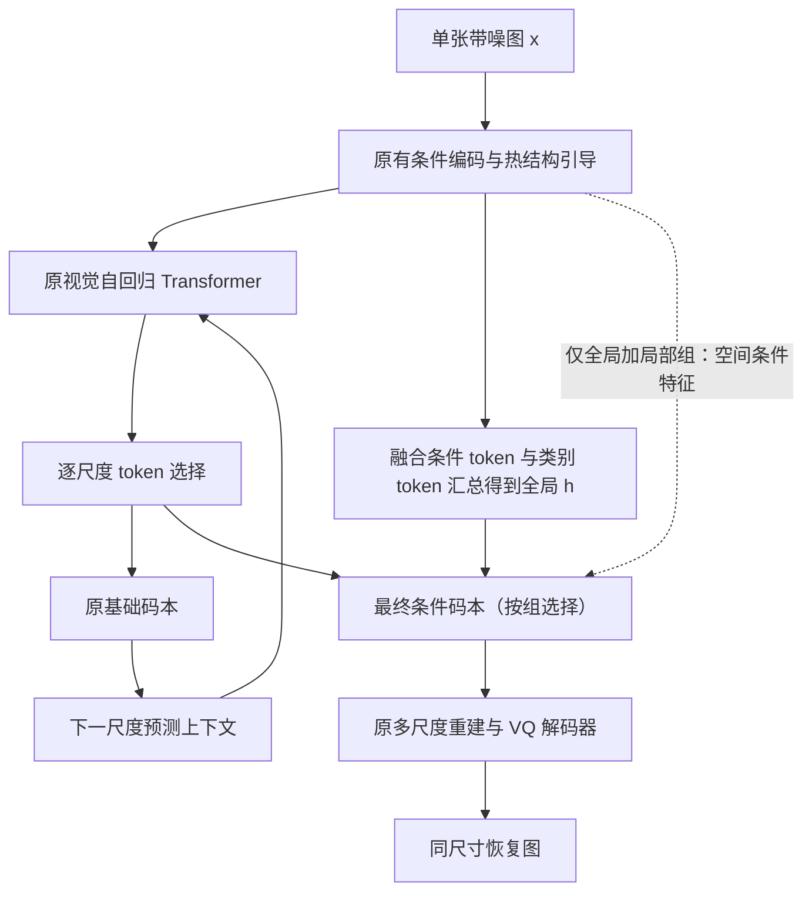
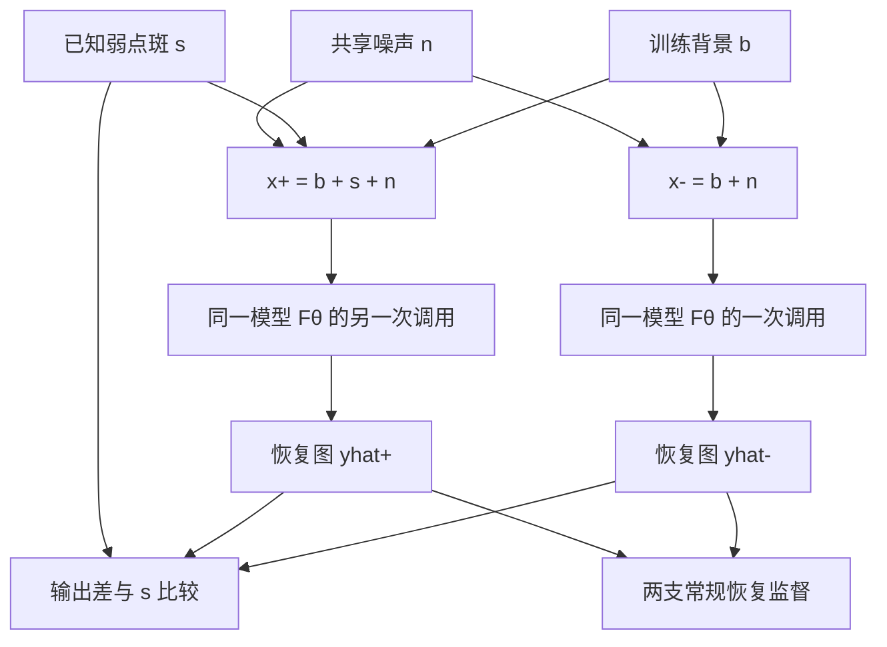

# 基于 Real-IISR 的弱小目标保真单帧红外图像去噪研究方案

> **历史方案与先导记录。** 本文件保留早期设计、运行条件和逐项结果。后续方法、分组及实验顺序以[七步实施主方案](<Real-IISR_Weak_Target_Denoising_Research_Plan (1).md>)为准。

## 文档信息

- 版本：v1.4
- 整理日期：2026-11-20
- 研究任务：单帧带噪红外图像 → 同尺寸恢复图像。
- 方法边界：在 Real-IISR 原有模型内部完成同尺寸适配和训练监督改进，不做模型拼接。
- 本地数据：NUAA-SIRST 为主，IRSTD-1K 用于跨库评价，NUDT-SIRST 用于合成压力测试。SCaN-TIR 等真实噪声数据仅作为后续扩展。
- 文档性质：研究设计与代码实施规范。四组模型的训练和性能结论以实际运行记录为准。
- 代码核查基线：官方仓库 JZD151/Real-IISR，提交 `70355f7e9d6b849272d429d12e854f5890b89ae2`，提交日期 2026-07-20。本文涉及源码事实的描述以该提交为准。[C0]

> 在背景恢复误差和列条纹残留都相当时，局部配对监督能否比基本扰动监督更好地保留留出原图的局部灰度对比？在同一种监督下，最终解码采用全局加局部条件码本是否还有改善？

**实验顺序。** 第一项正式实验是在本地 SIRST 训练集上重训原结构的 Real-IISR，得到用于比较的同尺寸去噪基线。成品权重推理属于环境与数据接入检查。用本地重训的终点权重评价基础性能后，再决定修改哪一处结构。最后做结构与监督消融，并按本地测试清单评价。[完整步骤和逐项状态](#13-整体研究步骤交付物与当前状态)

**当前进度。** 正式原结构基线已从 VQVAE 和 VARSR 初始化，正在本地训练。早期记录包括工程检查和成品权重微调先导。作者原版推理已处理本地 SIRST 训练清单全部 213 张原图，并保存逐图输出。去噪适配另已完成 213 张图的配对检查、S1 共同预热和 16 步 S2 自由预测先导。第一套噪声下，直接保留输入的背景 RMSE 为 6.44 DN，固定参数去列条纹后为 3.69 DN，S2 为 33.71 DN。第二套噪声复核方向相同。当前 S2 未达到第 13 节要求的有效去噪条件，四组结构与监督实验暂缓。第 10.1 节给出逐项结果。[环境记录](environment_record.md) · [冻结骨干的表示诊断](results/representation_probe.json)

---

## 目录

1. 研究定位与方法边界
2. 已有研究、创新性与可证伪假设
3. 官方代码与已核实的实现事实
4. 单一模型的架构与数据流
5. 数据构造与公开数据的使用规范
6. 损失函数与监督设计
7. 可微视觉自回归的实现方案
8. 代码修改清单
9. 关键代码示意与接口约定
10. 训练阶段、参数设置与资源策略
11. 推理流程
12. 实验对照与评价指标
13. 整体研究步骤、交付物与当前状态
14. 验收条件、失败分析与内部调整
15. 论文组织与题目建议
16. 参考文献与官方代码链接

---

## 1. 研究定位与方法边界

### 1.1 输入、输出和任务范围

令原始图像尺寸为 \(H\times W\)，研究模型为：

\[
\hat y=F_\theta(x),\qquad x,\hat y\in\mathbb R^{H\times W}.
\]

- 输入：一张含条纹噪声及可选随机噪声的红外图。
- 输出：同尺寸、相同灰度标尺下的恢复图。
- 主目标：抑制背景噪声，同时减少弱小目标的幅值收缩、过增强、偏移和展宽。
- 首版范围：以加性条纹为主要退化，随机噪声为伴随退化。
- 推理不输入目标掩码、目标位置、人工点斑参数、配对图像或参考图。
- 目标掩码只用于训练集背景采样、可选训练监督以及离线评价。

不在首版同时解决超分、去模糊、视觉增强和目标分割。先用边界清楚的同尺寸去噪任务验证监督方法。

### 1.2 “不做模型拼接”的具体含义

本方案仅使用一份 Real-IISR 参数体系，保留其原有组成：

1. 原图条件编码和热结构引导；
2. 视觉自回归 Transformer；
3. 多尺度 token 表示；
4. 原基础码本及条件自适应码本机制；
5. 原 VQ-VAE 解码器。

允许的改动：

- 修改数据加载与退化过程；
- 修改原模型的训练前向接口；
- 为原离散 token 选择增加训练时的梯度近似；
- 复用原模块实现可微逐尺度生成；
- 增加损失、评测和日志；
- 在指定结构组内，仅修改最终解码使用的条件自适应码本（CAC）调制，比较全局条件与全局加局部条件；
- 必要时解冻原模型已有参数。

不采用外接 U-Net、第二个去噪器、扩散网络、检测网络、新图像重建头或额外高分辨率补偿支路。原仓库已有的 AFF、CrossAttention 等内部组件继续复用，不把它们重新包装成新增模型。

训练时的有点／无点两支，表示同一个 \(F_\theta\) 被调用两次，也可以合成一个 \(2B\) 大小的 batch；两支不拥有独立权重。推理仍然只处理单张图。

### 1.3 最终模型如何命名

工作名可用 **Real-IISR-PRD**，其中 PRD 仅表示 paired-response denoising，属于本项目工作名，尚非已有方法名称。

完整定义为：

> 保留 Real-IISR 原有模型组成的同尺寸红外去噪模型，通过可微逐尺度训练和局部配对响应约束，减少恢复过程中对弱小目标的失真。

如果最终效果主要来自监督，论文应将贡献落在监督与评价上，不预先认定视觉自回归天然优于其他骨干。

### 1.4 题目建议

首选：

**《基于配对响应约束的弱小目标保真红外图像去噪》**

如果主要研究条纹：

**《基于配对响应约束的弱小目标保真红外图像去条纹》**

如果实验能够证明自回归结构的作用，可用：

**《面向弱小目标响应保真的视觉自回归红外图像去噪》**

SIRST 涉及多个波段，整套数据不应无条件称为热辐射测量数据。因此，在主要使用 SIRST 等公开显示域图像时，题目先使用“红外”，而非直接声称“热红外辐射／温度保真”。[R2]

---

## 2. 已有研究、创新性与可证伪假设

### 2.1 已有方法覆盖了哪些问题

| 研究 | 核心方法或问题 | 对本方案的启示 |
| --- | --- | --- |
| Real-IISR，2026 | 视觉自回归红外超分、热结构引导、条件自适应码本、CE＋像素 MSE＋强度顺序约束 | 可作为代码与权重基础，但原方法已经有幅值相关的像素监督。[R1] |
| 两阶段噪声参数估计去条纹，2022 | 估计增益和偏置校正参数，关注过平滑导致弱小目标丢失 | “去条纹同时保留弱小目标”已有直接先例。[R6] |
| GCAN，2024 | 梯度感知通道注意力与编解码去噪，评价小目标检测前恢复 | 不能把“小目标需要保护”本身作为新发现。[R7] |
| IRSTDID-800，2024 | 真实条纹下的小目标检测导向评价，并公开改进损失代码 | 需要比较真实条纹场景，不能只测人工白噪声。[R5] |
| 空间变 PSF 引导小目标恢复，2026 | 已知／校准 PSF、局部恢复及目标 ROI、局部可观测性、能量集中度和峰值监督 | 直接局部保真损失已经有研究，应增加强对照 B′。[R8] |
| 神经去噪扰动响应评价，2022 | 用加入信号前后的输出差分析低对比、小尺寸信号及形状传递 | 提供对比度传递的评价先例。[R9] |
| Lebel，ISMRM 2023 会议摘要 | 在 MRI 中用两次重建的输出差与已知扰动计算训练损失 | 将该基本损失移植为本实验的 P 组，直接检验局部加权和幅度归一化相对 P 的增量。[R14] |
| 任务信息引导去噪与 task-shift，2024 | 将任务信息引入去噪训练，并研究训练、测试任务变化的影响 | 人工点斑训练到原生目标的迁移必须单独验证。[R10] |
| SFPRNet、TIDY，2026 | 现代红外去条纹、真实热红外去噪路线 | 可作为外部性能参考，单独运行，不与本模型串接。[R11][R12] |

补充说明：IRSTDID 官方 `improved loss.py` 展示的是归一化方向差分惩罚，不是目标 mask 加权。该独立文件未给出所有调用上下文，不能仅凭它推断被约束张量的具体含义。[R5b]

### 2.2 动机应如何表述

例子“目标原本高出背景 6 个灰度级，恢复后只高出 1 个，顺序仍正确”可以说明强度排序约束单项的不足。

但是，Real-IISR 已有像素 MSE，不能写成“原方法没有绝对幅值监督”。更合理的研究动机是：

- 稀疏弱目标在全图重建误差中占比很小；
- 目标区域像素误差混合了背景恢复误差与目标响应误差；
- 配对差值尝试直接约束恢复算子对一个已知局部信号的传递；
- 是否优于认真调优的区域加权，取决于实验，而非公式名称。

### 2.3 待检验假设

- **H1：**在同一种 CAC 下，背景 RMSE 与列条纹残留均匹配时，局部配对监督 C 比基本扰动监督 P 的原生局部对比度绝对误差更低。
- **H2（扩展比较）：**在直接局部监督上再加入 C 有增量收益。只在同一种结构上完成 D 对 B′ 后判断。
- **H3：**收益能够迁移到未见点斑形状、不同条纹实现和原生目标。
- **H4：**给定同一监督，最终解码使用全局加局部 CAC 比原全局 CAC 的原生局部对比度绝对误差更低。所有结构均以单图推理。
- **H5：**在可确认的无目标背景上，新增伪响应的增幅低于事先规定的可接受上限。以按原图聚类的单侧区间上界判定。

### 2.4 新增价值的边界

拟分别验证局部配对损失相对 P 的增量、最终码本局部条件的增量，以及从人工扰动到原生局部对比度的迁移。配对扰动训练已有公开先例。[R14]

以下内容不能预先作为已证实创新：

- 首次研究红外弱小目标保真去噪；
- 首次使用输出差分析弱信号；
- 首次采用目标峰值、能量或 ROI 损失；
- ST 梯度近似本身是新方法；
- 人工高斯斑有效即可证明真实目标保真；
- 视觉自回归一定优于像素域恢复网络。

截至本文日期，本次核查未发现与本方案整个组合完全同构的红外训练方法，但这不是“首次”的充分证据。

---

## 3. 官方代码与已核实的实现事实

### 3.1 修改基础

只以官方代码为主线：

- 仓库：https://github.com/JZD151/Real-IISR
- 固定提交：`70355f7e9d6b849272d429d12e854f5890b89ae2`
- 论文：https://arxiv.org/html/2603.04745v1

开始实施时建议创建独立分支，并保存环境、权重来源与文件摘要：

```bash
git clone https://github.com/JZD151/Real-IISR.git
cd Real-IISR
git checkout -b weak-target-denoise 70355f7e9d6b849272d429d12e854f5890b89ae2
git rev-parse HEAD
```

上面的命令说明源码版本。已运行的环境、权重 SHA-256 和各阶段记录见 [环境记录](environment_record.md)。

配置好与硬件匹配的 PyTorch 环境，并按 README 将官方推理权重放入正确目录后，官方复现入口是：

```bash
python -m pip install -r requirements.txt
python test.py
```

官方测试入口读取成品 Real-IISR 权重。作者的训练入口另行加载 VQVAE 和 VARSR 两份预训练参数。正式本地重训沿用该训练起点，见第 13 节。

### 3.2 关键源码事实

| 已核实的文件／函数 | 当前行为 | 对去噪适配的影响 |
| --- | --- | --- |
| `dataloader/traindataset.py::TrainDataset.__getitem__` | 对裁块进行硬编码 `crop_size // 4` 下采样，再上采样至裁块大小 | 仅把 `lr_scale` 改为 1 不会自动去除这两行超分退化。[C1] |
| `models/var.py::Real_IISR` | 原条件编码有四次 stride 2，下采样 16 倍 | 512×512 输入对应 32×32 条件特征；可以保留该输入网格，直接输入同尺寸带噪图。[C2] |
| `utils/arg_util.py` | 源码默认 `pn=1_2_3_4_6_9_13_18_24_32`；`pn=512` 会展开成另一套 12 级序列 | 不能把简写 512 与源码默认序列视为等价，必须匹配实际 checkpoint。[C3] |
| `trainer.py::VARTrainer.train_step` | 用参考图 token 构造训练前缀；图像解码前使用 `argmax` | 配对主损失不能只依赖这种干净前缀；需要打通像素损失到 token logits 的训练通路。[C4] |
| `models/var.py::autoregressive_infer_cfg` | 有 `@torch.no_grad()`，使用 KV cache、逐尺度硬 token | 不能直接拿原推理函数计算可微训练损失。[C2] |
| `models/quant.py::embedding_lora` | 原基础 embedding 加上由 U、V、gate 和条件 h 决定的低秩偏移 | 可在原码本内部支持概率／ST token，不新增码本网络。[C5] |
| `models/vqvae.py::embed_to_img` | 接收多尺度 embedding，经过原残差累积与解码器输出图像 | 已有连续 embedding 到图像的接口，可复用。[C6] |
| `models/src/fusion.py::AFF` | 内含 BatchNorm | 配对训练要控制批统计，避免输出差依赖另一张图或 batch 大小。[C7] |
| `models/basic_var.py` | 原 block 使用 checkpoint，注意力有可变 KV cache | 可微 rollout 不应随意组合可变 cache 和重计算。[C8] |
| `test.py` | 默认 8-bit 转换及 `adain_color_fix` | 保真主评价需要独立、固定、可追踪的灰度输出流程。[C9] |

### 3.3 checkpoint 与尺度配置必须以实际权重为准

源码默认值不等于每一份发布权重的实际配置。加载时检查：

- `depth`、`patch_nums`、基础码本大小和通道数；
- 位置／层级 embedding 的形状；
- 码本适配参数和 VAE 是否随 checkpoint 一起保存；
- missing keys、unexpected keys；
- 完整模型的输出形状。

官方测试脚本使用 `model_state['trainer']['var_wo_ddp']` 加载模型。这个加载分支用于复现成品与回放历史先导。正式基线另建独立训练目录，按选定的初始化方式建立原模型，并记录实际加载的参数。[C9][C10]

### 3.4 源码与论文架构描述的使用原则

本文架构图以固定提交中的实际实现为准。该实现的条件部分使用现有卷积条件编码、热响应、Sobel、AFF 和 CrossAttention。第一版不根据论文中的其他描述额外接入新的预训练视觉模型。

现有模块的复用不是本项目新贡献；待检验的设计是局部配对损失和最终解码条件的局部修正，二者在同一可微训练路径中分别比较。

---

## 4. 单一模型的架构与数据流

### 4.1 推理架构



实线给出原 Real-IISR 的数据流。虚线是待验证的结构变体，取自现有条件编码器的空间特征。训练时 token 选择采用 ST 近似反传，推理时使用确定性硬选择。

**需要保留的一个细节：**当前官方逐尺度反馈使用基础码本，最后重建图像时才应用条件自适应码本。因此，第一版可微实现也应保留这两个角色，不把 CAC embedding 提前喂入下一尺度而不说明改变。[C2][C5]

拟验证的局部条件改动只作用于最终 CAC。原条件向量由一幅图共享，候选变体用同一幅输入的空间条件特征在各尺度的对应位置计算局部修正，并加到原全局条件上。将修正的最终投影初始化为零，使候选变体在训练前可对同一组 token 复现原解码结果。局部修正依赖单张图本身；各组均使用同一基础码本做逐尺度反馈。先比较同一输入、同一 token 下的零修正输出，再依据 §9.8 的诊断决定是否投入四组训练。

**本轮后的结构决定。** 现阶段优先验证原自回归模块能否利用带噪图自身的多尺度 token 保留输入结构。具体候选是让原 VQ 编码器先编码带噪图，让原 VAR 在这些 token 的条件下预测修正，继续共用原码本和解码器。直接解码输入 token 可作为零修正对照。该候选尚待训练，第 10.1 节给出提出它的依据。局部 CAC 保留为后续结构对照。

### 4.2 原有条件编码

实际源码的数据流为：

1. `con_embedding(x)` 生成图像条件特征；
2. `compute_thermal_response_map` 生成热响应线索；
3. `sobel_torch` 生成边缘线索；
4. 原 `heatmap_embedding` 与 `edge_embedding` 编码；
5. 原 `fusion_block` 和 `cross_attention` 处理这些条件；
6. 条件 token 进入原自回归块。

这些组件全部保留。新增配对监督不会向网络输入“这里有目标”的掩码。

先在 SIRST 训练图检查补边对前向的影响。固定有效图像和权重，只改变填充值，比较有效区中心的灰度和局部对比度。原热响应使用输入的全图统计，AFF 也有全局池化。若差异达到预定的实际意义门槛，先只用几何有效区计算热响应统计，再检查池化是否需要相同处理；全图有效时须复现原输出。作为共同适配的修改应同步用于四组。

### 4.3 训练数据流



两次调用共享同一组参数。图中分成两个框是为了展示训练关系，不表示两个网络。

### 4.4 输入输出尺寸与通道

首版保留 checkpoint 对应的 512×512 网格（确认该权重确实使用末级 32×32 token 后）：

- 小图：原尺度补边到 512×512，并保存有效区域；
- 大图：原尺度滑窗，使用同一个模型处理各块；
- 输出：去除补边，或用固定权重做重叠区域融合；
- 不先把整幅小图放大，不先把大图缩小再放大。

这只是尺寸处理，不引入第二个模型。跨块边界目标必须单独检查。

为兼容原三通道权重，可将灰度图重复为三通道。最终灰度输出采用固定通道均值，所有实验组相同；同时监测三通道差异。不得通过每张图独立拉伸灰度来“恢复”目标亮度。

---

## 5. 数据构造与公开数据的使用规范

### 5.1 三类证据分别成立

| 数据 | 参考性质 | 用途 | 不能直接推出的结论 |
| --- | --- | --- | --- |
| SIRST 原图＋额外已知噪声 | 加噪前公开图像参考 | 主实验：原生目标保真 | 不能证明真实无噪辐射场恢复 |
| 留出背景＋已知点斑＋已知噪声 | 点斑响应已知 | 机制分析：响应增益、展宽、外泄 | 不能代替原生目标泛化 |
| IRSTD-1K 原图＋额外噪声 | 加噪前公开图像参考 | 第二个原生目标测试 | 同样不等于逐像素物理真值 |
| SCaN-TIR | 双相机真实带噪／参考对 | 真实传感器噪声恢复 | 配准与成像差异使几像素目标不自动具有严格幅值真值 |
| IRSTDID-SKY | 真实条纹图及目标掩码 | 输出变化、检测影响和案例分析 | 没有干净参考时不能计算真实恢复 PSNR |
| NUDT-SIRST | 合成小目标数据 | 训练补充或压力测试 | 不承担独立真实原生目标主证据 |

数据事实依据官方论文、仓库和数据卡。[R2][R3][R4][R5][R13]

SCaN-TIR 提供 8-bit 映射图和原始 14-bit 图。两种域应分别记录，不把 8-bit 显示灰度保真表述为绝对温度保真。按序列划分并审查局部对齐质量。[R4]

### 5.2 固定划分

本项目按照 `datasets/<数据集>/img_idx/` 下随包提供的训练和测试清单逐行建立项目索引，保留每个 ID 的归属与顺序。路径均相对项目根目录。三个数据集只有训练集与测试集。

| 数据集 | 训练清单 | 训练图数 | 测试清单 | 测试图数 |
| --- | --- | ---: | --- | ---: |
| SIRST（目录 `NUAA-SIRST`） | `manifests/train.jsonl` | 213 | `manifests/test.jsonl` | 214 |
| IRSTD-1K | `manifests/train_irstd1k.jsonl` | 800 | `manifests/test_irstd1k.jsonl` | 201 |
| NUDT-SIRST | `manifests/train_nudt_sirst.jsonl` | 663 | `manifests/test_nudt_sirst.jsonl` | 664 |

1. 本轮仅用 SIRST 的 213 张训练图微调、生成训练点斑和做先导检查。IRSTD-1K 和 NUDT-SIRST 的训练清单保留，两个测试清单分别用于跨库原生目标评价和合成压力测试。
2. 同一原图的裁块、点斑、掩码与噪声变体继承该图的 `group_id` 和集合归属。只使用 `images/` 与 `masks/` 下对应的原图与 PNG 掩码。按图像 ID 核查交集；场景来源不全时，分别说明近重复与场景独立性的核查范围。
3. 本轮无独立验证集。探索性诊断只用训练图。正式实验开始前锁定分组阈值、超参数、背景匹配容差与各方法的工作点，各组统一使用预定训练步数结束时的 checkpoint。按锁定协议进行最终测试，报告原图数、目标实例数与各组样本数。
4. SIRST 测试成员 `Misc_111` 的原图为 325×220，掩码为 592×400。保留其测试归属，标记 `mask_metrics_eligible=false`。所有依赖该掩码的目标和背景指标使用其余 213 张尺寸一致的测试图，结果中注明实际分母。

### 5.3 生成配对样本

本文统一记号：

- \(y^-=b\)：注入前参考；
- \(y^+=b+s\)：注入后参考；
- \(x^-=b+n\)：注入前带噪输入；
- \(x^+=b+s+n\)：注入后带噪输入。

“无点”指没有新注入的这个点，不要求整张图不存在其他目标。注入位置应避开原生目标掩码的膨胀区。

推荐处理顺序：

1. 读取原图与原生掩码；
2. 同步原尺度裁剪／翻转；
3. 在最终像素网格生成点斑；
4. 采样一次条纹及随机噪声；
5. 两支共同使用该噪声；
6. 保存有效区域、点斑支持、环带和元数据；
7. 最后统一映射到模型的数值域。

原图及数据损失使用固定 [0,1] 标尺；模型输入可按原约定转换为 [-1,1]。返回评价灰度时使用同一个固定逆变换。

### 5.4 点斑模型

可使用像素积分近似的二维高斯／椭圆高斯：

\[
s(i,j)=a\,k_{\sigma_x,\sigma_y,\phi,\delta_x,\delta_y}(i,j).
\]

这是可控的图像平面响应模型，不代表真实目标一定遵循高斯 PSF。

初始搜索空间建议：

| 参数 | 启动建议 |
| --- | --- |
| 宽度 | \(\sigma_x,\sigma_y\) 约 0.45–1.5 像素 |
| 椭圆率 | 首版限制在约 2 以内 |
| 亚像素中心 | 像素单元内均匀采样 |
| 亮点峰值 | 例如 1、2、4、6、8、12 DN，再根据训练集分布调整 |
| 支持范围 | 约 \(3\sigma\) 截断，并保存实际离散响应 |
| 暗目标 | 若声称支持暗目标，则设置独立训练／测试组 |
| 位置 | 平坦、纹理、边缘附近分别采样 |

以上数值只是 8-bit 显示域的先导配置，不是传感器统计结论，不能直接搬到 14-bit 数据。最终范围根据训练集原生目标统计与训练图上的先导检查固定。

### 5.5 噪声模型

首版：

\[
n_{ij}=c_j+\epsilon_{ij},
\]

其中 \(c_j\) 为每列偏置，\(\epsilon_{ij}\) 为像素随机噪声。

8-bit 先导范围可采用列偏置标准差 0–12 DN、随机噪声标准差 0–4 DN，随后扩展：

- 列间相关偏置；
- 宽条带；
- 稀疏异常列；
- 缓慢变化的方向噪声。

其中一类噪声可作为未见类型测试，避免只验证匹配合成分布。

乘性增益模型属于后续扩展：

\[
x_{ij}=(1+g_j)y_{ij}+c_j+\epsilon_{ij}.
\]

此时两支共享 \(g,c,\epsilon\)，但 \(x^+-x^-\) 不再等于 \(s\)。输出监督仍使用参考差 \(y^+-y^-\)，并单独报告该实验。

### 5.6 饱和、量化与 padding

- 主实验优先拒绝在目标支持及环带中发生饱和的样本。
- 点斑、噪声和训练参考在浮点域构造，不能在中间随意转成 uint8。
- 两支禁止分别做 min–max、自动曝光或直方图匹配。
- 如果确实发生共同量化／截断，保存处理后的真实参考差，不继续使用已失效的理想点斑。
- padding 区不参与像素损失、目标指标和背景指标。
- padding 会进入上下文，仍可能影响邻近输出，应设置边界测试；填充值、模式及滑窗融合固定。
- 当前配对数据以 0 DN 填充，配对两支共享相同填充值，模型比较沿用同一约定。换成有效区均值后，原权重在上述 8 张训练图上距边界至少 16 像素的输出平均改变 12.05 DN。将热响应归一化限制在有效像素时，这个差值为 12.35 DN。当前基线保留原热响应实现。若另行比较新填充策略，需记录两支补边的差异，避免将其归入注入信号的响应。[补边对照](results/heatmap_padding_probe.json)
- 对大图先在整张原尺度图上生成一致噪声，再切块，避免每块形成不同的条纹统计。

### 5.7 数据清单

第 5.2 节的六份项目清单每行记录一张原图。字段示例如下。

```json
{
  "sample_id": "sirst_000001",
  "dataset": "SIRST",
  "source_image_id": "000001",
  "group_id": "sirst_000001",
  "split": "train",
  "reference_path": "images/000001.png",
  "noisy_path": null,
  "mask_path": "masks/000001.png",
  "reference_type": "pre_corruption_reference",
  "intensity_domain": "display_gray",
  "bit_depth": 8,
  "black_level": 0,
  "white_level": 255,
  "registration_status": "same_grid",
  "image_sha256": "由实际文件计算"
}
```

示例字段值不代表所有 SIRST 文件已被逐一检查。实施时按实际文件位深填写。

对于 SCaN-TIR，使用 `reference_type=registered_camera_reference`；对于无参考的 IRSTDID，使用 `reference_type=none`，并将参考路径置空。

---

## 6. 损失函数与监督设计

### 6.1 共同基础损失

\[
\mathcal L_{\mathrm{base}}
=
\lambda_{\mathrm{CE}}\mathcal L_{\mathrm{CE}}
+
\lambda_{\mathrm{pix}}\mathcal L_{\mathrm{pix}}
+
\lambda_{\mathrm{ord}}\mathcal L_{\mathrm{ord}}.
\]

其中：

\[
\mathcal L_{\mathrm{pix}}
=
\frac12\left[
\operatorname{MSE}_{V}(\hat y^-,y^-)
+
\operatorname{MSE}_{V}(\hat y^+,y^+)
\right].
\]

\(V\) 为有效像素区域。图像项在自由逐尺度输出上计算。CE 的参考 token 只作为标签，不进入配对主损失的生成上下文。

原顺序损失是否保留、权重是否调整，是共同基线配置，主比较四组与辅助对照均一致。原实现按 patch 聚合并带有阈值，小弱点对其贡献可能很小；需要实际统计其有效位置比例，而非只看总损失数值。[C11]

原顺序损失没有直接处理有效 mask 时，应新增 mask 支持：只保留完整落在有效区域内的 patch，并排除无效邻接关系。不能让补边区域主导顺序项。

该提交中顺序损失的 `reduction='mean'` 实际先对空间位置求和，再做 batch 平均。加入有效 mask 后，应明确采用怎样的有效 patch／邻接归一化，并重新校准权重；这一公共修改对所有组一致。[C11]

### 6.2 配对响应损失

\[
\Delta_\theta=F_\theta(x^+)-F_\theta(x^-).
\]

设目标支持区域为 \(M\)，周围环带为 \(A\)，定义区域平均：

\[
\langle z\rangle_M=
\frac{\sum_p M(p)z(p)}{\sum_p M(p)+\epsilon}.
\]

采用：

\[
\mathcal L_{\mathrm{pair}}
=
\mathbb E\left[
\frac{\langle|\Delta_\theta-s|\rangle_{M\cap V}
+\eta\langle|\Delta_\theta-s|\rangle_{A\cap V}}
{\max(a,a_{\min})}
\right].
\]

- 支持区约束幅值和空间响应；
- 环带约束展宽、光晕和外泄；
- 分母按样本归一化，并设置幅度下限；
- 无有效注入的真实数据样本不计算此项；
- 若目标有非零尾部，环带参考使用真实尾部值。

第一版不再叠加新的检测损失、感知网络或对抗网络。

### 6.3 为什么不能只用配对损失

在加性配置下，恒等输出 \(F(x)=x\) 满足：

\[
F(x^+)-F(x^-)=s.
\]

但条纹仍然保留。常规恢复监督和背景评价必须一直存在。

### 6.4 与区域加权的关系

设：

\[
e^\pm=F(x^\pm)-y^\pm,
\]

则：

\[
\Delta_\theta-s=e^+-e^-.
\]

区域加权控制各自局部误差，配对项控制加入目标后误差发生的变化。若两支已有完全正确的重建，配对项自然为零。因此，新增价值是可能更有效地组织有限数据下的优化，而非提供额外真实标签。

在较小扰动下，也可解释为 \(J_F(x)s\approx s\)。如果对所有任意像素扰动都要求完全保留，就会与去除随机噪声发生冲突；所以需要限定合理目标族，并测量失效范围。

### 6.5 实验版本

四组共用基础损失。P 按样本对所有有效像素的配对响应绝对误差求平均，再对有效配对取平均；C 按 §6.2 使用支持区、环带及幅度归一化。P 是对 Lebel 扰动训练思想的红外图像域移植。两种损失的数值尺度不同，在同样的训练图试验预算内分别确定各自的权重，再在两种结构中使用同一权重。[R14]

| 最终解码结构 | 基础损失＋基本扰动监督 P | 基础损失＋局部配对监督 C |
| --- | --- | --- |
| 原全局 CAC | 全局 CAC＋P | 全局 CAC＋C |
| 全局加局部 CAC | 全局加局部 CAC＋P | 全局加局部 CAC＋C |

同一行比较监督，同一列比较结构。分别报告两行和两列的差值，再检查两种监督在两种结构上的差值是否一致。A0 是原路径迁移检查，A 是只有共同基础损失的可微基线，B 是在 A 上加区域重建权重的辅助对照。

B′ 在 B 上加入逐支相对各自参考的局部对比度与空间残差。对同一支持区与背景环，积分响应等于面积乘以局部对比度，积分响应只作评价。比较同结构的 C 与 B′ 判断两种监督的替代效果。若保留 H2，则在同一结构上增加 D（B′＋C），与 B′ 用同一批样本及相同更新和调参预算比较。

---

## 7. 可微视觉自回归的实现方案

### 7.1 选择“硬前向、软反向”

某尺度 logits 为 \(l\)，取：

\[
p=\operatorname{softmax}(l/\tau),
\qquad
q_{\mathrm{hard}}=\operatorname{onehot}(\arg\max l),
\]

\[
q_{\mathrm{ST}}
=q_{\mathrm{hard}}+p-\operatorname{stopgrad}(p).
\]

前向等价于硬 token，反向通过 softmax 近似求导。ST 是有偏估计，不是 argmax 的真实导数，也不是本方案的独有创新。

首版使用固定温度和确定性 argmax。温度调整只作为实现超参数，不同时引入 Gumbel 随机采样或蒸馏。

### 7.2 在原码本内部实现

记基础码本为 \(E\)，原条件码本的参数为 \(U,V,g\)，原条件为 \(h\)。

逐尺度反馈使用：

\[
z_{\mathrm{base}}=q_{\mathrm{ST}}E.
\]

最终图像重建使用：

\[
z_{\mathrm{CAC}}
=
q_{\mathrm{ST}}E+
\tanh(g)\left[
\big(q_{\mathrm{ST}}U\big)\odot h
\right]V^\top.
\]

这正是原 `embedding_lora` 由离散索引查表推广到概率／ST 权重的形式，不新增参数。[C5]

原结构中的 h 在该尺度的空间位置上广播。全局加局部结构则按 §4.1 在最终解码前逐位置加修正，两者采用同一基础码本反馈。

不要简单只做 \(pE\) 就忽略条件码本；也不要改变原“基础码本反馈、条件码本最终解码”的顺序而把该改变混入配对损失贡献。

### 7.3 用自由预测前缀计算主损失

正式训练循环从第一尺度开始，下一尺度输入只来自：

- 当前带噪图条件；
- 当前模型自己此前生成的表示；
- 原位置、层级和类别条件。

参考图 token 仅用于 CE 标签。这样，配对损失衡量的是模型真正从带噪输入传递目标的能力，而不是利用干净前缀的能力。

逐尺度 CE 可以与自由生成同时计算，不需要另一个教师模型。它是在模型生成前缀下监督固定参考 token，应按实际训练方式描述，不能称作与原 teacher forcing 完全相同。

### 7.4 推荐首版：无 KV cache 的前缀重算

当前推理有可变 KV cache，原 block 又使用 checkpoint。直接删除 `no_grad` 并沿用这些状态，可能在 backward 重计算时重复修改 cache。

建议首版使用正确性优先的方案：

1. 抽取原条件构造逻辑；
2. 保存各已生成尺度对应的下一尺度输入；
3. 每一步拼出截至当前尺度的预测前缀；
4. 使用原 RoPE、层级位置与对应级别因果 mask，允许同一尺度内相互注意，不改成逐 token 下三角 mask；
5. 重新调用原 Transformer blocks；
6. 取当前尺度的 logits；
7. 用 ST 码字更新前缀；
8. 最后经原 CAC 与原解码器输出图像。

不增加新的 attention 或新的网络。该实现更慢，但能避免可变 cache 与重计算相互影响。可在纯函数 block 上使用无状态 checkpoint。

后续若优化为带 cache 的训练，必须禁用冲突的 checkpoint，确认 cache 不 detach、不会跨样本残留，并与无 cache 版本比较前向和梯度。优化是独立工程工作，不作为配对监督创新。

### 7.5 多尺度累积避免原地修改

`get_next_autoregressive_input` 和 `embed_to_fhat` 中存在原地累积。可微训练变体应采用非原地求和，保留前级计算图，避免 version counter 或重计算问题。[C5]

特别注意：原推理的最后一级 latent 更新存在覆盖中间变量的写法，而最终图像是另经 `idxBl_to_img_lora` 重建。不要为了“整理代码”改变最终解码语义。先以相同 token 下的原解码输出为数值对照，再做必要的无原地重构。

### 7.6 统一条件 h 的语义

当前训练 `forward` 与推理路径在构造 h 时，对位置编码加入时机存在差异。新的共同训练路径应明确统一，建议对齐实际推理语义：

> 原条件 token＋类别 token → 计算 h；之后再为自回归序列加入位置及层级编码。

这一对齐应应用于所有实验组，记录为实现一致性处理，不计作 C 的方法贡献。[C2]

### 7.7 确定性、BatchNorm 和数值精度

- 主配对训练关闭随机 token 采样和 DropPath。
- 原 AFF 含 BatchNorm，建议固定 running statistics，避免同一个输入因 batch 组成改变输出。
- 可使用 `model.eval()` 固定这些随机／统计行为，同时保留 autograd 和 optimizer 更新；`eval()` 不等于 `no_grad()`。
- 仅冻结解码器参数，不关闭 embedding→image 的梯度。
- softmax、码本累积、关键重建输出与配对损失优先使用 FP32。
- 将已经发生低精度量化的输出再转 FP32，无法恢复丢掉的微小差值。需要比较 FP32 与 AMP 对弱点响应的影响。
- 原 decoder 输出有 clamp。训练可增加无 clamp 的内部浮点返回选项，用于分析饱和梯度；但最终主指标必须来自实际部署的 clamp／位深流程，且所有组一致。

### 7.8 多卡接口

官方训练使用 DDP。新增 rollout 应通过原 `Real_IISR.forward` 的模式分派调用，例如 `mode='denoise_rollout'`，训练器仍调用 DDP 包装后的 `self.var(...)`。

不要直接调用 `self.var_wo_ddp` 的新增方法绕开 DDP 前向。先在单卡验证，再扩展多卡并核对参数同步及有效 batch。

---

## 8. 代码修改清单

下面“已有”表示固定提交中确认存在；“新增”表示本项目计划创建，尚非官方接口。

| 文件 | 状态 | 修改内容 | 验收条件 |
| --- | --- | --- | --- |
| `dataloader/traindataset.py` | 已有，保留官方复现路径 | 核对原超分退化，不在去噪分支调用其固定 4 倍缩放 | 去噪路径不经过该缩放 |
| `dataloader/denoise_dataset.py` | 计划新增 | 实现 `DenoisePairDataset`、本地原生目标训练／测试清单、真实配对样本 | 形状、噪声共享、split 和有效 mask 正确 |
| `dataloader/target_noise_synthesis.py` | 计划新增 | 点斑、条纹、稳定随机种子和拒绝饱和采样 | 相同配置可重现 |
| `utils/data.py::build_dataset` | 已有，修改 | 按 `task` 分派到去噪数据类 | 明确记录数据集类型 |
| `utils/arg_util.py::Args` | 已有，修改 | 增加 manifest、实验组、rollout、loss、强度域等参数 | 未识别参数报错，不静默忽略 |
| `models/var.py::Real_IISR` | 已有，修改 | 复用原模块抽取条件构造；增加无 GT 前缀的可微 rollout；通过 forward 分派 | 硬前向一致、图像损失可到 logits |
| `models/quant.py::VectorQuantizer` | 已有，修改 | 支持分布 embedding、最终解码的逐位置条件与无原地 latent 累积 | one-hot 与原查表一致，零修正时与全局 CAC 输出一致 |
| `models/vqvae.py::VQVAE` | 已有，必要的小改 | 复用 `embed_to_img`；支持安全的连续解码与可选 unclamped 返回 | 相同硬 token 对应原输出 |
| `models/basic_var.py` | 已有，必要的小改 | 明确 cache/checkpoint 开关及纯函数重计算策略 | 不产生 cache 重入和跨样本污染 |
| `models/src/loss.py` | 已有，修改 | 加入 P、C、区域项及直接属性项；顺序项支持 valid mask | 单项损失与归一化可核查 |
| `trainer.py::VARTrainer.train_step` | 已有，修改 | 两支组 batch，计算共同损失与实验组额外项 | 主比较四组与辅助组样本和预算一致 |
| `trainer.py::VARTrainer.eval_ep` | 已有，修改／新增评价入口 | 在训练图上做自由推理诊断；按锁定协议对测试图做最终评价 | 使用预定训练终点的模型 |
| `train.py::build_everything` | 已有，修改 | 按正式重训所选初始化建立原模型，设置参数组并记录来源 | 未加载权重和未入 optimizer 参数可见 |
| `train.py::main_training` | 已有，修改 | 记录实际样本数、优化步、有效学习率和方法配置 | 试验之间无意外 resume |
| `utils/lr_control.py::filter_params` | 已有，修改 | 显式只收集 `requires_grad=True` 参数，保存名单；原代码跳过冻结参数的语句被注释 | 可训练参数统计与 optimizer 一致 |
| `test.py`、`dataloader/testdataset.py` | 已有，修改或保留并新增去噪分派 | 原尺寸 padding/tile，固定灰度转换，关闭默认颜色修正 | 输出尺寸与灰度标尺正确 |
| `scripts/check_denoise_pipeline.py` | 计划新增 | 有意义的数据、梯度与硬前向检查 | 实施进入主实验前通过 |
| `scripts/evaluate_target_fidelity.py` | 计划新增 | 图像、目标、注入响应和真实场景分表 | 无参考样本不产生伪真值指标 |
| `configs/weak_target_denoise.yaml` | 可选新增 | 保存可读的研究配置 | 只有实现加载器后才作为实际运行输入 |

新增数据类、损失和评测脚本均不是新增模型。首版不新建任何独立 `nn.Module` 作为第二恢复网络；损失类可以是无可学习参数的 module。

---

## 9. 关键代码示意与接口约定

### 9.1 使用说明

本节是拟实现接口和代码示意，不是已经验证可运行的官方补丁。函数名中如 `denoise_rollout`、`embedding_from_distribution` 均为计划新增。模型内部循环需结合第 7 节和固定提交的张量形状完成。

### 9.2 数据返回接口

```python
sample = {
    'noisy_minus': ...,       # [1,H,W]，x-
    'noisy_plus': ...,        # [1,H,W]，x+
    'reference_minus': ...,   # [1,H,W]，y-
    'reference_plus': ...,    # [1,H,W]，y+
    'signal': ...,            # y+ - y-，实际离散响应
    'support_mask': ...,
    'ring_mask': ...,
    'background_mask': ...,
    'native_mask': ...,
    'valid_mask': ...,
    'pair_valid': True,
    'sample_kind': 'synthetic_pair',
    'meta': {
        'sample_id': '...',
        'group_id': '...',
        'geometry_seed': 0,
        'signal_seed': 0,
        'noise_seed': 0,
        'crop_xywh': [0, 0, 512, 512],
        'signal_parameters': {},
        'noise_parameters': {},
    },
}
```

collate 只堆叠张量，不重新独立生成两支噪声。随机种子采用稳定散列：

\[
\operatorname{seed}=\operatorname{stablehash}
(\text{base seed},\text{sample ID},\text{epoch/eval ID},\text{draw ID},\text{purpose}).
\]

不要使用 Python 内置 `hash()` 作为跨进程复现依据，也不把 worker ID 加入样本种子。训练诊断和最终测试各自固定 eval ID；主比较四组与辅助对照共享样本 schedule。

### 9.3 ST 权重与原条件码本

```python
# 拟新增的无参数辅助逻辑。
import torch
import torch.nn.functional as F

def straight_through_probs(logits, temperature=1.0):
    if temperature <= 0:
        raise ValueError('temperature must be positive')
    with torch.autocast(device_type=logits.device.type, enabled=False):
        probs = torch.softmax(logits.float() / temperature, dim=-1)
        indices = logits.argmax(dim=-1)
        hard = F.one_hot(indices, num_classes=logits.shape[-1]).to(probs.dtype)
        return hard + (probs - probs.detach()), indices

def embedding_from_distribution(quantizer, q_st, h_br=None):
    # 原有参数：embedding.weight, U, V, lora_gate。
    with torch.autocast(device_type=q_st.device.type, enabled=False):
        q_st = q_st.float()
        base = q_st @ quantizer.embedding.weight.float()
        if h_br is None or not quantizer.use_codebook_lora:
            return base

        low_rank = q_st @ quantizer.U.float()
        # 全局条件是 [B,r]；局部变体的最终解码条件是 [B,L,r]。
        condition = h_br[:, None, :] if h_br.ndim == 2 else h_br
        offset = (low_rank * condition.float()) @ quantizer.V.float().T
        gate = torch.tanh(quantizer.lora_gate.float())
        return base + gate * offset
```

同一尺度中：

- `embedding_from_distribution(vq, q_st, None)` 用于原逐尺度反馈；
- `embedding_from_distribution(vq, q_st, h_br)` 用于最终 CAC 重建。

该示意没有添加新 embedding 或新低秩参数。最终集成时需检查设备、dtype、AMP 范围和内存峰值。仅调用 `.float()` 不能阻止外层 autocast 将矩阵乘法降低精度；关键 latent 累积和重建层也须显式设置精度区域并验证。

### 9.4 配对损失

```python
# 输入均为 [B,1,H,W]、同一 [0,1] 标尺，返回每对平均后的标量。
def masked_abs_mean_per_sample(value, mask):
    mask = mask.to(value.dtype)
    numerator = (value.abs() * mask).flatten(1).sum(dim=1)
    denominator = mask.flatten(1).sum(dim=1).clamp_min(1.0)
    return numerator / denominator

def paired_response_loss(pred_minus, pred_plus, signal,
                         support_mask, ring_mask, valid_mask,
                         pair_valid, ring_weight=0.25,
                         amplitude_floor=1.0 / 255.0):
    delta = pred_plus.float() - pred_minus.float()
    residual = delta - signal.float()
    core = support_mask * valid_mask
    ring = ring_mask * valid_mask

    amplitude = signal.float().abs().flatten(1).amax(dim=1)
    amplitude = amplitude.detach().clamp_min(amplitude_floor)

    loss_core = masked_abs_mean_per_sample(residual, core)
    loss_ring = masked_abs_mean_per_sample(residual, ring)
    per_pair = (loss_core + ring_weight * loss_ring) / amplitude

    has_core = core.flatten(1).sum(dim=1) > 0
    use = pair_valid.to(per_pair.dtype) * has_core.to(per_pair.dtype)
    return (per_pair * use).sum() / use.sum().clamp_min(1.0)
```

注意：

- 14-bit 或不同强度域需要相应的幅度下限，不能沿用 1/255。
- 两支都参与梯度，不对其中一支默认 detach。
- 空区域或无有效人工信号时不计算该项。
- 根据训练图上的先导检查锁定该项权重，并记录不同损失项的优化强度。

### 9.5 可微逐尺度流程伪代码

```python
def denoise_rollout(noisy, label, use_st=True):
    # 保留原全局条件，同时取出有空间位置的条件特征供候选结构使用。
    context, h_br, spatial_features = encode_original_condition(noisy, label)
    predicted_prefix = []
    cac_embeddings = []
    logits_by_scale = []
    latent_state = make_original_zero_latent(noisy.shape[0])

    for scale_index, pn in enumerate(self.patch_nums):
        # 无 KV cache；原 blocks、RoPE、级别因果 mask 处理预测前缀。
        # 同一尺度内允许相互注意，不使用逐 token 下三角 mask。
        logits = run_original_blocks_on_prefix(
            context, predicted_prefix, scale_index
        )
        logits_by_scale.append(logits)

        if use_st:
            q, indices = straight_through_probs(logits, self.st_temperature)
        else:
            indices = logits.argmax(dim=-1)
            q = F.one_hot(indices, self.V).float()

        feedback_embedding = embedding_from_distribution(self.vq, q, None)
        decode_h = h_br
        if self.cac_mode == 'global_local':
            decode_h = h_br[:, None, :] + self.local_correction(spatial_features, pn)
        image_embedding = embedding_from_distribution(self.vq, q, decode_h)
        cac_embeddings.append(to_spatial_map(image_embedding, pn))

        if scale_index < len(self.patch_nums) - 1:
            latent_state, next_map = next_scale_without_inplace(
                latent_state, feedback_embedding, scale_index
            )
            predicted_prefix.append(next_map)

    # 原多尺度累积、post_quant_conv、decoder。
    image = decode_with_original_modules(cac_embeddings)
    return {'image': image, 'logits_by_scale': logits_by_scale}
```

该代码仅展示数据依赖。`encode_original_condition`、`run_original_blocks_on_prefix` 等需从原函数中抽取实现，不能直接按上述名称运行。

需要保留原 CFG 语义时，各尺度先复现原条件／空类别分支及混合公式，再进行 ST 选择。原实现的 `cfg=1` 不代表没有引导；不要误把它简化为只使用条件 logits。首版先保持官方已验证设置，统一所有组；若为节省计算改为 `cfg=0`，应作为共同配置重新验证。

### 9.6 训练器流程伪代码

```python
# 各组复用两支样本，自由前向按模型的 CAC 配置选择最终解码条件。
x = torch.cat([batch['noisy_minus'], batch['noisy_plus']], dim=0)
y = torch.cat([batch['reference_minus'], batch['reference_plus']], dim=0)

# 参考 token 仅作标签；原基础 tokenizer 冻结。
with torch.no_grad():
    _, target_tokens = vae.img_to_idxBl(to_original_model_domain(y))

out = model(
    noisy=to_original_model_domain(x),
    label=constant_denoise_label,
    mode='denoise_rollout',
    use_st=True,
)

pred = to_gray_01(out['image'])
pred_minus, pred_plus = pred.chunk(2, dim=0)
loss = common_token_and_reconstruction_loss(out, target_tokens, y, batch)

if experiment == 'P':
    loss = loss + lambda_plain * plain_perturbation_loss_from_batch(
        pred_minus, pred_plus, batch
    )
elif experiment == 'B':
    loss = loss + lambda_roi * direct_roi_loss(pred, y, batch)
elif experiment == 'Bprime':
    loss = loss + lambda_roi * direct_roi_loss(pred, y, batch)
    loss = loss + lambda_direct * direct_attribute_loss(pred, y, batch)
elif experiment == 'C':
    loss = loss + lambda_pair * paired_response_loss_from_batch(
        pred_minus, pred_plus, batch
    )
elif experiment == 'D':
    loss = loss + lambda_roi * direct_roi_loss(pred, y, batch)
    loss = loss + lambda_direct * direct_attribute_loss(pred, y, batch)
    loss = loss + lambda_pair * paired_response_loss_from_batch(
        pred_minus, pred_plus, batch
    )

loss.backward()
optimizer.step()
optimizer.zero_grad(set_to_none=True)
```

这里省略 AMP、梯度累积、DDP、梯度裁剪和日志，实际接入原 `AmpOptimizer`，不能同时重复执行它与手写 optimizer step。

参考 token 编码如果缓存，需要记录 tokenizer/codebook 哈希；一旦改变基础 tokenizer 或基础码本，必须重建缓存。

### 9.7 梯度检查

在少量真实训练样本上，单独计算 \(\mathcal L_{\mathrm{pair}}\)，关闭 CE、像素和顺序项，检查：

- 当前尺度 logits 是否保留有限的梯度；
- 预期可训练的 VAR attention／MLP／head 是否受到影响；
- 原 cb_cond、U、V、gate 的梯度是否来自正确路径；
- 参数是否在 optimizer 中；
- 一次小更新后参数和响应是否发生合理变化。

不要要求每个参数、每个样本都非零。例如 gate 为零时，部分低秩参数的首步梯度可能为零；共同模式偏置也可能被差分消去。要验证预期通路整体有效，不能把总梯度非零当作证据。

### 9.8 表示能力诊断的正确入口

该提交的某些 legacy helper 注释／返回类型与实际实现不完全一致。诊断时优先沿用 trainer 已使用的返回形式：

```python
with torch.no_grad():
    _, ms_indices = vae.img_to_idxBl(reference_in_model_domain)
    reconstructed = vae.idxBl_to_img(
        ms_indices, same_shape=True, last_one=True
    )
```

若诊断原 CAC 路径，则使用同一已统一的 h 和 `idxBl_to_img_lora`。这项诊断应同时报告基础 VQ 路径与实际条件重建路径，不能把其中一条直接称为整个模型的能力上界。

仅用本地 SIRST 训练图离线比较两种 token 来源：参考图编码所得 token，以及模型由带噪图自由预测的 token。对每个样本固定由同一带噪输入计算的 h，使用相同 CAC 和解码器。第一种重建能保留局部对比、第二种衰减时，优先检查条件编码和自回归预测；两种都衰减时，再排查码本与解码端。该比较用于定位可能的瓶颈，单独的结果不能判定局部 CAC 有增益。

---

## 10. 训练阶段、参数设置与资源策略

### 10.1 原结构重训与后续适配阶段

| 阶段 | 工作 | 参数策略 | 输出 |
| --- | --- | --- | --- |
| S0 | 官方入口处理本地 SIRST 训练原图，再在可控加噪条件下核查冻结权重与 VQ 响应 | 不训练 | 官方输出图、同尺寸对照与诊断记录 |
| 原结构重训 | 用本地同尺寸带噪图与加噪前参考训练原结构，保留原全局条件码本、参考 token 前缀与基础监督 | 新训练目录、独立优化器，训练前明确初始化与参数范围 | 正式原结构基线 checkpoint |
| S1 | 同尺寸去噪共同预热 | 先沿用原 token 监督；训练原 VAR／条件模块／CAC，冻结基础 tokenizer 与 decoder | 共同预热 checkpoint |
| S2 | 建立可微自由生成正式基线 A | 同一模型的自由 rollout、共同 CE＋图像损失 | 所有组共用的初始化 |
| S3 | 从同一 S2 checkpoint 启动两种 CAC × 两种监督 | 共享参数初始化相同；局部修正初值为零；配对样本与更新预算相同 | 四组独立 checkpoint 与训练诊断曲线 |

A 在 S3 中也要继续训练相同优化步数，不能把未继续训练的 S2 checkpoint 直接当作 A 与继续训练后的 C 比较。

#### 历史先导：从已发布的 Real-IISR 成品权重进行局部微调

S1 按固定次序遍历本地 SIRST 的全部 213 张训练图，每次使用一张原图生成的两支样本，共更新 213 步。为了在单卡上验证方法，实际解冻原 VAR 最后一个块、输出头及其归一化调制、`cb_cond` 和条件码本的 U、V、gate，合计 23 个张量、53,588,545 个参数。带噪图条件编码器与 VAE 的其余部分冻结。预热期使用参考 token 前缀，图像解码采用 FP32，使条件码本能从图像损失收到非零梯度。[S1 逐步训练记录](results/s1_warmup.json)

在训练清单前 3 张图上，自由前缀实现与官方缓存实现采用相同的确定性 argmax 时，全部 6,720 个 token 及最终 RGB 输出逐项一致。第一张图单独反传像素损失，全部 10 个尺度的 logits 均有有限非零梯度。整批图像的恢复评价统一使用官方的固定种子采样设置（`top_k=1, top_p=0.75, g_seed=0`）。[逐尺度一致性与梯度检查](results/rollout_check_s1_fp16.json)

在训练清单前 8 张图上固定带噪输入、S1 权重、解码条件和解码器，仅把自由预测的 token 换成由加噪前参考图编码的 token，有效区 MAE 从 17.01 降到 5.33 DN。后者使用了推理时不可得的参考图，只用于定位误差。这说明值得优先检查带噪条件如何预测 token，尚不足以判断增加局部条件码本能否改善恢复。在同一批图上只切换确定性 argmax 与官方固定种子采样，两路输出的有效区 MAE 为 0.84 DN，7 张图出现 token 分歧。[S1 表示诊断](results/s1_representation_probe.json) · [采样规则复核](results/s1_hard_sampler_check.json)

S2 从 S1 终点开始，按预先固定的置换取 16 张训练原图，在第二套噪声上逐图各更新一步。两支样本都由带噪输入自由生成，沿用全局条件码本、S1 的参数范围与损失权重。16 步均完成反传，23 个张量均发生变化，裁剪前总梯度范数为 15.98–141.01，均超过裁剪阈值 2。这个小预算用来检查自由生成训练的早期表现。[S2 逐步训练记录](results/s2_common_pilot.json)

下表取第一套固定噪声（draw 0）和未注入人工点斑的一支，指标均为 0–255 灰度标尺上的 DN，越低越好。对每张图单独计量，再对 213 张原图等权平均。原生对比度为标注区域与邻近两像素环带的平均灰度差，先在图内平均各实例的绝对误差，共覆盖 270 个实例。带噪输入与所有方法共用相同的原图、噪声、掩码和评价区域。

| 输出 | 有效区 MAE | 背景 RMSE | 列条纹残差 | 原生对比度绝对误差 |
| --- | ---: | ---: | ---: | ---: |
| 带噪输入 | 5.11 | 6.44 | 5.75 | 1.79 |
| 固定参数去列条纹 | 2.88 | 3.69 | 2.64 | 0.97 |
| 官方超分权重 | 19.23 | 26.84 | 14.06 | 51.05 |
| S1 共同预热 | 18.36 | 28.54 | 14.87 | 51.79 |
| S2 自由预测 16 步 | 24.35 | 33.71 | 14.90 | 52.01 |

固定参数对照只读取去掉补边的带噪图，在每一行做 7 像素水平中值滤波，用各列残差的中位数估计列偏置并校正。第二套噪声（draw 1）中，带噪输入、该对照、S1 和 S2 的背景 RMSE 依次为 6.42、3.62、28.26 和 33.36 DN。S2 在两套噪声下各仅有 5/213 张图的背景 RMSE 优于输入，原生对比度误差优于输入的图数均为 0/213。[第一套逐图比较](results/s2_pilot_paired_eval.json) · [第二套逐图比较](results/s2_pilot_paired_eval_draw1.json) · [固定参数对照](results/column_baseline.json)

将整批 draw 0 图上的 S2 推理也切换为训练用的确定性 argmax，背景 RMSE 为 33.77 DN，原生对比度误差为 52.02 DN。该结果排除了单靠统一此处的并列 token 选择规则就能达到输入基准的解释。训练预算与解冻范围仍有限，两次加噪来自同一批训练图。这些数据用于决定共同基线的修改方向，不能外推到本地测试集，也无法估计局部 CAC 或配对监督的独立增益。[整批 argmax 复核](results/s2_argmax_eval.json)

另取训练清单前 8 张图复查误差来源。在同一 S2 权重、带噪条件和原条件码本解码器下，自由预测 token 的背景 RMSE 为 26.06 DN，换成带噪图自身编码的 token 后降至 9.22 DN，8 张图均有下降。若使用加噪前参考图编码的 token，则为 6.67 DN；直接保留带噪像素为 6.62 DN。前两条生成路径均可在单图推理时实现，参考图编码仅供诊断。这组结果支持优先改变自由预测对输入结构的保留方式，也表明完整走一遍现有量化与解码路径仍会产生恢复误差。[S2 逐图 token 来源比较](results/s2_token_source_probe.json)

### 10.2 首版参数更新范围

建议第一轮：

- 冻结原 VQ-VAE encoder（不是带噪图条件编码器）、quant_conv、基础 embedding、quant_resi、post_quant_conv 和原 decoder；
- 保留原有 VAR、条件编码、cb_cond 和 CAC 参数训练；
- 关闭随机 DropPath，固定 BN running statistics；
- 固定各组共享参数的解冻范围。仅两组全局加局部 CAC 包含局部修正参数，两组用相同初值，单列新增参数数量和算力开销。

也就是：除原有 CAC 适配参数外，首版 VQ-VAE 参数保持冻结；带噪图条件编码与原 VAR 仍可训练。显式过滤 optimizer 参数并保存名单，避免把“模型总参数数”误报为“可训练参数数”。[C14]

decoder 冻结仍保留对其输入的梯度。如果确有表示瓶颈，再按第 14 节在原模型内部统一适配。

### 10.3 启动配置示意

下列 YAML 只描述后续的实验 C，其初始化须指向按第 13 节本地重训并完成共同适配的权重。正式原结构基线使用原训练前缀、全局条件码本和基础监督，额外配对损失权重为零。原仓库未默认读取该文件；只有实现对应加载／参数映射后，才可以将其作为实际运行配置。

```yaml
task: weak_target_denoising
experiment: C

source:
  repository: https://github.com/JZD151/Real-IISR
  revision: 70355f7e9d6b849272d429d12e854f5890b89ae2
  init_checkpoint: null  # 实验 C 启动前填入新的本地共同适配权重路径和校验值

data:
  train_manifest: manifests/train.jsonl
  test_manifest: manifests/test.jsonl
  working_patch: 512
  preserve_native_scale: true
  use_valid_mask: true
  intensity_domain: display_gray_01
  channels: repeat_gray_to_3

model:
  architecture: original_real_iisr
  cac_mode: global  # 主实验分别取 global 或 global_local
  extra_networks: 0
  patch_nums: from_checkpoint
  deterministic_rollout: true
  train_token_mode: straight_through
  inference_token_mode: argmax
  st_temperature: 1.0
  rollout_kv_cache: false
  freeze_batchnorm_statistics: true
  disable_drop_path: true
  keep_original_cac_order: true
  freeze_base_tokenizer: true
  freeze_base_codebook: true
  freeze_original_decoder: true

loss:
  lambda_ce: 1.0
  lambda_pixel: 0.2
  lambda_order: 0.8
  lambda_pair: 0.1
  ring_weight: 0.25
  amplitude_floor_dn: 1.0

optimization:
  backbone_lr_start: 0.00001
  cac_lr_start: 0.00005
  background_pairs_per_microbatch: 1
  grad_accumulation: 4
  grad_clip_norm: 2.0

evaluation:
  checkpoint_policy: final_predefined_step
  match_background_restoration: true
  no_adain_color_fix: true
  fixed_display_range: true
  cluster_statistics_by: group_id
```

这些学习率、权重和 batch 是启动建议，不是已验证最优值。改变区域／幅度归一化后，数值权重的意义也会变化。

原 `arg_util.py` 会重算 batch 和学习率。实施时必须打印最终生效值；如引入独立参数组，应明确绕过或修改原重算逻辑，避免配置写 1e-5、实际却使用另一个值。[C3]

### 10.4 资源不足时的处理顺序

1. 使用更小的背景对 microbatch；
2. 使用梯度累积；
3. 使用纯函数 block 的 activation checkpoint；
4. 精确控制 AMP 区域并检查弱响应精度；
5. 只更新原模型中预先规定的一部分参数；
6. 必要时按固定频率执行昂贵 rollout，所有实验组使用相同日程；
7. 若改变 token 尺度或工作分辨率，作为新的公共基线重新验证。

不要直接缩小目标所在图像来换显存，也不要声称一个固定显存配置必然可运行。首先实测一个前向／反向的峰值显存。

### 10.5 checkpoint 管理

- 共同初始化与各组输出目录分离；
- 主比较四组与辅助对照记录同一个新 S2 权重的摘要，并追溯到正式本地重训的基线。成品权重及历史 S1/S2 先导单独归档；
- 明确区分“初始化权重”和“继续同一实验的训练状态”；
- 不让 auto_resume 从其他实验目录自动恢复；
- 保存代码 SHA、配置、split 哈希、数据随机 schedule、参数训练列表与实际学习率；
- 所有方法使用预先约定的最终优化步 checkpoint，训练图自由推理指标只用于诊断。

---

## 11. 推理流程

### 11.1 单图推理

1. 读取单张红外图，记录原尺寸和固定黑白电平；
2. 转成浮点灰度，必要时重复三通道；
3. 保持原尺度，补边或分块；
4. 调用同一 Real-IISR 硬 token 推理路径；
5. 按实验配置使用全局或全局加局部 CAC，交给同一形式的原 decoder；
6. 去掉 padding 或做固定重叠融合；
7. 用固定通道均值输出灰度图；
8. 保存浮点评测结果及规定输出位深的图像。

不输入 mask，不寻找配对的无目标图，不使用另一个模型修正结果。

### 11.2 训练／推理一致性

在相同参数和关闭随机性的情况下：

- ST 硬前向与确定性硬推理应该在相同 CFG、h、prefix 和解码设置下接近；
- 先比较每尺度 logits／token，再比较最终图；
- 遇到不一致先检查 RoPE 索引、第一尺度最后位置、级别 embedding、CFG 和 h；
- 不以“软输出好看”替代最终硬推理评价。

部署可保留原 cache 加速，但必须与已验证无 cache 硬前向一致；这不改变模型组成。

### 11.3 拼块边界

固定窗口、步长、重叠权重，统计目标位于块中心和块边缘时的差异。滑窗融合可能改变弱目标响应，因此它属于整条推理流程的一部分，必须所有组相同并纳入评价。

---

## 12. 实验对照与评价指标

### 12.1 核心对照

先导和正式主比较均采用 §6.5 的四组。先导只在训练图上检查流程、梯度与匹配背景工作区。正式测试报告每组原生局部对比度绝对误差（DN）、背景 RMSE 和列条纹残留。锁定最小有意义改善量与两项背景容差后，按原图配对统计行内与列内差值；实际背景误差超出容差时不作优劣判断。

B′ 按同一结构加入，检验配对与直接局部监督的相对表现。仅在评价 H2 时加入同结构的 D。

独立外部对照可选传统去条纹、2022 两阶段方法、GCAN、SFPRNet 或 TIDY。外部方法只用于单独比较，不构成本模型推理链。区分原权重直接测试、重新训练和自行实现；不把未能获得的完整官方训练代码说成已经复现。

### 12.2 三套测试分表

**T1：注入响应。**在留出背景、噪声和点斑参数上，比较输出差与已知 s，诊断模型传递机制。

**T2：原生目标。**只对留出的 SIRST／IRSTD-1K 原图额外加噪，不增加新测试目标，以原图及其原生 mask 为参考。这是目标保真的主证据。

**T3：真实噪声。**SCaN-TIR 测真实恢复，IRSTDID 测真实条纹中的响应变化和检测影响。缺少干净参考的场景不输出有参考误差。

### 12.3 匹配背景恢复程度

在有参考数据上，先计算误差 \(e=\hat y-y_{\mathrm{ref}}\)。背景区排除所有目标膨胀邻域。

主指标：

- 背景 MAE／RMSE；
- 背景误差的逐列相干残留；
- 必要时加入逐行残留与方向频谱误差。

例如对列条纹，可定义：

\[
c_j=\frac{\sum_i M_{\mathrm{bg},ij}e_{ij}}
{\sum_i M_{\mathrm{bg},ij}+\epsilon},
\qquad
R_{\mathrm{stripe}}=
\sqrt{\frac1{|\mathcal J|}\sum_{j\in\mathcal J}(c_j-\bar c)^2}.
\]

只使用有效像素足够的列。该量是列相干误差代理，还要同时报告整体背景误差。

先在训练图上绘制目标误差与背景误差／条纹残留的曲线。正式实验开始前固定各方法工作点和两项背景匹配容差。最终测试按这些工作点报告结果；实际背景误差超出容差时，标记该比较无法判定。

### 12.4 原生目标保真

固定目标 mask \(M\) 和背景环 \(A\)：

\[
c(z)=\operatorname{mean}_M z-\operatorname{mean}_A z.
\]

报告：

1. 目标区 MAE；
2. 局部对比度绝对误差；
3. 有符号对比度偏差，区分衰减与过增强；
4. 扣除局部背景后的积分响应误差；
5. 质心偏移和宽度／二阶矩变化；
6. 邻域误差和潜在伪亮点。

原生 mask 不是纯目标辐射分量真值。积分响应与形状测量需明确局部背景估计方法。只有一两个像素时，不宜过度解释复杂轮廓指标。

如果目标消失，记录为失败，不从形状统计中无声删除。相对误差分母设下限，并同时报告 DN 单位的绝对误差。

### 12.5 注入响应的可解释指标

已知 \(\Delta=\hat y^+-\hat y^-\) 和 \(s\)，可增加：

\[
g=\frac{\langle \Delta,s\rangle}
{\langle s,s\rangle+\epsilon},
\]

其中 \(g\) 接近 1 表示与模板一致的幅值传递接近理想。

同时报告 \( \|\Delta-s\| \)、环带外泄与空间偏移。单独的 g 可能掩盖形状变化，不能替代完整误差。

### 12.6 检测指标的地位

用固定检测器的 Pd–Fa 曲线或固定 Fa 下的 Pd 作辅助。检测器不接入恢复网络，也不在不同方法上分别调成不同模型。

SCR／SCRG 上升不等于幅值保真：背景方差降低得更快时，即使目标变弱，SCR 也可能增加。检测改善与灰度保真应分别报告。

IRSTDID 没有干净参考时，可分析对比度、位置、展宽和检测变化，但不能把“变亮／更圆”直接判为更准确。

### 12.7 泛化与统计

- 按参考目标面积和强弱分组，不按输出分组；
- 尺寸分组可从 1–4、5–9、10–25 像素等启动，但须确保样本量并预先固定；
- 测未见点斑形状、幅度、条纹和背景；
- 正式结果采用多个训练随机种子，建议至少 3 个；
- 按原图／场景做配对 bootstrap 或等价聚类统计；
- 同图的多个噪声版本不当作独立场景；
- 展示统一灰度范围、局部剖面、差值和误差图。

### 12.8 结果文件

建议输出以下 CSV，缺失或不适用字段填 NA，不填 0：

| 文件 | 关键字段 |
| --- | --- |
| `image_metrics.csv` | method、checkpoint、seed、dataset、sample_id、group_id、reference_type、noise_type、PSNR、SSIM、背景 RMSE、条纹残留、推理时间 |
| `target_metrics.csv` | target_id、参考面积／对比度、分组、目标 MAE、对比度误差、有符号偏差、积分响应误差、质心／宽度误差、有效性说明 |
| `injection_metrics.csv` | signal_seed、noise_seed、幅度、宽度、角度、亚像素中心、响应误差、g、外泄 |
| `detection_metrics.csv` | detector checkpoint、阈值、Pd、Fa、Fa 定义、目标／图像数量 |
| `training_cost.csv` | 可训练参数数、每步图像数、更新步数、墙钟时间、峰值显存、rollout 次数 |

---

## 13. 整体研究步骤、交付物与当前状态

研究目标是从一张带噪红外图恢复一张同尺寸图，在降低背景噪声和列条纹的同时保留原有弱小目标的局部对比度。下表给出从开源复现到论文结论的顺序。S0、S1、S2、S3 是第 10 节的代码和训练阶段名。

| 步骤 | 这一阶段做什么 | 交付物与判断依据 | 当前状态 |
| --- | --- | --- | --- |
| 1. 用自己的训练集重训原模型 | 从本地 SIRST 的 213 张训练原图生成同尺寸带噪输入，以加噪前图像为参考。保留原 Real-IISR 结构、全局条件码本与基础训练监督，数据加载改为同尺寸配对。使用新的优化器和训练目录。 | 记录初始化来源、训练参数清单、步数和训练曲线，保存本地训练出的独立权重。 | VQVAE 与 VARSR 的来源和完整摘要已核实。正式训练已启动，按本地 213 张训练图、每批 4 张、20 轮执行。[初始化记录](results/local_retrain/initialization.json) · [逐步训练记录](results/local_retrain/updates.jsonl) |
| 2. 评价重训基线 | 在固定加噪输入上比较本地重训模型、直接保留带噪输入和固定参数去列条纹。先用训练图核验推理与计分，按步骤 6 报告留出测试结果。 | 逐图给出背景 RMSE、列条纹残差、原生目标局部对比度误差和同标尺输出。 | 输入及去条纹对照已就绪，待获得本地重训模型。 |
| 3. 验证共同训练适配 | 以步骤 1 的本地权重为起点，引入后续各组共用的可微自由生成训练，与同预算继续原训练的基线比较。 | 在相同输入与硬推理规则下检验恢复质量、梯度与新增训练策略的影响。 | 从成品权重出发的 S1/S2 仅有历史先导结果。本地重训起点的适配待做。 |
| 4. 定位误差，验证最小改动 | 若步骤 2 或 3 表现不足，先固定解码器，只改变 token 来源，区分自回归预测与量化解码的影响。由诊断提出一个候选，例如用输入图自身的多尺度 token 作条件，再由原自回归模块预测修正。 | 在相同训练样本、更新预算、损失和推理规则下，与原骨干对照。记录改善发生在哪些图、背景与目标是否同时受益。选出可用的共同恢复基线再进入步骤 5。 | 历史微调模型已做 8 张训练图的来源对照。候选修改需在本地重训模型上重新验证。 |
| 5. 分开检验模型结构与训练监督 | 从同一个可用去噪基线出发，交叉比较两种结构（全局条件码本、全局加局部条件码本）和两种监督（基本扰动监督、局部配对监督）。共同基线也按相同步数续训，必要时加入直接局部重建对照。 | 四组使用相同的原图、噪声、初始共享权重与更新预算。固定监督比较结构，固定结构比较监督；在背景 RMSE 和条纹残差相近时比较目标对比度。 | 待共同基线达到步骤 3、4 的恢复要求后启动。 |
| 6. 锁定方案，按本地测试清单正式评价 | 先用训练图确定超参数、推理设置、训练终点和背景匹配容差。再依次评估 SIRST 主测试、IRSTD-1K 跨库测试、NUDT-SIRST 合成压力测试；核对不同噪声和随机种子的一致性。 | 按原图配对报告指标、区间、实例数和失败样本。原生目标与人工注入信号分表。要声称能恢复真实传感器噪声，另需有相应参考的真实噪声数据。 | 未开展正式测试。 |
| 7. 整理论文与复现材料 | 根据最终结果判断哪种结构或监督有效，说明适用噪声、失败情形及方法代价。 | 论文主对照、消融、代表性输出、固定清单、运行配置、源码版本、权重摘要和复现命令。 | 待正式实验完成。 |

**正式基线的初始化。** 本研究采用作者的训练起点。先加载 `VQVAE.pth`（图像编码、码本与解码的起始参数），再按作者代码映射 `VARSR.pth`（从粗到细预测图像 token 的预训练模型参数）。论文第 4.1 节报告作者在 FLIR-IISR 上微调 10,000 次迭代，公开 README 示例命令设为 20 轮。本地首轮重训计划采用 README 的 20 轮，数据保持 SIRST 的 213 张训练原图。每次以带噪图为输入、加噪前图像为参考，保存本地去噪权重，并记录实际更新步数。所有可比实验记录各组件的参数来源、冻结范围及初始化文件摘要。[论文第 4.1 节](https://arxiv.org/html/2603.04745v1#S4.SS1)[作者训练说明](vendor/Real-IISR/README.md) · [初始化代码](vendor/Real-IISR/train.py)

**已完成的工程检查。** 此前用成品权重运行官方推理，保存了 213 张训练原图的输出。该次推理更新 0 步。之后从成品权重进行的 S1（213 步）和 S2（16 步）仅更新了部分参数。两项工作保留为工程与迁移先导记录，正式原结构基线的性能仍待测量。[官方推理记录](results/official_sirst_train/run_summary.json) · [局部微调记录](results/s1_warmup.json)

**全程沿用本地划分。** 三套数据以 `datasets/<数据集>/img_idx/` 的六份随包清单为准，训练／测试图数依次是 SIRST 213／214、IRSTD-1K 800／201、NUDT-SIRST 663／664。所有衍生图继承原图的集合归属。先导仅用 SIRST 的 213 张训练图，不另划验证集。SIRST 测试图 `Misc_111` 保留在原清单，依赖对齐掩码的指标使用其余 213 张。详见 §5.2。

---

## 14. 验收条件、失败分析与内部调整

### 14.1 数据验收

- [ ] 项目清单 ID 与顺序匹配对应随包清单，同一原图的衍生样本保持同一集合。
- [ ] 两支图、参考、mask 形状一致。
- [ ] \(y^+-y^-=s\)。
- [ ] 纯加性且未截断时 \(x^+-x^-=s\)。
- [ ] 固定 eval ID 可重现相同噪声和点斑。
- [ ] 主比较四组及辅助对照的样本流和噪声哈希一致。
- [ ] padding、配准无效区不进入损失和指标。
- [ ] 网络主前向不接受目标掩码或参考图。

### 14.2 模型与梯度验收

- [ ] 只有一份恢复模型权重，无额外恢复网络或重建头。
- [ ] one-hot 分布 embedding 与原查表一致。
- [ ] 相同硬 token 经新连续解码与原解码一致。
- [ ] ST 硬前向与部署硬推理在统一设置下相符。
- [ ] 仅配对损失反传时，预期 VAR 路径梯度有效。
- [ ] 不仅 CAC 或 CE 在更新而被误认为整个配对通路有效。
- [ ] 无 GT token 前缀进入主配对生成。
- [ ] 无 cache 重入、跨样本状态或隐藏 detach。
- [ ] FP32／AMP 差异不会掩盖主要弱响应结论。
- [ ] 参数训练列表与 optimizer 参数列表一致。

### 14.3 评价验收

- [ ] 输出等于参考时，有参考误差为零。
- [ ] identity 能让加性配对误差接近零，但仍测出条纹／恢复误差。
- [ ] 人为衰减、过增强、平移、展宽时，相应指标方向正确。
- [ ] 没有干净参考时，不产生伪 PSNR 或伪幅值真值。
- [ ] 目标消失被记录为失败。
- [ ] 指标分组只依赖参考信息。
- [ ] 同标尺可视化不使用逐图自动拉伸。
- [ ] 统计单位为原图／场景，而非全部合成变体。

### 14.4 不拼接模型的调整顺序

| 问题 | 优先检查 | 允许的内部调整 |
| --- | --- | --- |
| 原 VQ 路径已经明显抹掉弱点 | 基础／CAC 重建差异、幅度范围、预处理 | 在训练集上共同适配原 decoder、CAC；必要时适配原 tokenizer／码本 |
| 配对 loss 下降但单图推理无改善 | GT 前缀、soft/hard、CFG、h、BN 与后处理 | 统一自由生成训练和实际推理 |
| 骨干梯度为零 | argmax、no_grad、detach、optimizer、缓存 | 修复原模型内部可微通路 |
| 背景条纹仍强 | 配对权重、基础重建、数据噪声覆盖 | 调整共同损失和数据范围 |
| 人工点有效、原生目标无效 | 点斑形状、强度和背景分布 | 增强训练分布多样性；保持测试集不参与调参 |
| 伪亮点增加 | 强度偏置、无目标样本、生成不稳定 | 增加负样本、降低保真权重，检验共同恢复监督 |
| 显存不足 | 有效 batch、cache/checkpoint、精度 | 累积梯度、原模块冻结、纯函数重计算 |
| C 与 P 的差异未达到预设门槛 | 匹配背景、区间和原生结果 | 报告局部加权相对基本扰动损失的估计及不确定性 |
| 同一监督下两种 CAC 的差异未达到预设门槛 | 同 token 诊断、区间与零修正检查 | 保留原 CAC 作为较简方案，逐项报告结构比较 |

若需要改动基础 tokenizer／码本，先做共同适配阶段，再重新生成参考 token，并统一全部组。不要给 C 单独更强的 decoder 或不同 tokenizer。

如果原模型内部适配仍无法在硬推理下保留预定尺寸和强度范围，应该缩小适用范围或报告骨干局限，不通过外接网络补回信号来维持原主张。

---

## 15. 论文组织与题目建议

### 15.1 推荐论文结构

1. 引言：条纹抑制与弱目标响应失真之间的冲突。
2. 相关工作：红外去噪／去条纹、小目标保真、生成恢复与扰动响应。
3. 问题定义：同尺寸恢复、参考类型、目标响应测量。
4. 方法：单一 Real-IISR 适配、可微自由生成、两种最终解码条件与配对损失。
5. 实验：两种 CAC × P/C、直接局部监督 B′、匹配背景恢复和原生目标。若检验 H2，则报告 D 对 B′。
6. 分析：梯度、表示瓶颈、强弱／尺寸分组、外泄与伪响应。
7. 局限与结论：合成分布、非辐射标定、双相机参考、不可辨识的小信号。

### 15.2 拟写的贡献，须由结果支持

- 提出在原有视觉自回归恢复模型内实现的局部配对响应训练方法。
- 通过受控信号实验分析幅值衰减、空间展宽和外泄等失真。
- 在背景恢复水平匹配时分别量化 C 相对 P 的增量、局部条件相对全局 CAC 的增量，并与直接局部监督比较。
- 验证人工响应监督向留出原生目标和真实条纹场景迁移的范围。

这些是待验证的贡献方向。最终论文只能保留被实验支持的部分。

### 15.3 研究主线

**本地重训原结构 → 评价去噪基线 → 验证共同训练适配并定位误差 → 两种 CAC × P/C → 按本地清单正式测试。**

最小可实施方法是：

**原 Real-IISR 模型＋同尺寸数据＋ST 硬前向训练＋原解码器上的局部输出差监督。**

不增加第二个模型、不增加独立重建支路，不将工程适配本身包装成全部方法创新。

---

## 16. 参考文献与官方代码链接

### 16.1 论文与数据

- **[R1] Real-IISR（2026）**：Toward Real-world Infrared Image Super-Resolution: A Unified Autoregressive Framework and Benchmark Dataset。  
  论文：https://arxiv.org/html/2603.04745v1  
  官方代码：https://github.com/JZD151/Real-IISR

- **[R2] SIRST 原论文与官方数据**：Asymmetric Contextual Modulation for Infrared Small Target Detection。  
  论文：https://arxiv.org/pdf/2009.14530  
  数据：https://github.com/YimianDai/sirst

- **[R3] IRSTD-1K / ISNet**。  
  官方仓库：https://github.com/RuiZhang97/ISNet

- **[R4] SCaN-TIR**。  
  官方数据卡：https://huggingface.co/datasets/williamrhee/SCaN-TIR

- **[R5] IRSTDID-800，TGRS 2024**。  
  DOI：https://doi.org/10.1109/TGRS.2024.3468441  
  官方仓库：https://github.com/xdFai/IRSTDID-800

- **[R5b] IRSTDID 官方损失代码**。  
  https://github.com/xdFai/IRSTDID-800/blob/main/improved%20loss.py  
  本文关于损失的描述以可见代码为限，不推断未公开在该文件中的完整调用语义。

- **[R6] 两阶段噪声参数估计去条纹，2022**：Noise Parameter Estimation Two-Stage Network for Single Infrared Dim Small Target Image Destriping。  
  https://www.mdpi.com/2072-4292/14/19/5056

- **[R7] GCAN，2024**：Gradient-aware channel attention network for infrared small target image denoising before detection。  
  https://journal.sitp.ac.cn/hwyhmb/hwyhmbcn/article/html/2023144

- **[R8] 空间变 PSF 小目标恢复，2026**：Physics-Informed Spatially Variant Image Restoration for Unresolved Infrared Remote Sensing Small Targets。  
  https://www.mdpi.com/2072-4292/18/17/2934

- **[R9] 扰动响应评价，2022**：Performance Assessment Framework for Neural Network Denoising。  
  https://pmc.ncbi.nlm.nih.gov/articles/PMC9113009/

- **[R10] 任务引导去噪与 task-shift，2024**：Investigating the use of signal detection information in supervised learning-based image denoising with consideration of task-shift。  
  https://pmc.ncbi.nlm.nih.gov/articles/PMC11376226/

- **[R11] SFPRNet，2026**。  
  论文：https://www.mdpi.com/2072-4292/18/17/2877  
  官方代码：https://github.com/cyyj191/SFPRNet

- **[R12] TIDY，2026**。  
  官方代码：https://github.com/williamrheeth/TIDY  
  论文：https://arxiv.org/abs/2606.19813

- **[R13] NUDT-SIRST / DNANet 官方仓库**。  
  https://github.com/YeRen123455/Infrared-Small-Target-Detection

- **[R14] R. Marc Lebel，ISMRM 2023 会议摘要 3708。** Perturbation loss with carrier image reconstruction: A loss function for optimized point spread functions. [会议原文与图 1](https://cds.ismrm.org/protected/23MProceedings/PDFfiles/3708_IphDNTQgC.html) · [DOI](https://doi.org/10.58530/2023/3708)

### 16.2 固定版本的代码依据

以下永久链接对应本文核查提交。本文中的新增接口不包含在这些链接中。

- [C0] 固定提交：https://github.com/JZD151/Real-IISR/commit/70355f7e9d6b849272d429d12e854f5890b89ae2
- [C1] 训练数据：https://github.com/JZD151/Real-IISR/blob/70355f7e9d6b849272d429d12e854f5890b89ae2/dataloader/traindataset.py
- [C2] 模型主类：https://github.com/JZD151/Real-IISR/blob/70355f7e9d6b849272d429d12e854f5890b89ae2/models/var.py
- [C3] 参数配置：https://github.com/JZD151/Real-IISR/blob/70355f7e9d6b849272d429d12e854f5890b89ae2/utils/arg_util.py
- [C4] 训练器：https://github.com/JZD151/Real-IISR/blob/70355f7e9d6b849272d429d12e854f5890b89ae2/trainer.py
- [C5] 码本与多尺度累积：https://github.com/JZD151/Real-IISR/blob/70355f7e9d6b849272d429d12e854f5890b89ae2/models/quant.py
- [C6] VQ-VAE：https://github.com/JZD151/Real-IISR/blob/70355f7e9d6b849272d429d12e854f5890b89ae2/models/vqvae.py
- [C7] 原融合模块：https://github.com/JZD151/Real-IISR/blob/70355f7e9d6b849272d429d12e854f5890b89ae2/models/src/fusion.py
- [C8] 原自回归块：https://github.com/JZD151/Real-IISR/blob/70355f7e9d6b849272d429d12e854f5890b89ae2/models/basic_var.py
- [C9] 推理入口：https://github.com/JZD151/Real-IISR/blob/70355f7e9d6b849272d429d12e854f5890b89ae2/test.py
- [C10] 训练入口：https://github.com/JZD151/Real-IISR/blob/70355f7e9d6b849272d429d12e854f5890b89ae2/train.py
- [C11] 原顺序损失：https://github.com/JZD151/Real-IISR/blob/70355f7e9d6b849272d429d12e854f5890b89ae2/models/src/loss.py
- [C12] 数据分派：https://github.com/JZD151/Real-IISR/blob/70355f7e9d6b849272d429d12e854f5890b89ae2/utils/data.py
- [C13] 测试数据：https://github.com/JZD151/Real-IISR/blob/70355f7e9d6b849272d429d12e854f5890b89ae2/dataloader/testdataset.py
- [C14] 参数过滤与学习率：https://github.com/JZD151/Real-IISR/blob/70355f7e9d6b849272d429d12e854f5890b89ae2/utils/lr_control.py

[R1]: https://arxiv.org/html/2603.04745v1
[R2]: https://arxiv.org/pdf/2009.14530
[R3]: https://github.com/RuiZhang97/ISNet
[R4]: https://huggingface.co/datasets/williamrhee/SCaN-TIR
[R5]: https://github.com/xdFai/IRSTDID-800
[R5b]: https://github.com/xdFai/IRSTDID-800/blob/main/improved%20loss.py
[R6]: https://www.mdpi.com/2072-4292/14/19/5056
[R7]: https://journal.sitp.ac.cn/hwyhmb/hwyhmbcn/article/html/2023144
[R8]: https://www.mdpi.com/2072-4292/18/17/2934
[R9]: https://pmc.ncbi.nlm.nih.gov/articles/PMC9113009/
[R10]: https://pmc.ncbi.nlm.nih.gov/articles/PMC11376226/
[R11]: https://www.mdpi.com/2072-4292/18/17/2877
[R12]: https://github.com/williamrheeth/TIDY
[R13]: https://github.com/YeRen123455/Infrared-Small-Target-Detection
[R14]: https://doi.org/10.58530/2023/3708
[C0]: https://github.com/JZD151/Real-IISR/commit/70355f7e9d6b849272d429d12e854f5890b89ae2
[C1]: https://github.com/JZD151/Real-IISR/blob/70355f7e9d6b849272d429d12e854f5890b89ae2/dataloader/traindataset.py
[C2]: https://github.com/JZD151/Real-IISR/blob/70355f7e9d6b849272d429d12e854f5890b89ae2/models/var.py
[C3]: https://github.com/JZD151/Real-IISR/blob/70355f7e9d6b849272d429d12e854f5890b89ae2/utils/arg_util.py
[C4]: https://github.com/JZD151/Real-IISR/blob/70355f7e9d6b849272d429d12e854f5890b89ae2/trainer.py
[C5]: https://github.com/JZD151/Real-IISR/blob/70355f7e9d6b849272d429d12e854f5890b89ae2/models/quant.py
[C6]: https://github.com/JZD151/Real-IISR/blob/70355f7e9d6b849272d429d12e854f5890b89ae2/models/vqvae.py
[C7]: https://github.com/JZD151/Real-IISR/blob/70355f7e9d6b849272d429d12e854f5890b89ae2/models/src/fusion.py
[C8]: https://github.com/JZD151/Real-IISR/blob/70355f7e9d6b849272d429d12e854f5890b89ae2/models/basic_var.py
[C9]: https://github.com/JZD151/Real-IISR/blob/70355f7e9d6b849272d429d12e854f5890b89ae2/test.py
[C10]: https://github.com/JZD151/Real-IISR/blob/70355f7e9d6b849272d429d12e854f5890b89ae2/train.py
[C11]: https://github.com/JZD151/Real-IISR/blob/70355f7e9d6b849272d429d12e854f5890b89ae2/models/src/loss.py
[C12]: https://github.com/JZD151/Real-IISR/blob/70355f7e9d6b849272d429d12e854f5890b89ae2/utils/data.py
[C13]: https://github.com/JZD151/Real-IISR/blob/70355f7e9d6b849272d429d12e854f5890b89ae2/dataloader/testdataset.py
[C14]: https://github.com/JZD151/Real-IISR/blob/70355f7e9d6b849272d429d12e854f5890b89ae2/utils/lr_control.py


步骤	做什么	当前状态
1. 本地原图跑官方原版	用自己的原图和官方权重跑完整推理，检查作者的模型实际输出什么。
2. 建立可计分的去噪对照	给原图加已知噪声，用加噪前的图作参考。比较直接保留带噪输入、简单去条纹和冻结的官方模型。	
3. 训练原结构的去噪基线	保留原模型结构，用本地训练图做同尺寸去噪训练，检查它能否同时降低背景误差、保住目标对比度。此前的 S1、S2 都在这一步。
4. 定位问题，再验证一项修改	固定解码器，只换 token 来源，判断误差出现在哪一段。再用相同数据和训练预算，比较原结构与一项针对性修改。	已做 8 张图的诊断；基于输入 token 做修正的候选尚未训练
5. 分别验证结构和损失的贡献	共同基线可用后，做“两种条件码本结构 × 两种监督方式”的四组对照，分别判断改结构和改损失各带来多少收益。	未启动
6. 按本地清单正式测试	锁定模型和参数，在 SIRST 做主测试、IRSTD-1K 做跨库测试、NUDT-SIRST 做合成压力测试。	未启动，沿用 datasets 原划分
7. 整理论文与复现材料	汇总主结果、消融、失败样例、代码、权重和运行配置。	待正式实验完成
